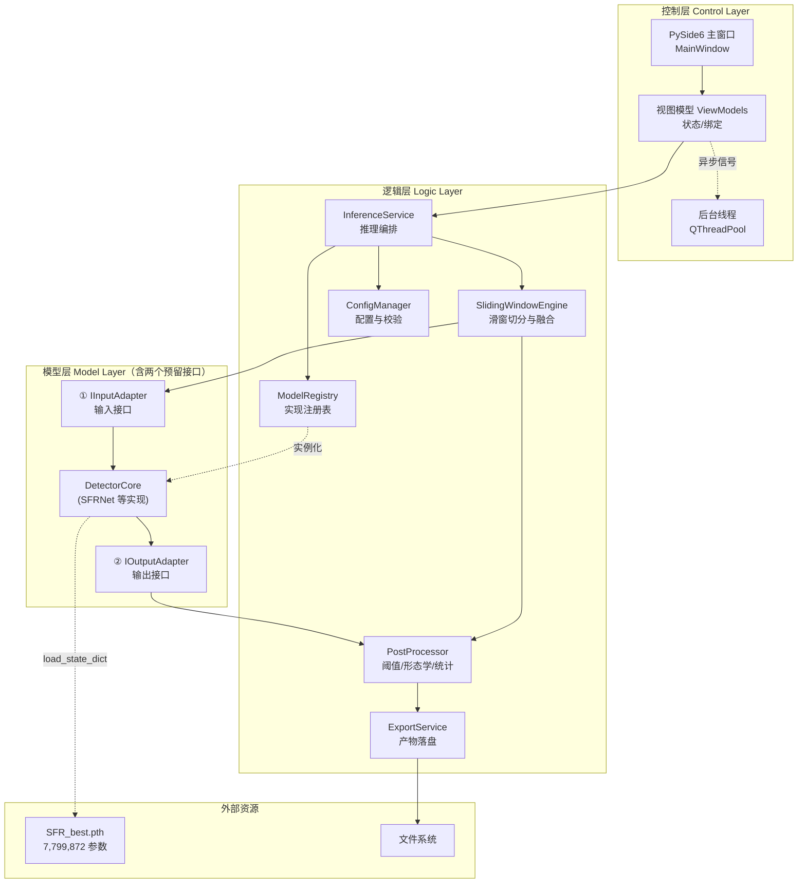

# 摩尔纹视觉识别软件 — 软件设计文档（SDD）

> **项目代号**：MoiréGuard
> **仓库**：`https://github.com/chunri3255425/SFRNet.git`
> **文档版本**：v1.0（软件化的第一份基线文档）
> **状态**：设计基线，待评审后转入实施
> **上游依赖**：本文档基于仓库现有 `SFRNet` 科研代码（`train.py` / `predict.py` / `utils/`）与 `TECHNICAL_DOC.md`（v2.0）实机核验结论撰写。

---

## 0. 阅读指南

本文档是**后续所有软件开发工作的唯一契约来源**。它回答四个问题：

| 章节 | 回答的问题 | 主要读者 |
|---|---|---|
| §1–§2 | 这个软件到底做什么、不做什么 | 全体 + 评审 |
| §3–§4 | 系统怎么分层、目录怎么长 | 开发 |
| §5 | **模型层的两个预留接口具体长什么样**（本文重点） | 算法 + 开发 |
| §6–§9 | 逻辑层、控制层、数据契约、UI 如何落地 | 开发 |
| §10–§14 | 怎么验证、怎么交付、不做什么、有哪些存量风险 | 全体 |

**约定**：凡标注 `[实机]` 的数值为本机运行结果；凡标注 `[存量]` 的指向上游科研代码中已存在的问题；凡标注 `[待定]` 的为需在评审时拍板的开放项。接口签名一经本文档确认，变更必须走 §14 的变更流程。

---

## 1. 项目定位

### 1.1 一句话定义

**一个在 Windows 桌面端运行的摩尔纹检测工具：输入一张（或一批）图片，输出像素级的摩尔纹区域掩膜、可视化叠加图与量化指标，全部参数可在界面上实时调整。**

### 1.2 与上游科研代码的关系（关键边界）

上游 `SFRNet` 是一份**科研脚本集合**，不是软件。本次开发不是"给脚本套个界面"，而是把脚本的算法内核**解耦成可替换的模型层**，再在其上重建逻辑层与控制层。

| 维度 | 上游科研代码 | 本软件 |
|---|---|---|
| 入口形态 | 改源码里的硬编码路径后 `python predict.py` | 双击 exe，选图即用 |
| 模型调用 | 直接在脚本里 `build_SFR()` + 硬编码 `r'./checkpoints/ins/SFR_best.pth'` | 通过 §5 的抽象接口 + 注册表按配置加载 |
| 推理组织 | 脚本内联的滑窗循环 | 独立的 `InferenceService`，纯函数式 |
| 参数暴露 | 常量写在函数体里（`TILE_SIZE=512`、`STRIDE=256`） | 配置 + 界面热调，每次推理独立生效 |
| 结果产物 | 只写一张二值 PNG | 掩膜 + 叠加图 + 概率图 + JSON 元数据 |
| 可测性 | 无 | 每层可单测（§10） |

> ⚠️ **不改动原则**：`utils/sfr/` 下的模型定义（`sfrnet.py` / `safm.py` / `FRM.py`）是**冻结的第三方权重对应结构**。`SFR_best.pth` 以 `strict=True` 严格加载成功 `[实机]`，任何对网络结构的修改都会导致权重失配。因此模型层**只做包装，不做改造**。上游已有的 2 个高危缺陷（§13）在软件形态下**天然被规避**，也不回改上游脚本。

### 1.3 目标形态

| 项 | 决策 |
|---|---|
| 平台 | Windows 10/11 x64（首要）；Linux 保留可运行性但不保证打包 |
| 交付形态 | PyInstaller 打包的桌面 exe（含模型权重） |
| 技术栈 | Python 3.11/3.12 + PyTorch（CPU/CUDA 双后端）+ PySide6（Qt6） |
| 运行模式 | 单机单进程；推理在后台线程，UI 线程不阻塞 |
| 首版能力范围 | **推理 + 结果导出 + 参数热调**（见 §1.4） |

**Python 版本说明**：上游已验证 PyTorch 2.12.0 `[实机]`。打包建议固定 **3.11 或 3.12**，原因是 PyTorch 的 CUDA 轮子在 3.13+ 上覆盖不全。本机现有 3.14.2 + torch 2.12.0+cpu 可用于算法验证，但不作为发布基准。

### 1.4 V1 功能范围（已确认）

| # | 能力 | 说明 |
|---|---|---|
| F1 | 单图推理 | 打开一张图，秒级返回掩膜 |
| F2 | 批量推理 | 选一个目录，逐张处理并列出结果 |
| F3 | 结果导出 | 二值掩膜 PNG / 叠加图 PNG / 概率热力图 PNG / 单条 JSON |
| F4 | 参数热调 | 阈值、tile_size、stride、设备、后端，改完立即重算，无需重启 |

**明确排除**（留至 V2，见 §12）：任务队列与断点续跑、SQLite 历史库、权重热切换、数据集批量评测报表、视频流输入、多用户/网络协同。

### 1.5 目标用户与典型场景

| 用户 | 场景 | 对软件的期待 |
|---|---|---|
| 质检工程师 | 印刷品/屏幕翻拍抽检，判断是否存在龟纹/摩尔纹及面积占比 | 批量跑、直观看到纹在哪、导出报告图 |
| 算法研究员 | 调阈值与滑窗参数看边界变化，对比不同权重 | 参数随手改、结果即时刷新 |
| 项目演示者 | 答辩/评审现场演示 | 启动快、界面稳、效果直观 |

---

## 2. 核心概念与术语

先把词定死，避免后面接口命名分歧。

| 术语 | 定义 | 在代码中的名字 |
|---|---|---|
| **ImageTensor** | 归一化到 `[0,1]` 的 RGB 张量，形状 `[1,3,H,W]`，float32 | `torch.Tensor` |
| **Logits** | 网络原始输出，形状 `[1,1,H,W]`，**未过 Sigmoid**，取值实测约 `[-23.1, 10.4]` `[实机]` | `raw_logits` |
| **ProbMap** | `sigmoid(logits)`，形状 `[1,1,H,W]`，取值 `[0,1]` | `prob_map` |
| **Mask** | `prob_map > threshold` 的二值图，形状 `[1,1,H,W]`，取值 `{0,1}` | `binary_mask` |
| **Tile** | 滑窗推理的单块，默认 `512×512` | `tile_size` |
| **Stride** | 滑窗步长，须 `< tile_size` 才有重叠 | `stride` |
| **Coverage** | 摩尔纹像素占比 = `mask.sum() / (H*W)`，一个 0~1 的标量 | `coverage` |
| **Verdict** | 是否判定为"存在摩尔纹"的布尔结论，由 `coverage > coverage_threshold` 决定 | `has_moire` |

> **重要**：上游代码中网络末端**没有 Sigmoid**（`sfrnet.py:191` 只做 `Conv2d(16,1,1)`）。因此任何下游消费点都必须自行施加 `sigmoid`，绝不能把网络输出当概率用。

---

## 3. 系统架构

### 3.1 三层结构



### 3.2 各层职责与不可越界的红线

| 层 | 职责 | 红线（禁止做的事） |
|---|---|---|
| **模型层** | 把任意形状的输入规范成网络能吃的张量；调用网络；把网络原始输出规范成本层统一的输出契约 | ❌ 不做阈值判断 ❌ 不做滑窗 ❌ 不做文件 IO ❌ 不读配置 ❌ 不打印日志 |
| **逻辑层** | 编排：切图 → 逐块调模型 → 融合 → 后处理 → 统计 → 导出 | ❌ 不做 UI 回调 ❌ 不持有 Qt 对象 ❌ 不知道窗体的存在 |
| **控制层** | 承载交互、线程调度、状态管理、错误呈现 | ❌ 不直接 `import torch` ❌ 不写推理算法 ❌ 不碰 `state_dict` |

**依赖方向严格单向**：控制层 → 逻辑层 → 模型层。反向引用一律视为设计缺陷。

### 3.3 一次推理的数据流（时序）

```
用户点"开始"
  └─ MainWindow 收集 UI 参数 → dict
       └─ ViewModel.submit(params) → 投递到 QThreadPool
            └─ InferenceService.run(task)
                 1. ConfigManager.validate(params)          # 参数校验失败即刻返回错误码
                 2. ModelRegistry.create(model_id)           # 首次则加载权重，之后复用单例
                 3. IInputAdapter.from_external(image)       # → ImageTensor + Meta
                 4. SlidingWindowEngine.plan(H, W, tile, stride)  # → List[Rect]
                 5. for each rect: DetectorCore.forward(tile)     # → raw logits
                 6. SlidingWindowEngine.fuse(...)            # → 整图 logits
                 7. IOutputAdapter.to_external(logits, meta) # → DetectorOutput
                 8. PostProcessor.apply(prob_map, threshold) # → binary_mask + coverage
                 9. ExportService.save(...) (若勾选导出)
                10. emit finished(result) → UI 线程渲染
```

> **关键设计**：第 3 步与第 7 步就是"两个预留接口"的落点。**算法团队换模型时只实现这两个接口 + 一个 `DetectorCore`**，逻辑层与控制层零改动。

---

## 4. 目录结构

在现有仓库上**增量新增**，不动已有文件。

```
SFRNet/
├── SOFTWARE_DESIGN.md              # 本文档（新增）
├── TECHNICAL_DOC.md                # 上游技术文档（保留）
├── README.md                       # 使用说明（新增，V1 交付时补）
├── requirements.txt                # 依赖锁定（新增）
├── pyproject.toml                  # 打包与工具配置（新增）
├── SFR_best.pth                    # 权重（现有，移入 assets/ 见 §4.2）
├── train.py                        # 上游训练脚本（保留，不改）
├── predict.py                      # 上游推理脚本（保留，不改，作为行为参照）
│
├── utils/                          # 上游算法代码（冻结，不改）
│   ├── sfr/{sfrnet,safm,FRM}.py
│   ├── data_loding.py
│   └── metrics.py
│
├── app/                            # ★ 新增：软件主体
│   ├── __init__.py
│   ├── main.py                     # 入口：创建 QApplication
│   │
│   ├── model_layer/                # ── 模型层
│   │   ├── __init__.py
│   │   ├── contracts.py            # ★★ 两个预留接口 + 数据契约（§5.2）
│   │   ├── builtin_adapter.py      # ★★ 默认实现（§5.5）
│   │   ├── registry.py             # 实现注册表（§5.6）
│   │   ├── weight_loader.py        # 权重加载与设备迁移
│   │   └── detectors/
│   │       ├── __init__.py
│   │       └── sfrnet_detector.py  # SFRNet 的 DetectorCore 实现
│   │
│   ├── logic_layer/                # ── 逻辑层
│   │   ├── __init__.py
│   │   ├── config.py               # ConfigManager + 校验
│   │   ├── inference_service.py    # 编排入口，对外唯一 API
│   │   ├── sliding_window.py       # 切分 + 融合
│   │   ├── postprocess.py          # 阈值、形态学、统计
│   │   ├── export_service.py       # 产物落盘
│   │   └── exceptions.py           # 领域异常与错误码
│   │
│   ├── control_layer/              # ── 控制层
│   │   ├── __init__.py
│   │   ├── main_window.py          # 主窗体
│   │   ├── widgets/                # 参数面板、结果视图、批量列表
│   │   ├── viewmodels/
│   │   └── workers.py              # QThreadPool 任务封装
│   │
│   └── resources/                  # 图标、qss、i18n
│
├── assets/                         # ★ 新增：模型权重归档
│   └── weights/SFR_best.pth
│
├── configs/                        # ★ 新增
│   ├── default.yaml                # 默认配置
│   └── models.yaml                 # 模型注册清单
│
└── tests/                          # ★ 新增
    ├── unit/
    ├── integration/
    └── fixtures/
```

### 4.1 新增模块与上游的隔离

新增代码全部落在 `app/` 下，**只允许单向 `from utils.sfr.sfrnet import build_SFR` 这一处引用**（在 `sfrnet_detector.py` 内部）。其余任何文件不得直接 import `utils.*`。这样将来上游换实现时，只需改一个文件。

### 4.2 权重文件路径策略

`SFR_best.pth` 目前位于仓库根目录（约 30 MB，已入库）。建议**移动**到 `assets/weights/`，并在 `.gitignore` 中对大文件引入 Git LFS 或改为发布时附带。寻址优先级：

1. 环境变量 `MOIREGUARD_WEIGHTS`
2. `configs/models.yaml` 中的 `weights_path`（相对仓库根解析）
3. `assets/weights/<默认文件名>`
4. 打包后：`<exe 同级>/weights/<默认文件名>`

任一命中即停止；全部未命中则抛出 `E-WEIGHT-NOT-FOUND`（见 §8.2）。

---

## 5. 模型层设计（核心章节）

### 5.1 设计意图

模型层要解决的根本问题是：**算法的输入形态和输出形态，与软件的输入形态和输出形态，往往不一致。**

举三个必然出现的不一致：

1. **尺寸**：软件收到的是任意分辨率的手机照片（可能是 3024×4032），网络只能吃 `512×512`（滑窗），甚至是 `256×256`（不同训练配置）。两者之间的适配不该写死在推理服务里。
2. **色彩/位深**：软件可能收到 16 位 TIFF、CMYK 扫描件、带 alpha 的 PNG、灰度图。网络**只接受 3 通道 `[0,1]` float**。转换规则一旦说明不清，就会出现"训练时 RGB、推理时 BGR"这类静默错误。
3. **输出**：网络的输出是 **logits**，而软件需要的是"某个坐标系下的二值掩膜"。若未来引入下采样预测（如 1/4 分辨率输出）或多类别头，坐标系与语义都会变。

因此预留两个接口，把"适配"这件事收敛到两个明确的、可替换的、可单独测试的组件里。**换句话说：逻辑层只依赖接口契约，永远不依赖某个具体模型的行为细节。**

### 5.2 接口一：`IInputAdapter`（输入接口）

**职责**：把外部世界的任意图像对象，规范成模型层内部唯一的张量表示，并携带必要的元信息。

```python
# app/model_layer/contracts.py
from abc import ABC, abstractmethod
from dataclasses import dataclass
from typing import Any, Protocol
import torch


@dataclass(frozen=True)
class InputMeta:
    """输入的可追溯元信息。随张量一路传递，最终写进输出 JSON。"""
    src_width: int            # 原始像素宽
    src_height: int           # 原始像素高
    channels: int             # 输入原始通道数（1/3/4）
    bit_depth: int            # 8 / 16
    color_space: str          # "RGB" / "L" / "CMYK" / "RGBA"
    source_id: str            # 文件名或任务 ID，用于日志与导出命名
    scale_x: float = 1.0      # adapter 内部若做了缩放，记录横向比例
    scale_y: float = 1.0


class IInputAdapter(ABC):
    """
    输入接口。实现者负责：
      1. 接受"外部的图像对象"（PIL.Image / numpy.ndarray / 文件路径 / 内存字节）
      2. 转换为模型可消费的 ImageTensor: [1,3,H,W]，float32，值域 [0,1]
      3. 返回 InputMeta 供回溯

    契约（必须遵守，违反视为 bug）：
      C1. 返回值 shape 必须是 [1, 3, H, W]，float32
      C2. 值域必须落在 [0.0, 1.0]，不得有 NaN/Inf
      C3. 色彩顺序必须是 RGB（不是 BGR）
      C4. 不得在此处做 tile 切分（那是逻辑层的事）
      C5. 不得修改传入对象（不可原地修改 ndarray）
    """

    name: str = "abstract"

    @abstractmethod
    def from_external(self, obj: Any) -> tuple[torch.Tensor, InputMeta]:
        """外部对象 → (ImageTensor, InputMeta)"""
        raise NotImplementedError

    @abstractmethod
    def to_external(self, tensor: torch.Tensor, meta: InputMeta) -> Any:
        """(可选逆变换) ImageTensor → 外部可显示对象（PIL.Image）

        用途：把滑窗融合后的张量还原成原始尺寸的可视化底图。
        若 adapter 未做缩放，实现应直接无损转换。
        """
        raise NotImplementedError

    def probe(self, obj: Any) -> dict[str, Any]:
        """轻量探测：不解码全图，仅返回尺寸/模式等概要。

        用于 UI 打开文件时快速展示信息，以及做前置校验
        （例如超大图预警）。默认实现返回空 dict，组件可覆盖。
        """
        return {}
```

**为什么是 `tuple[Tensor, InputMeta]` 而不是只返回 Tensor**：掩膜必须能落回**原始坐标系**。若 adapter 内部为提速把 4K 图缩到 2K（V2 可能做的事），`scale_x/scale_y` 就是唯一能还原的线索。这个字段现在留空，以后救场。

**为什么 `probe` 单独存在**：打开一个 200 MB 的 TIFF 并解码，在 UI 上会卡死。`probe` 让界面先拿到尺寸信息、判断是否超过安全阈值，再决定是否真的解码。

### 5.3 接口二：`IOutputAdapter`（输出接口）

**职责**：把网络原始输出规范成逻辑层唯一认得的输出对象，并承担"坐标系还原"与"语义映射"。

```python
@dataclass(frozen=True)
class DetectorOutput:
    """模型层对外的唯一输出契约。逻辑层只认这个。"""
    logits: torch.Tensor        # [1, 1, h_out, w_out]，未过 sigmoid
    out_width: int              # logits 的空间宽，可能 ≠ src_width
    out_height: int             # logits 的空间高，可能 ≠ src_height
    meta: InputMeta             # 透传，便于回溯
    extras: dict[str, Any]      # 模型私有附加信息（如路由器类别分布），可为空


class IOutputAdapter(ABC):
    """
    输出接口。实现者负责：
      1. 校验/规整模型原始输出（可能是 tuple、dict、多尺度列表）
      2. 声明输出坐标系（是否与输入同分辨率）
      3. 提供反变换，把低分辨率输出映射回与 src 同分辨率

    契约：
      O1. 返回的 logits 必须是未激活的原始分数（不得先 sigmoid）
      O2. shape 必须是 [1, 1, h, w]，不允许多通道（多类别请用 extras 传）
      O3. 不得在此处做阈值二值化
      O4. 若 out_* ≠ src_*，必须实现 resample_to_source()
    """

    name: str = "abstract"

    @abstractmethod
    def to_external(self, raw: Any, meta: InputMeta) -> DetectorOutput:
        """模型原始输出 → DetectorOutput"""
        raise NotImplementedError

    @abstractmethod
    def resample_to_source(self, out: DetectorOutput) -> DetectorOutput:
        """把 logits 双线性上采样到 (meta.src_height, meta.src_width)

        当 out_w == src_width 且 out_h == src_height 时应直接原样返回
        （零拷贝，避免无谓的插值引入数值噪声）。
        """
        raise NotImplementedError
```

**为什么输出统一为 `logits` 而不是 `prob_map`**：Sigmoid 是单调但不线性的。上游两个脚本就栽在这上面——`train.py` 累加 **logits** 再取平均，`predict.py` 累加 **sigmoid 后的概率**再取平均 `[存量]`。数学上 $\sigma(\mathbb{E}[\ell]) \neq \mathbb{E}[\sigma(\ell)]$，导致同一模型在验证与推理时的重叠区置信度系统性不一致。本设计把"融合"统一定义在 logits 域，Sigmoid **只在 `PostProcessor` 里施加一次**，从根上消除这个分歧。

### 5.4 两个接口与 `DetectorCore` 的组合关系

```mermaid
graph LR
    EXT_IN["外部对象<br/>PIL / ndarray / path"] --> IA["IInputAdapter"]
    IA -->|"ImageTensor + Meta"| SW["SlidingWindowEngine<br/>(逻辑层)"]
    SW -->|"List[Tile]"| CORE["DetectorCore.forward"]
    CORE -->|"raw logits per tile"| SW2["SlidingWindowEngine.fuse"]
    SW2 -->|"whole-image raw logits"| OA["IOutputAdapter"]
    OA -->|"DetectorOutput"| PP["PostProcessor<br/>(sigmoid 唯一施加点)"]

    style IA fill:#e8f0fe,stroke:#4a6fa5
    style OA fill:#e8f0fe,stroke:#4a6fa5
```



三者的注册与装配由 `ModelRegistry` 完成。**注册表里存的是一个三元组** `(core_factory, input_adapter_factory, output_adapter_factory)`，因此换模型时三者可以一起换，也可以只换其中一个（例如：新模型沿用现有 RGB 输入适配器，只换输出适配器）。

```python
@dataclass(frozen=True)
class ModelBundle:
    """注册表中的一个条目。三件套一起装配。"""
    model_id: str
    display_name: str
    core_factory: Callable[[], "DetectorCore"]
    input_adapter_factory: Callable[[], IInputAdapter]
    output_adapter_factory: Callable[[], IOutputAdapter]
    default_weights: str
    expected_tile_size: int      # 该模型建议的 tile（SFRNet=512）
    expected_stride: int


class DetectorCore(Protocol):
    """模型内核协议：只要求能吃 tile、吐 raw logits。"""
    def forward(self, tile: torch.Tensor) -> torch.Tensor: ...
    def eval(self) -> None: ...
    def to(self, device: str) -> "DetectorCore": ...
```

> **注意** `DetectorCore` 用的是 `Protocol` 而非 ABC。原因：SFRNet 的 `build_SFR()` 返回的 `nn.Module` 天然满足 `forward/eval/to`，无需为它写适配类继承。只需在 `sfrnet_detector.py` 里做一层 `_SFRCore` 薄包装以满足登记与元信息需要。

### 5.5 默认实现参考（`builtin_adapter.py`）

这是 V1 唯一需要交付的实现，同时作为后续新增模型的参考样板。

```python
class RGBInputAdapter(IInputAdapter):
    """默认输入适配器：接受 PIL.Image / np.ndarray / str(path)。

    处理链：解码 → 通道规整(RGBA 丢 alpha / L 复制三通道 / CMYK 转 RGB)
            → 若为 16bit 则线性缩放到 [0,1] → ToTensor → unsqueeze(0)
    """
    name = "rgb_8bit"

    def from_external(self, obj) -> tuple[torch.Tensor, InputMeta]:
        img = _as_pil(obj)                      # 统一成 PIL.Image，不就地修改入参
        meta = InputMeta(
            src_width=img.width, src_height=img.height,
            channels=len(img.getbands()),
            bit_depth=_detect_bit_depth(img),
            color_space=img.mode,
            source_id=_guess_source_id(obj),
        )
        if img.mode not in ("RGB",):
            img = img.convert("RGB")            # C4：强制 RGB，杜绝 BGR 混入
        t = torch.from_numpy(np.asarray(img)).permute(2, 0, 1).float() / 255.0
        t = t.unsqueeze(0).contiguous()         # C1： [1,3,H,W]
        _assert_contract(t)                     # C2：值域 + 无 NaN
        return t, meta

    def to_external(self, tensor, meta):
        arr = (tensor.squeeze(0).clamp(0, 1) * 255).byte().permute(1, 2, 0).numpy()
        return Image.fromarray(arr, mode="RGB")


class SFRNetOutputAdapter(IOutputAdapter):
    """默认输出适配器：单通道同分辨率 logits。"""

    name = "sfrnet_single_channel"

    def to_external(self, raw, meta) -> DetectorOutput:
        if isinstance(raw, (tuple, list)):
            raw = raw[0]
        if raw.dim() == 3:
            raw = raw.unsqueeze(0)
        if raw.shape[1] != 1:
            raise ContractViolation("E-CONTRACT-OUT-CHANNEL")   # O2
        return DetectorOutput(
            logits=raw, out_width=raw.shape[-1], out_height=raw.shape[-2],
            meta=meta, extras={},
        )

    def resample_to_source(self, out: DetectorOutput) -> DetectorOutput:
        if (out.out_width, out.out_height) == (out.meta.src_width, out.meta.src_height):
            return out                                          # 零拷贝
        up = F.interpolate(out.logits, size=(out.meta.src_height, out.meta.src_width),
                           mode="bilinear", align_corners=False)
        return replace(out, logits=up, out_width=out.meta.src_width,
                       out_height=out.meta.src_height)
```

### 5.6 注册表与配置

`configs/models.yaml`：

```yaml
active: sfrnet_uhd

models:
  sfrnet_uhd:
    display_name: "SFRNet (UHD Moiré)"
    weights_path: "assets/weights/SFR_best.pth"
    tile_size: 512
    stride: 256
    device: "auto"          # auto | cpu | cuda:0
    precision: "fp32"       # fp32 | fp16 (仅 cuda)
```

`ModelRegistry` 的行为约定：

- **懒加载 + 单例**：首次 `create("sfrnet_uhd")` 才 `torch.load`，同 `model_id` 后续复用，避免每次推理都读 30 MB。
- **严格加载**：`load_state_dict(sd, strict=True)`。不匹配就报 `E-WEIGHT-MISMATCH`，**绝不静默跳过**（上游 `predict.py` 未捕获此异常，出错信息极不友好）。
- **设备决策**：`auto` → `cuda` 可用则用 `cuda`，否则 `cpu`。切换设备时重新 `to(device)` 而不重新读盘。
- **未知 id**：抛 `E-MODEL-UNKNOWN`，并在消息里列出所有可用 id。

### 5.7 新增一个模型的最小工作量清单

这是本文档最重要的可验收承诺。新增模型只需：

1. 在 `app/model_layer/detectors/` 下新建一个类，实现 `forward(tile) -> logits`；
2. 若输入输出格式与默认不同，另写两个 Adapter（否则直接复用 `RGBInputAdapter` / `SFRNetOutputAdapter`）；
3. 在 `configs/models.yaml` 里加一段；
4. 在 `registry.py` 注册一行三元组。

**逻辑层、控制层、UI 代码一行不改。** 这条必须作为代码评审的硬性检查项。

---

## 6. 逻辑层设计

### 6.1 `InferenceService` — 对外唯一入口

```python
@dataclass
class InferenceRequest:
    source: Path | Image.Image
    model_id: str = "sfrnet_uhd"
    tile_size: int | None = None          # None → 取模型默认
    stride: int | None = None             # None → tile_size // 2
    threshold: float = 0.5
    coverage_threshold: float = 0.01      # 判定 has_moire 的门槛
    device: str = "auto"
    apply_morphology: bool = False
    export: ExportOptions | None = None


@dataclass
class InferenceResult:
    source_id: str
    prob_map: torch.Tensor          # [1,1,H,W]
    binary_mask: torch.Tensor       # [1,1,H,W] uint8
    coverage: float                 # 面积占比
    has_moire: bool
    stats: InferenceStats           # 耗时分段、tile 数、峰值显存
    artifacts: list[Path]           # 导出产物路径
    warnings: list[str]


class InferenceService:
    def __init__(self, registry: ModelRegistry, config: ConfigManager): ...

    def run(self, req: InferenceRequest,
            on_progress: Callable[[int, int], None] | None = None) -> InferenceResult:
        ...

    def cancel(self) -> None:
        """协作式取消：滑窗循环在每块开始前检查取消标志。"""
```

**线程模型**：`run` 是纯同步函数，**不含任何 Qt 依赖**，因此可被 CLI、单测、未来 Web 服务直接复用。控制层负责把它放进 `QThreadPool`。进度通过 `on_progress(done, total)` 回调上抛，控制层再把回调桥接成 Qt Signal。

### 6.2 `SlidingWindowEngine` — 切分与融合

这是整个软件数学上最需要小心的部分，规则必须写死。

**切分规则（Plan）**：

```python
def plan(h: int, w: int, tile: int, stride: int) -> list[Rect]:
    # 1. stride 必须满足 0 < stride <= tile
    # 2. 若 h <= tile 且 w <= tile → 单块，且做 right/bottom 反射填充到 tile 尺寸
    #    （填充量记录在 Plan 里，融合后裁回原尺寸）
    # 3. 否则按 stride 步进；末行/末列强制回退贴边：
    #    最后一个坐标 = max(0, H - tile)
    # 4. 去重：回退可能与倒数第二块完全重合，需判重
```

**融合规则（Fuse）——三层保护**：

| 层级 | 规则 | 理由 |
|---|---|---|
| L1 域 | 在 **logits 域**累加求平均，**不**先 sigmoid | 消除上游 `predict.py` / `train.py` 不一致 `[存量]` |
| L2 权重 | 使用**余弦窗**（Hann 2D）作为重叠区权重，而非均匀权重 `1` | 均匀权重会让块边界出现接缝。余弦窗让块中心权重高、边缘低，接缝被平滑掉 |
| L3 归一 | `out = Σ(w_i · logit_i) / Σ(w_i)`，分母为 0 的兜底为 1 | 数值稳定 |

> **关于 L2 的取舍**：上游用均匀平均（`count_map`），在 512/256 配置下接缝不明显但存在。余弦窗是几乎零成本的改进，且不影响单块区域结果（单块覆盖时权重归一后仍为 1）。V1 直接采用余弦窗，并在配置中保留 `fusion: "uniform" | "cosine"` 开关以便 A/B 对比。

**内存约束**：融合需要三张与整图同尺寸的 float32 缓冲（分子、分母、输出）。一张 4K（3840×2160）图 = 约 33 MB/张 × 3 ≈ 95 MB `[实机算得 94.9 MB]`，可接受。但若用户传 20000×20000 的扫描件，需要前置拦截：当 `H*W > max_pixels`（默认 1.5e8，按可用内存估算）时抛 `E-INPUT-TOO-LARGE` 并给出建议分块方案。

> **块数实测**：3840×2160 在 tile 512 / stride 256 下产生 14×8 = **112 块**（尾部回退后）。这直接决定了耗时——若单块前向为 30 ms，则纯前向约 3.4 s，与论文报告的 3.44 s 同量级。

### 6.3 `PostProcessor`

```python
def apply(logits, threshold, coverage_threshold, morph) -> tuple[prob, mask, coverage]:
    prob = torch.sigmoid(logits)                      # ★ 全流程唯一的 sigmoid
    mask = (prob > threshold)
    if morph:
        mask = binary_opening(mask, kernel=3)         # 去孤立噪点
        mask = remove_small_objects(mask, min_area=64)
    coverage = mask.sum() / mask.numel()
    return prob, mask, coverage
```

**为什么形态学默认关闭**：形态学改变 IoU，会让"软件里的数值"与"论文里报告的数值"不可比。作为**可选后处理**存在，并默认关闭，在导出 JSON 中记录 `apply_morphology` 的真实值，保证可复现。

### 6.4 `ExportService`

产物命名规则（沿用源文件名，避免覆盖）：

| 产物 | 文件名模板 | 格式 |
|---|---|---|
| 二值掩膜 | `{stem}__mask.png` | 8-bit 灰度，0/255 |
| 叠加图 | `{stem}__overlay.png` | 原图 + 半透明红色掩膜（α 可配，默认 0.45） |
| 概率热力图 | `{stem}__prob.png` | 8-bit，jet/viridis 映射（可配） |
| 元数据 | `{stem}__meta.json` | 见 §7.3 |

批量模式下额外产出 `run_summary.csv`（每行一张图的 coverage、has_moire、耗时）。

### 6.5 `ConfigManager`

- 加载顺序：`configs/default.yaml` → 用户配置 `%APPDATA%/MoireGuard/config.yaml` → 本次会话 UI 覆盖。
- 每次 `run` 前对合并后的配置做 `validate()`，返回结构化的错误列表（字段名 + 原因 + 建议范围），供 UI 就地标红。
- **不写回用户配置，除非用户显式点"保存为默认"**，避免调参探索污染基线。

---

## 7. 控制层设计

### 7.1 窗口布局

```
┌─────────────────────────────────────────────────────────────────┐
│  MoiréGuard — 摩尔纹视觉识别                        [_][□][X]   │
├──────────────┬──────────────────────────────────────────────────┤
│  参数面板     │              图像视图区                           │
│              │  ┌────────────────────┬────────────────────┐     │
│ 模型  [▼]    │  │                    │                    │     │
│ 设备  [▼]    │  │      原图          │   叠加结果          │     │
│ 阈值  ─●─    │  │                    │                    │     │
│  tile  [512] │  │                    │                    │     │
│  stride[256] │  └────────────────────┴────────────────────┘     │
│  ☐形态学     │   ☑掩膜  ☑叠加  ☑热力图   缩放 [—][100%][+]      │
│              │                                                  │
│ [打开图片]    ├──────────────────────────────────────────────────┤
│ [选择目录]    │  结果摘要                                        │
│              │   覆盖率 12.4%   判定：存在摩尔纹   耗时 1.83s    │
│ [开始处理]    │   tile 数 40   设备 cuda   警告 0                │
│ [取消]       │                                                  │
│ [导出…]      │                                                  │
├──────────────┴──────────────────────────────────────────────────┤
│ 进度 ████████░░░░░░ 24/40   |  status bar                       │
└─────────────────────────────────────────────────────────────────┘
```

### 7.2 状态机

```
IDLE ──(选图)──> READY ──(开始)──> RUNNING ──(完成)──> DONE
                    ↑                  │                  │
                    │             (取消/出错)         (改参数)
                    │                  ↓                  ↓
                    └──────────── CANCELLED/FAILED <── DIRTY
```

- `RUNNING` 期间：参数控件禁用，仅"取消"可用，防止半路改参数导致结果自相矛盾。
- `DONE` 后修改任意参数 → 进入 `DIRTY`，结果区标注"参数已变更，结果需重算"，但不自动重算（4K 图重算要钱，交用户决定）。
- 结果缓存保留上一次的完整 `InferenceResult`，用于导出。

### 7.3 线程与信号

```python
class InferenceWorker(QRunnable):
    """在 QThreadPool 中执行；只通过信号与 UI 通信。"""
    class Signals(QObject):
        progress = Signal(int, int)
        finished = Signal(object)     # InferenceResult
        failed = Signal(str, str)     # (error_code, message)

    def run(self):
        try:
            res = self._service.run(self._req, on_progress=self._emit_progress)
            self.signals.finished.emit(res)
        except MoireError as e:
            self.signals.failed.emit(e.code, e.user_message)
```

**硬性要求**：
1. 任何 `torch` 调用都不得发生在 UI 线程（避免长任务冻结窗口）。
2. `InferenceService` 内部维护 `threading.Event` 作为取消标志，在每块推理前检查。
3. 异常必须转换成 `MoireError(code, user_message, detail)`，`user_message` 面向用户（中文、可操作），`detail` 写入日志。
4. 推理结束后释放中间张量并 `torch.cuda.empty_cache()`（仅 cuda）。

### 7.4 参数热调的语义

| 参数 | 是否需重算 | 说明 |
|---|---|---|
| `threshold` | 否（可复用 prob_map） | 直接对缓存概率图重新二值化，毫秒级 |
| `coverage_threshold` | 否 | 仅重算判定 |
| `tile_size` / `stride` | 是 | 需重跑滑窗 |
| `model_id` / `device` | 是 | 需重载或迁移 |
| 形态学开关 | 否 | 对缓存 mask 重算 |

> 这个表决定了实现方式：`InferenceResult` 必须**保留 prob_map 的完整缓存**（而不是只留 mask），才能实现阈值滑杆的实时响应。

---

## 8. 数据契约

### 8.1 层间契约总表

| 边界 | 输入 | 输出 | 违反时的错误码 |
|---|---|---|---|
| 外部 → InputAdapter | `PIL.Image` / `np.ndarray` / `str` | `(Tensor[1,3,H,W] f32, InputMeta)` | `E-INPUT-*` |
| DetectorCore | `Tensor[1,3,tile,tile]` | `Tensor[1,1,tile,tile]` raw logits | `E-MODEL-OUTPUT` |
| OutputAdapter | raw + meta | `DetectorOutput` | `E-CONTRACT-OUT-*` |
| PostProcessor | logits + threshold | `(prob, mask, coverage)` | — |
| ExportService | `InferenceResult` + `ExportOptions` | `list[Path]` | `E-EXPORT-*` |

### 8.2 错误码表

| 码 | 触发条件 | 用户可见文案（中文） |
|---|---|---|
| `E-WEIGHT-NOT-FOUND` | 四层寻址全未命中 | 未找到模型权重文件，请检查 assets/weights 目录 |
| `E-WEIGHT-MISMATCH` | `strict=True` 加载失败 | 权重与模型结构不匹配，请确认模型版本 |
| `E-MODEL-UNKNOWN` | model_id 未注册 | 未知模型，可用模型：… |
| `E-INPUT-UNSUPPORTED` | 格式/位深不支持 | 不支持的图片格式，请使用 PNG/JPG/TIFF |
| `E-INPUT-TOO-LARGE` | 像素数超上限 | 图片过大（N 万像素），建议先分块处理 |
| `E-INPUT-DECODE` | 解码失败 | 图片解码失败，文件可能已损坏 |
| `E-CONTRACT-OUT-CHANNEL` | 输出通道 ≠ 1 | 模型输出通道数异常 |
| `E-CUDA-OOM` | 显存不足 | 显存不足，可降低 tile 尺寸或切换到 CPU |
| `E-CANCELLED` | 协作式取消 | 已取消 |
| `E-EXPORT-DENIED` | 目录不可写 | 导出目录不可写，请更换位置 |

### 8.3 导出 JSON 元数据（`{stem}__meta.json`）

```json
{
  "schema_version": "1.0",
  "source": {
    "id": "IMG_20261103_001.jpg",
    "width": 4032, "height": 3024,
    "channels": 3, "bit_depth": 8, "color_space": "RGB"
  },
  "model": {
    "id": "sfrnet_uhd",
    "weights": "assets/weights/SFR_best.pth",
    "params": 7799872,
    "device": "cuda:0",
    "precision": "fp32"
  },
  "inference": {
    "tile_size": 512, "stride": 256,
    "fusion": "cosine",
    "num_tiles": 40,
    "threshold": 0.5,
    "coverage_threshold": 0.01,
    "apply_morphology": false,
    "elapsed_ms": { "total": 1832, "per_tile_avg": 45.1 }
  },
  "result": {
    "coverage": 0.1243,
    "has_moire": true,
    "mask_pixels": 1515720
  },
  "artifacts": ["IMG_2026103_001__mask.png", "IMG_..._overlay.png"],
  "software": { "name": "MoireGuard", "version": "1.0.0" }
}
```

**设计要点**：`inference` 段完整记录所有影响结果的参数，使任意一次导出都能被精确复现。`apply_morphology` 必须记录真值而非"是否支持"，否则形态学开关会让两次结果不可比。

---

## 9. 非功能需求

| 类别 | 要求 | 验证方式 |
|---|---|---|
| 性能 | 4K 图（tile 512/stride 256，共 **112 块**）在 RTX 3060 级显卡 ≤ 4 s；CPU 模式 ≤ 90 s | 基准测试脚本，固定 seed 输入 |
| 内存 | 4K 图融合缓冲 94.9 MB `[实机算得]`，整进程峰值 ≤ 1.5 GB（GPU）/ 2 GB（RAM） | `torch.cuda.max_memory_allocated()` |
| 响应 | UI 线程无阻塞 > 100 ms 的操作 | 手工巡检 + 长任务注入测试 |
| 启动 | exe 冷启动 ≤ 5 s（不含首次模型加载） | 计时 |
| 稳定性 | 单张图失败不中断批量 | 注入损坏文件测试 |
| 打包体积 | ≤ 2.5 GB（含 CPU 版 torch）；CUDA 版单独分发 | 构建产物测量 |
| 日志 | 滚动日志，保留 7 天，路径 `%APPDATA%/MoireGuard/logs` | — |
| 可复现 | 同参数 + 同权重 + 同设备 → 结果 bit-level 一致 | 单测（固定 seed） |

**跨设备可复现性说明**：CPU 与 CUDA 之间**不保证** bit-level 一致（浮点累加顺序、不同 kernel 实现）。文档与 UI 中不承诺跨设备一致，只承诺同设备一致。

---

## 10. 测试策略

| 层级 | 测什么 | 关键用例 |
|---|---|---|
| 单元 · Adapter | 契约 C1–C5 | RGBA→RGB 丢 alpha；16bit 缩放；灰度复制三通道；CMYK 转换；入参未被修改 |
| 单元 · SlidingWindow | `plan` 覆盖完整性 | (512,512) 单块；(3000,4000) 尾部回退；(400,400) 需填充；去重不重复 |
| 单元 · SlidingWindow | `fuse` 正确性 | 构造已知 logits，验证余弦窗归一后中心值不变、边界无接缝 |
| 单元 · PostProcess | 阈值边界 | threshold=0/1 极端值；全零 logits → coverage=0 |
| 集成 · 端到端 | 输入→掩膜 | 用 `predict.py` 在同一张图上的输出做黄金基准比对（差异 < 1e-4） |
| 集成 · 错误路径 | 错误码 | 缺权重、坏文件、超大图各命中对应码 |
| 回归 · 性能 | 耗时 | 每次发版跑基准，超过 120% 基线则告警 |

> **黄金基准的建立**：先用上游 `predict.py`（修复 §13 缺陷 #2 后）对 5 张固定图生成掩膜，存为 `tests/fixtures/golden/`。本软件在 `fusion=uniform, threshold=0.5, morph=off` 配置下应与其完全一致（因为算法等价）。这条测试是"软件没有走偏"的最终保险。

---

## 11. 交付里程碑

| 阶段 | 内容 | 验收标准 |
|---|---|---|
| **M0** 骨架 | 目录搭建、`contracts.py` 落地、两个 Adapter 默认实现、注册表 | 单测覆盖 Adapter 契约；`build_SFR` + 权重 `strict` 加载通过 |
| **M1** 推理链 | `SlidingWindowEngine` + `PostProcessor` + `InferenceService` | 与 `predict.py` 黄金基准一致（容差 1e-4） |
| **M2** 导出 | `ExportService` + JSON 元数据 + 批量 CSV | 产物命名无覆盖、JSON 可复现 |
| **M3** 界面 | 单图模式、参数热调、进度与取消 | 阈值滑杆 < 200 ms 响应；4K 图不冻结 UI |
| **M4** 批量与打包 | 目录批处理、PyInstaller、依赖锁定 | exe 在干净 Win11 上双击可用 |
| **M5** 收尾 | README、日志、错误文案统一、回归基准 | 全部 P0 用例通过 |

**M0 是本文档最需要尽早锁定的一步**。接口一旦定型，后面所有工作都在契约上生长；接口反复则返工量呈平方增长。

---

## 12. V2 路线（不在本次范围，但需在设计中留出接缝）

| 方向 | 需要预留的接缝 |
|---|---|
| 任务队列与断点续跑 | `InferenceService.run` 已是无状态纯函数，队列只需在其上包一层 |
| SQLite 历史库 | `InferenceResult` + `meta.json` 已含全部字段，直接建表即可 |
| 权重热切换 | `ModelRegistry` 已按 `model_id` 分桶，加"卸载 + 重载"方法即可 |
| 数据集批量评测 | `utils/metrics.py` 已有 IoU/F2/Precision/Recall，接一个 `EvaluationService` |
| 导出 PDF 报告 | `ExportService` 增加一个 renderer，复用 JSON 数据 |
| 服务化（HTTP） | `InferenceService.run` 无 Qt 依赖，可直接被 FastAPI 包装 |

---

## 13. 存量风险与规避（来自上游科研代码）

以下问题**已在上游代码中确认存在**，本设计通过架构手段规避，但不回改上游文件。

| # | 上游问题 | 位置 | 后果 | 本设计的规避 |
|---|---|---|---|---|
| 1 | `autocast(device_type='cuda:1')` | `train.py:24` | PyTorch ≥2.0 直接抛异常（`device_type` 只接受类别名） | 软件不含训练代码，天然规避 |
| 2 | 小图（任一边 < 512）推理崩溃：画布按原尺寸分配但输入被 pad 到 512 | `predict.py:42-43, 62-65` | `RuntimeError: size of tensor a (400) must match b (512)` | `SlidingWindowEngine.plan` 显式处理 `H<Wtile` 情形，填充量与裁剪一并记录 |
| 3 | 融合域不一致：`train.py` 累加 logits，`predict.py` 先 sigmoid 再累加 | `train.py:104` vs `predict.py:75,79` | 重叠区置信度系统性偏高/偏低，val 与 test 口径不一致 | **唯一融合域 = logits 域**；`PostProcessor` 是唯一 sigmoid 施加点 |
| 4 | 滑窗密度不一致：验证 overlap=0.25，推理 overlap=0.5 | `train.py:141` vs `predict.py:25` | 按 val 选出的 best 权重未必是 test 口径最优 | 配置化 `stride` 并在 JSON 中留痕，评测时可对齐 |
| 5 | `predict.py` 未捕获 `load_state_dict` 异常 | `predict.py:21` | 权重不匹配时报错信息晦涩 | 注册表统一转 `E-WEIGHT-MISMATCH` + 可读文案 |
| 6 | FRM 输出被 8× 下采样后才融合 | `sfrnet.py:179-184` | 全分辨率频率细节在瓶颈处损失 | **属模型设计范畴，不在软件层修改**。作为已知精度上限记录，若未来模型升级可走 §5.7 换模型 |

> 第 6 条特别说明：这是论文级的方法问题，软件层不应也不能修。本文档记录它，是为了避免团队误把它当成"软件 bug"去追。

---

## 14. 开放项与变更流程

### 14.1 待评审拍板

| # | 开放项 | 备选 | 建议 |
|---|---|---|---|
| Q1 | 打包是否同时发布 CPU 版与 CUDA 版 | 单包（仅 CPU，慢但通用）/ 双包 | 建议双包：演示用 CPU 版保底，质检用 CUDA 版 |
| Q2 | 是否支持拖拽文件到窗口 | 支持 / 不支持 | 支持，成本极低且演示友好 |
| Q3 | 界面语言 | 仅中文 / 中英双语 | V1 仅中文（用 `tr()` 包一层，留 i18n 口子） |
| Q4 | 批量模式是否并行多图 | 串行 / 多 worker | 串行，避免显存争抢；未来按显存预算开并发 |
| Q5 | 是否需要"无摩尔纹"的反向置信度 | 需要 / 不需要 | V1 不需要，`coverage` 已足够 |

### 14.2 变更流程

`contracts.py` 中的接口（`IInputAdapter` / `IOutputAdapter` / `DetectorOutput` / `InputMeta`）为**冻结契约**。

任何变更必须：
1. 在 PR 描述中引用本文档对应小节；
2. 更新接口的 `Contract` 编号（C1–C5 / O1–O4）；
3. 同步更新本文档与 `tests/unit` 的契约测试；
4. 若为破坏性变更，主版本号 +1。

---

## 附录 A：与上游脚本的行为对照

| 行为 | `predict.py` | 本软件 | 是否有意不同 |
|---|---|---|---|
| 输入 | PIL RGB，ToTensor | 同，但支持 RGBA/16bit/CMYK 规整 | 扩展 |
| tile / stride | 512 / 256（常量） | 默认同值，可配 | 一致 |
| 小图处理 | zero-pad 到 512，画布不扩 → **崩溃** | 反射填充 + 记录裁剪量 | **有意修复** |
| 融合域 | sigmoid 后累加 | logits 域累加 | **有意修复** |
| 重叠权重 | 均匀 `1` | 余弦窗（可切回 uniform） | 可选改进 |
| 输出 | 单张二值 PNG | 掩膜 + 叠加 + 热力图 + JSON | 扩展 |
| 设备 | 自动选 cuda/cpu | 配置项 `auto/cpu/cuda:0` | 扩展 |
| 异常处理 | 无 | 错误码 + 用户文案 | 扩展 |

## 附录 B：V1 完整依赖清单

```text
torch>=2.2,<3.0          # 与 SFR_best.pth 兼容；已实测 2.12.0
torchvision>=0.17        # ToTensor 等（可精简掉，仅用 numpy 亦可）
numpy>=1.24
Pillow>=10.0
PyYAML>=6.0
scipy>=1.10              # utils/metrics.py 依赖（hd_dist）
PySide6>=6.6             # UI
pyinstaller>=6.0         # 打包（dev）
pytest>=8.0              # 测试（dev）
```

> `scipy` 仅为 `utils/metrics.py` 的 `directed_hausdorff` 引入。软件层 V1 不用 HD 距离，可考虑在 import 时不触发（避免无谓依赖）。若确认不用，从依赖中移除并在 `utils/metrics.py` 加惰性 import —— **这属于对上游文件的最小改动，需单独评审**。

---

**文档结束。**
