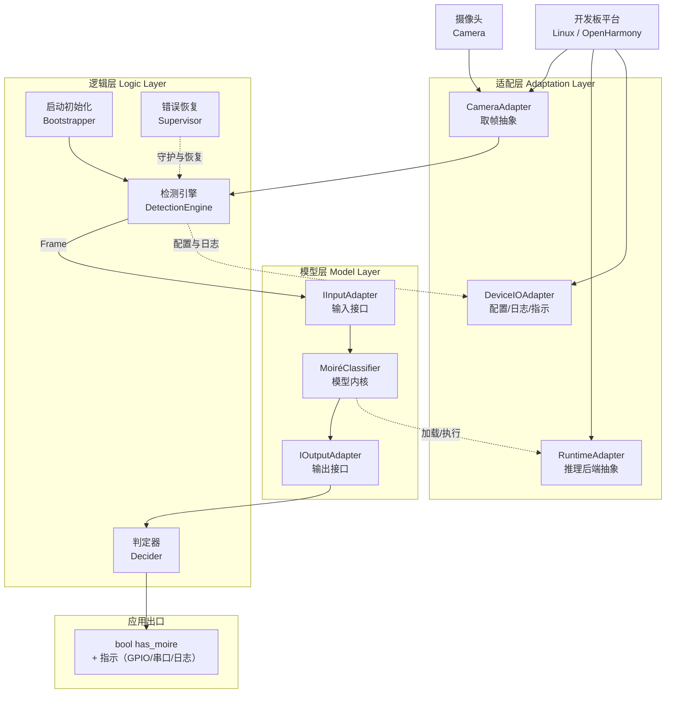
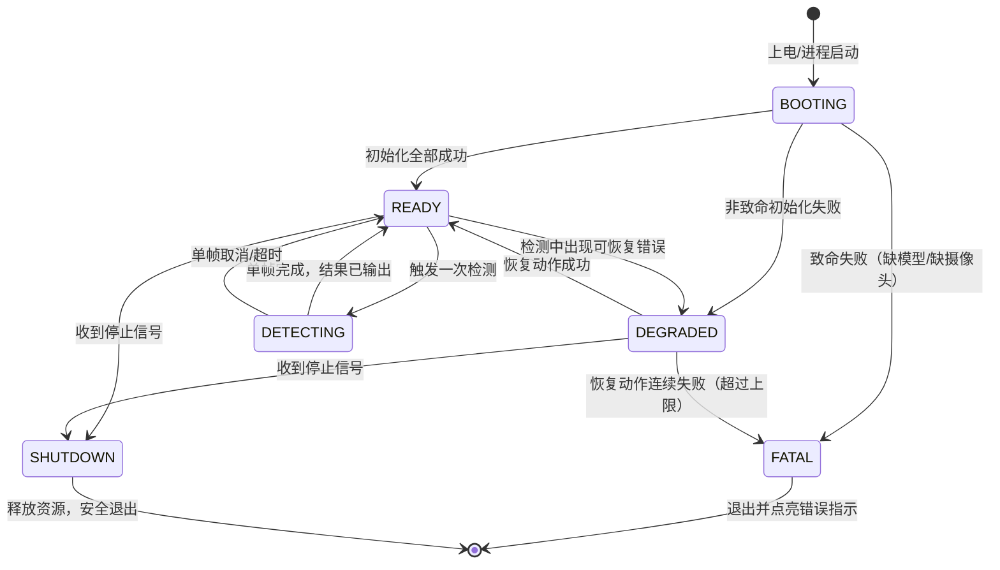

# 摩尔纹视觉识别系统 — 系统架构

> **仓库**：`https://github.com/chunri3255425/SFRNet.git`
> **文档版本**：v2.1（交付形态与逻辑层细化）
> **状态**：架构基线
> **部署形态**：带摄像头的开发板，同时支持 Linux 与鸿蒙（OpenHarmony）双系统

---

## 1. 项目目标与交付品

在一台**带摄像头的开发板**上运行摩尔纹检测能力：

```
摄像头采集一张图像  →  判断图中是否存在摩尔纹  →  输出一个布尔值
```

系统的全部输出就是这一个布尔量。不要求像素级掩膜、区域可视化、面积占比报表——这些是模型内部能力，不是系统对外承诺。

### 1.1 交付形态：可烧录镜像

**最终交付品是一个可以直接烧录进开发板的系统镜像**，不是需要用户手动配置环境的源码包。镜像内容：

| 组成 | 内容 | 说明 |
|---|---|---|
| 操作系统 | Linux 发行版 / OpenHarmony（按板型选择其一） | 板型确定后锁定 |
| 运行时 | Python 解释器 + 推理后端（ONNX Runtime / NPU SDK） | 随镜像预装，不依赖联网 |
| 应用本体 | `app/` 编译打包后的检测程序 | 上电自启动 |
| 模型资产 | 量化后的模型文件（由 `SFR_best.pth` 转换） | 随镜像固化 |
| 配置 | `default.yaml` 烧录内置默认值 | 现场可覆盖（见 §4.3.6） |

**构建流水线**（开发机执行，产出镜像）：

```
SFR_best.pth ──导出──> ONNX ──量化──> 板端模型文件
app/ 源码    ──打包──> 独立运行包（免依赖安装）
                │
                ├──> Linux：   板厂商镜像 + 根文件系统叠加（systemd 自启服务）
                └──> OpenHarmony：镜像构建系统产物 + HAP/独立进程
                          │
                          ▼
                  可烧录镜像（.img / 刷机包）──烧录──> 开发板上电即跑
```

**验收口径**：拿到一块空白开发板 → 烧录镜像 → 接摄像头 → 上电 → 无任何手动配置 → 系统自动开始检测并输出布尔结果。这是交付测试的唯一标准。

---

## 2. 技术选型约束

| 项 | 决策 | 说明 |
|---|---|---|
| 开发板 | **硬件待定，架构上抽象** | 具体型号后续确定；本文不绑定任何 SoC 厂商 SDK，接口层隔离 |
| 操作系统 | **Linux 与鸿蒙双系统，同一套代码** | 系统差异全部收敛到适配层，业务代码零分支；镜像构建各自一条流水线 |
| 开发语言 | **Python + PyTorch** | 算法与业务逻辑统一；**烧录的是转换后的板端模型**（ONNX/量化图），板端不跑 PyTorch 训练栈 |
| 摄像头接口 | 抽象为"取帧"能力 | Linux 走 V4L2，鸿蒙走相机 Kit，上层无感知 |
| 上电行为 | 应用自启动 | 烧录后无需登录 shell 手动拉起 |

> **关于端侧性能的现实提醒**：PyTorch 模型（7,799,872 参数）无法直接在多数嵌入式开发板的 CPU 上实时运行。因此镜像内固化的是**量化后的模型**，由适配层的推理后端接口加载执行，见 §4.3。

---

## 3. 总体架构

### 3.1 三层结构



### 3.2 三层职责

| 层 | 职责 | 红线 |
|---|---|---|
| **适配层** | 屏蔽平台差异：怎么取一帧、用哪个后端跑模型、配置和日志落在哪、布尔结果如何指示 | ❌ 不含任何判定逻辑 ❌ 不懂"摩尔纹"是什么 |
| **模型层** | 把一帧图规范成张量、调模型、把输出规范成统一的 logits；两个预留接口负责输入/输出的形态转换 | ❌ 不做布尔判定 ❌ 不做平台判断 ❌ 不做文件 IO |
| **逻辑层** | 系统的**操作主体**：上电初始化、检测循环、判定、异常恢复、优雅退出 | ❌ 不 import 任何平台 SDK ❌ 不碰 `state_dict` |

**依赖方向严格单向**：逻辑层 → 模型层 → （仅通过适配层接口访问）平台。

**为什么这样分**：交付品是烧录镜像，意味着系统是**无人值守常驻运行的**——上电自启、出错自恢复、断电安全。这些"操作逻辑"全部属于逻辑层，必须显式设计，不能靠人守着终端。

---

## 4. 各层设计

### 4.1 适配层

三个抽象接口，各自对应一类平台差异。

```python
# ── 4.1.1 摄像头 ─────────────────────────────
class ICameraAdapter(ABC):
    """把"取一帧"这件事抽象出来，屏蔽 V4L2 / 鸿蒙相机 Kit 的差异。"""

    @abstractmethod
    def open(self, **kwargs) -> None: ...

    @abstractmethod
    def grab(self) -> "Frame":
        """阻塞取一帧，返回 Frame(width, height, channels, timestamp, data)"""
        ...

    @abstractmethod
    def close(self) -> None: ...


# ── 4.1.2 推理后端 ───────────────────────────
class IRuntimeAdapter(ABC):
    """把"跑一次前向"抽象出来，屏蔽 ONNX Runtime / NPU SDK 的差异。

    镜像内固化的是量化模型文件；开发机调试时亦可用 Torch 后端。
    """

    @abstractmethod
    def load(self, model_path: str, **kwargs) -> None: ...

    @abstractmethod
    def infer(self, tensor) -> "np.ndarray | torch.Tensor":
        """输入 [1,3,H,W]，输出 [1,1,H,W] raw logits（未过 sigmoid）"""
        ...

    @abstractmethod
    def warmup(self) -> None: ...


# ── 4.1.3 设备 IO ────────────────────────────
class IDeviceIO(ABC):
    """配置、日志、临时目录、布尔结果的物理指示。两套系统的路径与外设约定不同，统一在此。"""

    @abstractmethod
    def read_config(self) -> dict: ...

    @abstractmethod
    def log(self, level: str, msg: str) -> None: ...

    @abstractmethod
    def indicate(self, has_moire: bool) -> None:
        """布尔结果的物理呈现：GPIO 电平 / LED / 屏幕角标 / 串口输出"""
        ...
```

**平台差异对照表**（实现时按此表填各子类）：

| 能力 | Linux 实现 | 鸿蒙实现 |
|---|---|---|
| 取帧 | `V4L2CameraAdapter`（`/dev/video*`） | `OhosCameraAdapter`（相机 Kit / NAPI） |
| 推理 | `OnnxRuntime`（部署）/ `TorchRuntime`（开发） | 同上，或厂商 NPU 后端 |
| 配置路径 | `/etc/moireguard/`（镜像内置）+ `/var/lib/moireguard/`（现场覆盖） | 应用沙箱 `filesDir` |
| 日志 | `/var/log/moireguard/`（logrotate 滚动） | 应用沙箱 `cacheDir/logs/` |
| 自启动 | systemd 服务单元 | 系统服务 / ArkTS 壳拉起 |
| 布尔指示 | GPIO sysfs / 串口 / LED | GPIO NAPI / 屏幕 |

### 4.2 模型层（两个预留接口）

模型层的唯一使命：把平台送来的一帧，变成标准化的 logits；把 logits 变成标准化的输出对象。**输入形态与输出形态的转换规则集中在这两个接口里**，使得换模型、换输入格式、换输出语义都只改一处。

#### 接口一：`IInputAdapter` — 输入接口

```python
@dataclass(frozen=True)
class InputMeta:
    src_width: int
    src_height: int
    channels: int          # 1 / 3 / 4
    source_id: str         # 帧序号或时间戳，用于日志追溯
    scale_x: float = 1.0   # 若内部做过缩放，记录比例
    scale_y: float = 1.0


class IInputAdapter(ABC):
    """外部图像对象 → 模型可消费的张量。

    契约：
      C1. 返回 shape 必须为 [1, 3, H, W]，float32
      C2. 值域必须落在 [0.0, 1.0]，无 NaN/Inf
      C3. 色彩顺序必须是 RGB（不是 BGR）
      C4. 不做 tile 切分（属逻辑层职责）
      C5. 不修改传入对象
    """

    @abstractmethod
    def from_external(self, obj) -> tuple["torch.Tensor", InputMeta]: ...

    @abstractmethod
    def to_external(self, tensor, meta) -> object: ...
```

#### 接口二：`IOutputAdapter` — 输出接口

```python
@dataclass(frozen=True)
class DetectorOutput:
    logits: "torch.Tensor"   # [1,1,h,w]，未激活
    out_width: int           # 可与 input 不同分辨率
    out_height: int
    meta: InputMeta


class IOutputAdapter(ABC):
    """模型原始输出 → 统一输出契约。

    契约：
      O1. 保留 raw logits，不得先 sigmoid
      O2. shape 必须为 [1,1,h,w]，单通道
      O3. 不做阈值二值化
      O4. 若分辨率与输入不同，必须实现 resample_to_source()
    """

    @abstractmethod
    def to_external(self, raw, meta) -> DetectorOutput: ...

    @abstractmethod
    def resample_to_source(self, out: DetectorOutput) -> DetectorOutput: ...
```

> **O1 为什么重要**：Sigmoid 是非线性的。若下游对"已 sigmoid 的概率"做任何平均或聚合，与对 logits 聚合是两回事（$\sigma(\mathbb{E}[\ell]) \neq \mathbb{E}[\sigma(\ell)]$）。把融合统一在 logits 域、sigmoid 只在判定时施加一次，可避免同一模型在不同环节给出不一致的置信度。

#### 模型内核与注册表

```python
@dataclass(frozen=True)
class ModelBundle:
    model_id: str
    display_name: str
    core_factory: Callable[[], "MoiréClassifier"]
    input_adapter_factory: Callable[[], IInputAdapter]
    output_adapter_factory: Callable[[], IOutputAdapter]
    input_size: int          # 模型期望的输入边长（SFRNet 为 512）
    default_threshold: float
```

新增模型只需：实现内核类 → （如需）写两个 Adapter → 在注册表登记一行。**逻辑层与适配层零改动。**

### 4.3 逻辑层 — 操作逻辑（本章细化）

逻辑层是系统在板上的"操作主体"。无人值守环境下，它要回答完整生命周期里的每个问题：上电后干什么、每一帧怎么处理、出错怎么办、配置怎么生效、怎么停。

#### 4.3.1 状态机

系统在任一时刻处于且仅处于以下状态之一：



各状态的对外含义（经 `IDeviceIO.indicate` 呈现）：

| 状态 | 含义 | 指示约定 |
|---|---|---|
| BOOTING | 正在初始化 | 布尔输出无效，指示"忙" |
| READY | 空闲，等待触发 | 布尔输出无效 |
| DETECTING | 正在处理一帧 | 布尔输出无效，指示"忙" |
| DEGRADED | 带病运行（见 4.3.5） | 沿用最近一次有效结果 + 警告标记 |
| FATAL | 无法继续 | 错误指示常亮，布尔输出固定为 False |

#### 4.3.2 启动序列（BOOTING → READY）

上电后按固定顺序执行，**任何一步失败立即判定致命/非致命，不静默跳过**：

```
1. 读取配置
     ├─ 读取顺序：镜像内置默认值 → 现场覆盖文件（若存在）
     └─ 配置解析失败 → 用内置默认值 + 记警告（非致命）
2. 初始化日志系统（IDeviceIO）
3. 探测平台，装配适配层实现（factory）
     └─ 平台探测失败 → FATAL（理论上不会发生）
4. 初始化推理后端（IRuntimeAdapter.load）
     ├─ 模型文件缺失 / 校验失败 → FATAL（缺模型无法工作）
     └─ 后端加载成功 → warmup() 预热一次（首次推理通常显著偏慢）
5. 打开摄像头（ICameraAdapter.open）
     ├─ 首次打开失败 → 重试 3 次（间隔 2s）
     └─ 仍失败 → FATAL（无输入源无法工作）
6. 取一帧做连通性自检（只验证管道通，不要求判定正确）
     └─ 取帧失败 → DEGRADED（可能摄像头预热中）
7. 全部通过 → READY，记录启动耗时
```

**关键决策**：模型缺失、摄像头缺失是**致命**的——镜像里两者都已固化，缺了任何一样说明镜像损坏或硬件故障，重启也救不回来，直接进 FATAL 并点亮错误指示。而配置损坏是**非致命**的——退回默认值继续跑，因为默认值足以完成基本功能。

#### 4.3.3 单帧检测流程（READY → DETECTING → READY）

一次 `detect_once` 的完整操作序列：

```
输入：DetectionRequest(model_id, threshold, pixel_ratio, timeout_ms)

1.  状态检查：当前必须为 READY，否则拒绝并返回错误码 E-BUSY
2.  取帧：camera.grab()（带超时，默认 3000 ms）
      ├─ 超时/失败 → 抛 CaptureError，交由 Supervisor 处理
      └─ 成功 → Frame
3.  输入适配：input_adapter.from_external(frame)
      → Tensor[1,3,H,W] + InputMeta
4.  尺寸适配（按帧尺寸与模型 input_size 的关系三分支）：
      a. H,W > input_size：滑窗切块，逐块推理，logits 域加权融合，
         末行/末列强制贴边回退
      b. H,W < input_size：反射填充至 input_size，推理后裁回原尺寸
      c. 相等：单次前向
5.  输出适配：output_adapter.to_external(...) → DetectorOutput(logits)
      （若输出分辨率 ≠ 输入，内部完成 resample_to_source）
6.  判定（Decider，见 4.3.4）
7.  结果输出：IDeviceIO.indicate(has_moire) + 日志一行
      log 格式：{frame_id, has_moire, coverage, elapsed_ms, state}
8.  回到 READY
```

**每步的超时预算**（单帧端到端的耗时控制点）：

| 步骤 | 预算 | 超时后果 |
|---|---|---|
| 取帧 | 3000 ms | CaptureError |
| 前向（单块） | 5000 ms（板端按实测标定） | InferTimeout，整帧作废 |
| 单帧总计 | `timeout_ms`（请求参数） | 返回 E-TIMEOUT，帧作废 |

超时帧**作废重试**而非无限等待——无人值守系统宁可漏一帧，不能卡死在某一帧上。

#### 4.3.4 判定规则（Decider）

```
prob     = sigmoid(logits)              ← 全流程唯一的 sigmoid
coverage = mean(prob > threshold)       ← 超阈值像素的面积占比
has_moire = coverage > pixel_ratio      ★ 布尔结论
```

- **双门限设计**：单点判据（任一像素超阈值即 True）对孤立噪点极敏感；纯占比判据更稳。`threshold`（像素级，默认 0.5）先过滤置信度，`pixel_ratio`（面积级，默认 0.01）再过滤规模。
- `coverage` 保留在日志与诊断结果中，便于现场标定 `pixel_ratio`，但**不写入对外契约**。
- 判定结果**逐帧独立**：不做跨帧平滑、不做历史投票。连续多帧的一致性判断（如"连续 N 帧为 True 才告警"）属应用侧策略，V1 不做，但在 Decider 接口上预留 `smooth` 参数位。

#### 4.3.5 错误恢复（Supervisor，DEGRADED 的进出）

无人值守的核心：**出错不退出，恢复不无限**。

| 错误类别 | 典型场景 | 恢复动作 | 连续失败上限 | 达到上限后 |
|---|---|---|---|---|
| 取帧失败 | 摄像头瞬时掉线、缓冲区溢出 | 重开摄像头（close → open），间隔 2s | 5 次 | FATAL |
| 推理失败/超时 | NPU 异常、内存不足 | 释放资源 → 重载模型（load + warmup） | 3 次 | FATAL |
| 帧数据异常 | 全黑帧、解码损坏 | 跳过该帧，直接取下一帧 | 连续 10 帧 | DEGRADED 持续，维持警告 |
| 未知异常 | 任何未捕获异常 | 记录堆栈 → 完整重新初始化（回到 BOOTING 序列第 3 步） | 3 次 | FATAL |

**DEGRADED 状态的语义**：系统仍在运行并持续尝试恢复，期间布尔输出**沿用最近一次有效结果**并附带警告标记（指示层区分"新结果"与"旧结果"）。这样下游不会拿到突然跳变的 False。

**退避策略**：恢复动作采用固定间隔（2s）而非指数退避——嵌入式场景下简单可靠优先，且摄像头重开本身就有硬件级延迟。

#### 4.3.6 配置热更新

运行中允许不重启更新两个运行时参数：

| 参数 | 生效方式 | 是否中断检测循环 |
|---|---|---|
| `threshold` | 下一帧立即生效 | 否 |
| `pixel_ratio` | 下一帧立即生效 | 否 |
| `model_id` / `input_size` | 需重载模型（走恢复流程） | 短暂 |
| 其他（摄像头参数等） | 需重启进程 | 是 |

配置读取遵循**"镜像内置默认值 + 现场覆盖文件"两层**：烧录后的系统自带可靠默认值，现场调参只改覆盖文件，且覆盖文件解析失败时自动回退默认值（对应 4.3.2 第 1 步）。

#### 4.3.7 连续检测模式与优雅退出

```python
class DetectionEngine:
    def run_forever(self, req, on_result) -> None:
        """常驻循环：READY → DETECTING → READY → ...

        循环体内每轮：
          1. 检查停止信号（SIGTERM / 系统关机广播）→ 走 SHUTDOWN
          2. 检查配置版本号变化 → 热更新（4.3.6）
          3. 执行 detect_once（含全部错误处理）
          4. 等待触发间隔（按配置的检测频率；0 = 连续全速）
        """

    def shutdown(self) -> None:
        """优雅退出（SHUTDOWN 状态）：
          1. 停止接收新帧
          2. 等待当前帧完成（最多再等一个 timeout_ms）
          3. 按序释放：摄像头 → 推理后端 → 日志 flush
          4. 指示层熄灭，进程退出码 0
        """
```

**上电自启与关机安全**：镜像层面由 systemd 服务单元（Linux）或系统服务（鸿蒙）负责拉起与停止；进程只需正确响应停止信号。断电安全靠"无持久状态"设计——系统不在运行中写任何关键状态文件，重启后行为与冷启动完全一致。

#### 4.3.8 对外 API 汇总

逻辑层对外的全部接口（适配层与模型层不直接对外）：

| 方法 | 用途 |
|---|---|
| `DetectionEngine.bootstrap(config)` | 上电初始化，返回 READY / DEGRADED / FATAL |
| `DetectionEngine.detect_once(req)` | 单帧检测，返回 `DetectionResult` |
| `DetectionEngine.run_forever(req, on_result)` | 常驻检测循环 |
| `DetectionEngine.update_config(partial)` | 热更新参数 |
| `DetectionEngine.shutdown()` | 优雅退出 |
| `DetectionEngine.health() -> HealthReport` | 状态查询（当前状态、最近错误、累计统计） |

`DetectionResult` 的字段：`has_moire`（唯一对外承诺）、`coverage`、`elapsed_ms`、`frame_id`、`warnings`——后四项为诊断信息。

### 4.4 关于"结果导出"

系统对外的结果就是一个布尔量。落地方式按场景二选一：

| 场景 | 输出方式 |
|---|---|
| 调试/开发 | 标准输出打印 `True` / `False`，或每帧一行 `{frame_id, has_moire}` |
| 板端常驻 | 布尔量驱动一个物理指示（GPIO 电平 / 屏幕角标 / LED），由适配层 `IDeviceIO.indicate` 实现 |

不产出图片文件、不产出报告、不建结果数据库。

---

## 5. 目录结构

```
SFRNet/
├── utils/sfr/                  # 上游模型定义（冻结，不改）
│   └── {sfrnet,safm,FRM}.py
├── assets/weights/             # SFR_best.pth（板端模型的转换源）
│
├── app/
│   ├── main.py                 # 入口：bootstrap → run_forever / detect_once
│   │
│   ├── adaptation/             # ── 适配层
│   │   ├── camera/{base,v4l2,ohos}.py
│   │   ├── runtime/{base,onnx_runtime,torch_runtime}.py
│   │   ├── device_io/{base,linux_io,ohos_io}.py
│   │   └── factory.py          # ★ 平台探测与实现装配（唯一允许平台分支处）
│   │
│   ├── model_layer/            # ── 模型层
│   │   ├── contracts.py        # ★ 两个预留接口 + 数据契约
│   │   ├── builtin_adapter.py  # 默认实现（RGB 输入 / 单通道输出）
│   │   ├── registry.py         # ModelRegistry
│   │   └── detectors/sfrnet.py # MoiréClassifier 实现
│   │
│   └── logic_layer/            # ── 逻辑层
│       ├── engine.py           # DetectionEngine（状态机主体）
│       ├── bootstrapper.py     # 启动序列
│       ├── decider.py          # 双门限判定
│       ├── supervisor.py       # 错误恢复与降级
│       ├── sliding_window.py   # 切块与融合
│       └── exceptions.py       # 错误分类与恢复策略映射
│
├── build/                      # ★ 镜像构建流水线（产出可烧录镜像）
│   ├── export_model.py         # SFR_best.pth → ONNX → 量化模型
│   ├── package_app.py          # app/ → 免依赖独立运行包
│   ├── image_linux/            # Linux 镜像叠加层 + systemd 单元
│   └── image_ohos/             # OpenHarmony 镜像集成 + HAP/进程配置
│
├── configs/default.yaml        # 镜像内置默认配置
└── tests/
```

**引用约束**：`utils.*` 只允许在 `app/model_layer/detectors/sfrnet.py` 中 import 一次；`v4l2`、`ohos`、`onnx` 等平台字样只允许出现在 `app/adaptation/` 与 `build/` 之下。

---

## 6. 关键约束与已知风险

| # | 事项 | 影响 | 应对 |
|---|---|---|---|
| 1 | 板端算力未知 | 量化后模型仍可能跑不到目标帧率 | `IRuntimeAdapter` 预留多后端；`build/export_model.py` 支持多档量化位宽 |
| 2 | 开发板未定 | 摄像头驱动、NPU SDK、镜像构建方式均未定 | `ICameraAdapter` 隔离；`build/` 按板型各建一条流水线 |
| 3 | 双系统同一套代码 | 需保证业务代码零平台分支 | 平台判断只允许出现在 `adaptation/factory.py` 一处 |
| 4 | 鸿蒙 Python 运行时可用性 | 鸿蒙上跑 CPython 生态支持有限 | 备选：Python 独立进程 + IPC，由 ArkTS 壳展示结果；此路径下逻辑层代码完全复用 |
| 5 | 上游模型无 Sigmoid 末端 | 输出是 logits 而非概率 | 契约 O1 保证下游统一施加 |
| 6 | 上游 `predict.py` 小图推理崩溃（画布未随 pad 扩大） | 直接搬用会崩 | 逻辑层滑窗自行处理填充与裁剪，不复用该脚本 |
| 7 | 量化对精度的影响 | 摩尔纹多为高频细密纹理，量化敏感度未知 | 导出脚本内建"量化前后 logits 一致性比对"，超阈值降位宽或回退 fp16 |
| 8 | 无人值守长期运行 | 内存泄漏 / 日志撑满存储 | 每帧释放中间张量；日志滚动（适配层负责）；Supervisor 周期性自检 |

---

## 7. 待定项

| # | 开放项 | 影响范围 |
|---|---|---|
| Q1 | 开发板具体型号与算力 | 决定推理后端、量化档位、镜像构建方式 |
| Q2 | 摄像头分辨率与取帧帧率 | 决定是否必须滑窗、单帧延迟预算 |
| Q3 | 检测频率（连续全速 / 定周期） | 决定 `run_forever` 触发间隔参数 |
| Q4 | 布尔结果的物理呈现方式（GPIO / LED / 屏幕 / 串口） | 决定 `IDeviceIO.indicate` 各板型实现 |
| Q5 | `pixel_ratio` 与 `threshold` 的取值 | 需用真实场景样本标定 |
| Q6 | 镜像的烧录格式（dd 镜像 / 厂商刷机包） | 板型确定后随其 SDK 确定 |

---

**文档结束。**
