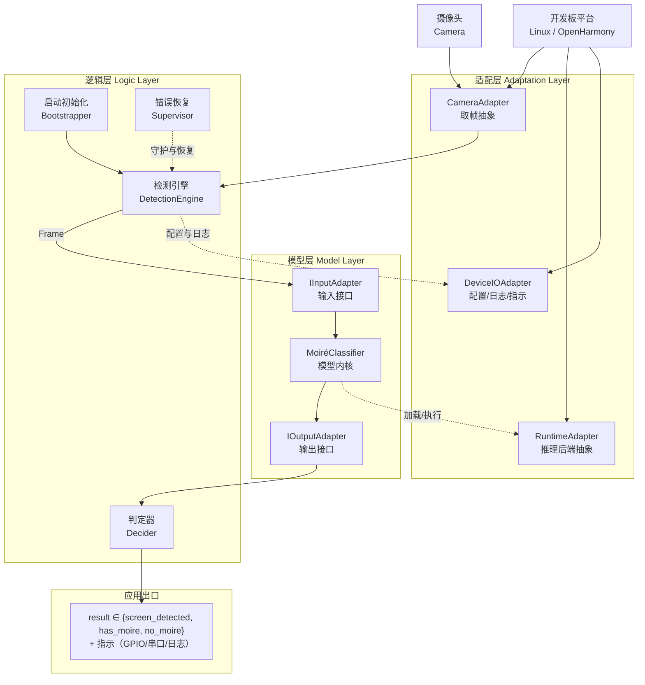
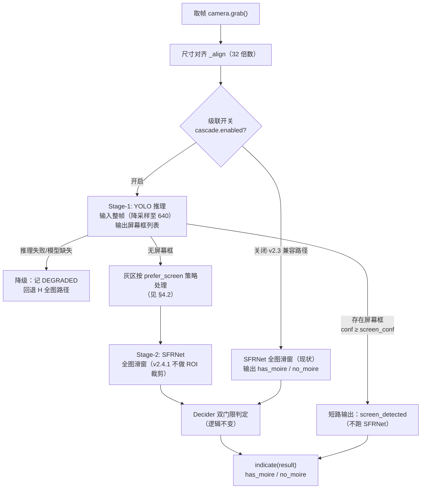
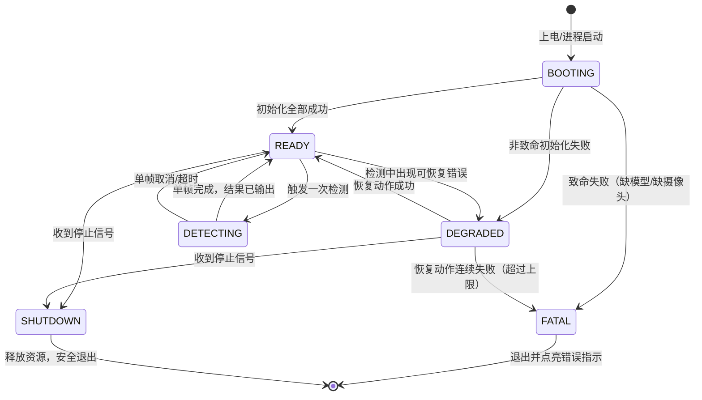

# 摩尔纹视觉识别系统 — 系统架构

> **仓库**：`https://github.com/chunri3255425/SFRNet.git`
> **文档版本**：v2.4.1（v2.4 级联方向反转：有屏幕 → 输出 `screen_detected`；无屏幕 → SFRNet 查摩尔纹；YOLO 工具链就位：Ultralytics 8.4.207 源码库）
> **状态**：架构基线
> **部署形态**：带摄像头的开发板，同时支持 Linux 与鸿蒙（OpenHarmony）双系统

---

## 1. 项目目标与交付品

在一台**带摄像头的开发板**上运行摩尔纹检测能力（v2.4 起为两级级联；v2.4.1 按二次审核决议反转方向）：

```
摄像头采集一张图像
  → Stage-1: 轻量 YOLO 判断画面中是否存在电子屏幕
  → 若检测到屏幕: 输出 screen_detected（本轮结束，不跑摩尔纹模型）
  → 若未检测到屏幕: Stage-2 SFRNet 全图判定摩尔纹 → 输出 has_moire / no_moire
```

系统对外输出是一个**三态结果**：`screen_detected`（画面中检测到电子屏幕）/ `has_moire`（无屏幕但检出摩尔纹）/ `no_moire`（无屏幕且无摩尔纹）。这是 v2.4 审核决议（方案 B）对 v2.3"单布尔量"承诺的显式升级；v2.4.1 按 2026-11-08 二次决议反转级联方向——**屏幕存在性本身是系统要输出的第一级结论**，摩尔纹识别作为无屏场景下的补充检测。不要求像素级掩膜、区域可视化、面积占比报表——这些是模型内部能力，不是系统对外承诺。

### 1.1 目标硬件：触觉智能 Purple Pi OH2

| 项 | 规格 | 对本设计的影响 |
|---|---|---|
| 型号 | 触觉智能（Industio）Purple Pi OH2 | 厂商提供 Linux 与 OpenHarmony 双系统支持，契合本项目双系统要求 |
| SoC | 瑞芯微 **RK3576**（4×Cortex-A72 + 4×Cortex-A53，另含 M0 协处理器）。**大小核频率已上电实测**：A72（`CPU part 0xd08`）档顶 **2208 MHz**、A53（`0xd03`）档顶 **2016 MHz**。⚠️ 本文早期版本把两档都写成 2.2 GHz，实测 **A53 到不了 2.2 GHz** | CPU 本身也有可观算力，可作 NPU 故障时的软回退；A72 代际低于 RK3588S 的 A76，软回退与 CPU 侧融合/后处理的吞吐需按此下调预期。A53 侧预算按 **2.016 GHz** 而非 2.2 GHz 估。实测来源见 [BOARD_BRINGUP §2](../guides/BOARD_BRINGUP.md) |
| 内存/存储 | **4 GB + 64 GB eMMC**（订单 SKU：Purple Pi OH2 开发板 4+64G）。内存类型两处口径不一致：商品主图写"高速 LPDDR5"，系列规格页另见 LPDDR4/4X@4266。**已上电实测**：`MemTotal` = 3,990,676 kB（4 GB 吻合）；`dmc available_frequencies` = **534 / 1320 / 1968 / 2736 MHz**，`normal_rate` = 1968 MHz；`androidboot.fwver` 含 `ddr-v1.10-9071d8ccd4`。⚠️ 档位表里**没有 LPDDR5 应有的 3200+ 档**，最高仅 2736 —— **"LPDDR5" 说法不成立**；但板上读不到 DDR 类型节点（debugfs 未挂载、无 `/proc/ddrinfo`），**具体是 LPDDR4 还是 4X 仍不作断言**，要坐实只能取厂商 SDK 的 dts | 量化后模型与运行时占用 < 500 MB，余量充足；4 GB 内存需注意 4K 图融合缓冲（见 §6 风险 #1）。内存类型只影响实测吞吐预期，不改变任何接口设计。eMMC 代际已实测确认为 **5.1**（`mmc0: new HS400 Enhanced strobe MMC card`）；容量也已板端实证：`/sys/block/mmcblk0/size` = 120,832,000 × 512 B = **57.6 GiB**（标称 64 GB），与订单 SKU 相符。刷官方 Ubuntu 后两边再各自实测一次：`free -m` 可见 **3895 MiB**、rootfs 分区 **59,332,607,488 B = 55.25 GiB**（[BOARD_BRINGUP §10](../guides/BOARD_BRINGUP.md)） |
| NPU | **6 TOPS INT8**（RKNN 生态，支持 INT4/INT8/INT16/FP16/TF32；片上 SRAM 1 MB）。**已实测调频档位**：`/sys/class/devfreq/27700000.npu` = **300–950 MHz** 八档（300/400/500/600/700/800/900/950），governor `rknpu_ondemand` | 推理后端锁定 **RKNN Runtime**；模型走 `pth → ONNX → RKNN` 转换链。TOPS 与 RK3588S 同为 6，但核数与微架构不同（公开资料对核数口径不一致，本文不作断言），单块延迟必须以实板实测为准。⚠️ governor 是 `ondemand`，意味着**冷启动首帧跑在低档**，任何延迟实测都必须先 warmup 再计时，否则数字不可比（与 `torch_runtime` 的 warmup 治理同一动机） |
| 2D 引擎 | 自带 **RGA** 光栅化加速器 | resize / 色彩转换 / 格式拷贝可卸载到 RGA，4K 输入预处理与融合缓冲的 CPU 占用由此降低（`adaptation` 侧可选优化，非首版必需） |
| 视频输入 | **多路 AHD 视频输入**（商品主图标注） | 除 MIPI CSI 外还有一条候选取帧通路；AHD 若走 V4L2 节点，则 `ICameraAdapter` 只是换一个 device path，业务层无感。是否启用属 Q2 剩余项 |
| 视频解码 | **4K@120fps**（商品主图标注；RK3576 硬件解码器） | 若输入源是码流而非裸帧，解码可交硬件，不必占用 NPU 与 CPU；当前设计按裸帧取图，暂未用到 |
| 网络 | **双千兆网口**（商品主图标注） | 硬件上具备"一路进产线网、一路点对点接巡检机"的隔离条件。⚠️ HTTP/SSE 出口是代码先行能力（`adaptation/network/`，配置默认 `enabled: false`），尚未在本文正式立项；是否升为正式输出通道待 Q4 一并定夺 |
| 烧录 | RKDevTool / 升级固件（.img 刷机包）。**已实板确认只有 USB 直连一条路**：厂商《上手指南》§八通篇是 OTG + Loader/Maskrom，**无 SD 启动路径**；TF 卡座是外设存储（功能表原文"TF卡(测试传输8G文件)"） | 镜像构建产出 RK3576 参数化 .img，Q6 已解。首轮点板用厂商预编译固件 `IDO_PurplePiOH2_V1B_Ubuntu22.04_HDMI4K_250907R.img`（选型与拒绝项见 [BOARD_BRINGUP §4](../guides/BOARD_BRINGUP.md)）；⚠️ 烧录只能在 Windows 主机做，WSL 不透传 USB |
| 摄像头接口 | MIPI CSI ×2（板载）+ USB；ISP 为 RKISP V3.9（16M pixel、HDR 120dB，与主图"16M ISP"一致）。厂商《Linux 使用手册》：板上实为 **3 路**摄像头座 J19/J20/J25，**J19 与 J25 默认适配 IMX415，J20 默认适配 OV13855** | 优先 MIPI CSI 摄像头（RKISP 硬件 ISP），Linux 走 V4L2。**已随板购入 IMX415 模组**（订单含"Purple Pi OH2 + IMX415 摄像头"），即 8MP/4K 级 MIPI CSI-2 传感器，Q2 的接口之争基本落定。⚠️ 接 IMX415 必须用 **J19 或 J25**；插 J20 不报错但画面偏绿，属"能跑但结果是错的"一类，已列入验收清单 |
| **摄像头型号（已定）** | **Sony IMX415**（MIPI CSI-2 接口，经板载 RKISP） | 1/2.8" STARVIS，8.46 MP，最高 3840×2160@30fps —— 传感器原生分辨率与模型 4K 基准（UHDMD）一致，滑窗参数（tile 512 / stride 256）无需调整；低照灵敏度高，适配现场光照不均的屏摄场景。Linux 下经 RKISP 驱动暴露 `/dev/video*`，V4L2 取帧即可，**无需新增驱动层抽象**（Q2 已解） |

**推理后端决策随之收敛**：

```
开发机（x86 + PyTorch）:  TorchRuntime（已有实现）
板端 Linux/OpenHarmony:  RknnRuntime（新增，实现 IRuntimeAdapter）
                          └── 模型文件：SFR_best.pth → ONNX → rknn（int8 量化）
软回退：                   OnnxRuntime CPU（NPU 驱动异常时），A53 小核上仍可低速运行
```

RKNN Runtime 是纯 C 库，Python 侧通过 `rknn-toolkit-lite2`（板端推理用）调用，无需在板上装 PyTorch。

> **版本约束的两次更正（2026-11-06，已闭环）**：本文早期写的“转换端 `rknn-toolkit2` 与板上 `librknnrt.so` **同主版本**”
> 是未经证实的假定，**已被实测推翻**：板上 runtime 为 **2.1.0 (2024-08-07)**，而转换端用 PyPI 能装到的 **2.3.2**
> 转出的模型，在这块板上 `init_runtime` 返回 0 且 `inference()` 正常跑完（只报一行
> `Model version: 2.3.2 not match with runtime 2.1.0` 的 warning）。
> 顺带：“钉 2.1.0”本身也不可用——PyPI 上 `rknn-toolkit2` 与 `rknn-toolkit-lite2` 都没有 2.1.0 发布版，
> 而 lite2 的 wheel 不自带 `librknnrt.so`（运行时 dlopen 系统那个）。
> 现行口径：**转换端 2.3.2 + 板端保持厂商 2.1.0，不替系统库**；实验过程与证据见
> [BOARD_BRINGUP §13.1](../guides/BOARD_BRINGUP.md)（它推翻了同文件 §11.4 拟的 A/B 两条路线）。

### 1.2 交付形态：可烧录镜像

**最终交付品是一个可以直接烧录进开发板的系统镜像**，不是需要用户手动配置环境的源码包。镜像内容：

| 组成 | 内容 | 说明 |
|---|---|---|
| 操作系统 | Linux 发行版 / OpenHarmony（Purple Pi OH2 官方镜像为基座） | 双系统各构建一条流水线 |
| 运行时 | Python 解释器 + **rknn-toolkit-lite2**（板端 NPU 推理） | 随镜像预装，不依赖联网；板上不装 PyTorch。⚠️ **“预装”是我们构建镜像那一步的责任，不是拿官方固件就有**：实测官方 Ubuntu 22.04.5 只有 Python 3.10.12（cp310 与 lite2 wheel 口径对齐 ✓），`numpy`/`cv2`/`rknn-toolkit-lite2` **均未安装**（BOARD_BRINGUP §10）。本轮已用 WiFi 经 apt/pip 现场补齐（§11.3），但**现场能装不等于交付形态合格**，这些件必须固化进镜像 |
| 应用本体 | `app/` 打包后的检测程序 | 上电自启动（systemd / 系统服务） |
| 模型资产 | 量化后的 **.rknn** 模型文件：`model.rknn`（SFRNet，由 `SFR_best.pth` 转换）+ `yolo_screen.rknn`（v2.4 新增的 Stage-1 屏幕 YOLO） | 随镜像固化于 `/usr/share/moireguard/models/`；YOLO 文件缺失为**非致命**（自动禁用级联回退全图路径，见 §4.3.5） |
| 配置 | `default.yaml` 烧录内置默认值 | 现场可覆盖（见 §4.3.6） |

**构建流水线**（开发机执行，产出镜像）：

```
SFR_best.pth ──导出──> ONNX ──rknn-toolkit2（x86 开发机）──> .rknn（int8 量化）
app/ 源码    ──打包──> 独立运行包（免依赖安装）
                │
                ├──> Linux：        Purple Pi OH2 官方镜像 + 根文件系统叠加（systemd 自启服务）
                └──> OpenHarmony：  OH 镜像构建系统产物 + HAP/独立进程
                          │
                          ▼
                  可烧录镜像（.img，RKDevTool 刷机包）──烧录──> 开发板上电即跑
```

注意分工：**rknn-toolkit2 装在 x86 开发机上做模型转换**；**rknn-toolkit-lite2 装在板上做推理**。两者不可装反。
另一条硬约束：两边的**主版本必须跟板上 `librknnrt.so`（实测 2.1.0）一致**，否则转换产物在板上加载不了；
但“去哪拿同版本包”与“要不要升级板上 runtime”尚未定（[BOARD_BRINGUP §11.4、§12](../guides/BOARD_BRINGUP.md)）。

**验收口径**：拿到一块空白开发板 → 烧录镜像 → 接摄像头 → 上电 → 无任何手动配置 → 系统自动开始检测并输出三态结果（`screen_detected` / `has_moire` / `no_moire`）。这是交付测试的唯一标准。

---

## 2. 技术选型约束

| 项 | 决策 | 说明 |
|---|---|---|
| 开发板 | **触觉智能 Purple Pi OH2**（RK3576，4GB+64GB，NPU 6 TOPS） | 板型已锁定，见 §1.1；SoC 型号曾误记为 RK3588S，已按实购订单更正（订单为 OH2 4+64G 整板与 OH2 核心板+IMX415 摄像头各 2 件）；厂商 SDK（RKNN/RKISP/刷机工具）允许进入适配层与 `build/`，仍不允许进入逻辑层与模型层 |
| 操作系统 | **Linux 与鸿蒙双系统，同一套代码** | 系统差异全部收敛到适配层，业务代码零分支；镜像构建各自一条流水线 |
| 开发语言 | **Python + PyTorch（开发）/ RKNN Runtime（板端）** | 板端推理走 NPU，加载 int8 量化的 .rknn 模型；板上不跑 PyTorch |
| 摄像头接口 | 抽象为"取帧"能力 | Linux 走 V4L2（MIPI CSI 经 RKISP），鸿蒙走相机 Kit，上层无感知 |
| 上电行为 | 应用自启动 | 烧录后无需登录 shell 手动拉起 |
| 远程运维 | **SSH 连接开发板** | 开发与运维统一走 SSH：部署/更新配置用 `scp`，查日志、重启服务、故障排查走 `ssh`；SSH 仅是**运维控制面**，不进检测数据面（检测链路不依赖网络可达） |
| 画面回传 | **WiFi 传输画面到上位机** | 板端通过 WiFi 将采集帧（可选叠加判定结果）实时回传给开发/演示主机，便于远程观察现场画面；属**旁路诊断面**，可关闭、失败不致命，见 §4.5 |

> **关于端侧性能的现实预估**（2026-11-05 开发机实测后重写；本文早期推算已被实测证伪）
>
> **算力实测**：SFRNet 共 7,799,872 参数，单块 512×512 前向 **178.6 G-MAC ≈ 357 GFLOPs**（forward hook 统计 Conv2d+Linear，未含逐元素与注意力矩阵乘）。**本文早期假设的"约 1.5 GFLOPs"低估约 238 倍**，据此得出的所有延迟结论作废。热点与结构一致：最贵的 6 层里 4 条落在 `d3.*.safm.basic_block.conv_layers` 与 `d1/d2/d3.r1.c1.2`，即全分辨率处的 3×3 膨胀卷积——网络最深只下采样到 1/8，绝大部分算力花在高空间分辨率上。
>
> **开发机实测**（RTX 5060 Ti，fp32，torch eager，batch=1）：单块 **163 ms**；batch=8 摊薄后 138 ms/块（几乎不随 batch 下降 → 是算力/带宽受限，不是内核启动开销）；fp16 119 ms（仅 1.4×）；4K 全图 112 块端到端 **20.1 s**，其中滑窗融合 + 两次 PNG 编码约 1.3 s（占 6%，主体耗时确为前向）。折合有效吞吐 2.19 TFLOP/s，约为该卡 fp32 峰值的一成——torch 侧没有明显浪费，慢在模型结构本身。
>
> **对 RK3576 的直接推论**（本段的推算**已被板端实测证伪**，保留是为了记“算术锁定量级”这件事本身不可靠）：6 TOPS(int8) 对 357 GOPs/块，**即使 100% 利用率也要 60 ms/块**；按 30–50% 的现实利用率取 120–200 ms/块，一张 4K 图 **13–22 s**。故原来的"5–20 ms/块、0.6–2.2 s/帧"不再成立，**当前架构在板上做不到实时**——这半句仍成立，且实测比推算更糟。
>
> **板端实测（2026-11-07，[BOARD_BRINGUP §15](../guides/BOARD_BRINGUP.md)）**：fp16 产物经产品代码路径跑 2275×1279（32 块）端到端 **96.6 s**，折合 **3.02 s/块**——比上面 120–200 ms/块 的推算又差 **15–25 倍**；照此 4K（112 块）约 **340 s**，不是 13–22 s。推算错在两处，都得记：① 拿 **6 TOPS 这个 int8 峰值**去除 fp16 的活，而 RK3576 的 fp16 吞吐本来就只是 int8 的一小档；② 凭经验直接借了“30–50% 利用率”这个数，而实测折合有效吞吐仅约 **0.12 TFLOP/s**（不到名义 fp16 峰值的一成）——未查清部分算子（OneHot / MatMul 类注意力 / reflect Pad / Resize）是否落了 CPU，这仍是 §6 风险 #11 里最值钱的一个待查项。
>
> 同图同引擎代码在开发机（RTX 5060 Ti，torch eager fp32）实测 **5.38 s / 32 块 = 168 ms/块**，与本节 2026-11-05 的 163 ms/块吻合——⇒ 开发机侧数字可复现，差全在板上。
>
> **可行的收敛方向**（均需实测验证，按依据强弱排序）：① **结构化裁剪砍 `d3`**——与实测热点直接对应，是本项目最有依据的一条；② **降低检测输入分辨率**——布尔判定不要求像素级定位，1080p 下块数降到约 28，缩放记入 `InputMeta.scale_x/y`；③ **加大 stride**（256→512 使块数近乎减半，代价是融合边界质量）；④ 用 **RGA** 承担缩放与格式转换，把 CPU 从数据通路里摘出来。
>
> 另需正视：已购 IMX415 本身就是 4K 级传感器，**112 块是常态负载而不是最坏情况**。
---

## 3. 总体架构

### 3.1 三层结构



### 3.2 三层职责

| 层 | 职责 | 红线 |
|---|---|---|
| **适配层** | 屏蔽平台差异：怎么取一帧、用哪个后端跑模型、配置和日志落在哪、布尔结果如何指示 | ❌ 不含任何判定逻辑 ❌ 不懂"摩尔纹"是什么 |
| **模型层** | 把一帧图规范成张量、调模型、把输出规范成统一的 logits；两个预留接口负责输入/输出的形态转换 | ❌ 不做布尔判定 ❌ 不做平台判断 ❌ 不做文件 IO |
| **逻辑层** | 系统的**操作主体**：上电初始化、检测循环、判定、异常恢复、优雅退出 | ❌ 不 import 任何平台 SDK ❌ 不碰 `state_dict` |

**依赖方向严格单向**：逻辑层 → 模型层 → （仅通过适配层接口访问）平台。

**为什么这样分**：交付品是烧录镜像，意味着系统是**无人值守常驻运行的**——上电自启、出错自恢复、断电安全。这些"操作逻辑"全部属于逻辑层，必须显式设计，不能靠人守着终端。

### 3.3 两级级联检测架构（v2.4 新增）

#### 设计原则

```
原则 P1：级联只加"门"，不改"门后"。
         SFRNet 路径（滑窗、Hann 融合、双门限 Decider）原样保留（v2.4.1 起作用域恒为全图），
         YOLO 只决定"要不要跑 SFRNet"。

原则 P2：两级模型在 ModelRegistry 里是平级的两个 ModelBundle。
         YOLO 不享受特权，它只是另一个 model_id；
         级联编排逻辑放在逻辑层 engine，不放在模型层。

原则 P3：Stage-1 失败必须可降级。
         YOLO 模型缺失/推理失败时，系统退回 v2.3 行为（直接跑 SFRNet 全图），
         记 DEGRADED 警告——级联是性能与精度优化，不是功能依赖。

原则 P4：对外输出为三态（v2.4 审核决议，方案 B；v2.4.1 反转方向）。
         result ∈ {screen_detected, has_moire, no_moire}，
         下游与指示层必须显式处理三个态（见 §4.4）。
```

> **设计动机（v2.4.1 口径）**：屏幕存在性是系统的第一级输出结论——YOLO 命中即出 `screen_detected`，快速、低耗；SFRNet 只对"没有屏幕"的帧做摩尔纹补充判定。注意这使 §6 风险 #12（SFRNet 判定恒真）**更容易暴露而非被掩盖**：SFRNet 现在只看无屏帧，而恒真问题恰在无内容图上最严重——回归测试必须保留级联开关双路对照（风险 #17）。

#### 级联流程



#### 各级职责与耗时预算

| 级 | 模型 | 任务 | 输入 | 输出 | 耗时量级（推算，**均待实机标定**） |
|---|---|---|---|---|---|
| Stage-1 | 轻量 YOLO（int8） | 画面中是否存在电子屏幕 | 整帧降采样至 640×640 | 框列表 [{x,y,w,h,conf}] | int8 NPU 单前向预计 **几十 ms** `[推算]`；含 NMS 后处理预计 < 200 ms `[推算]` |
| Stage-2 | SFRNet（fp16，现产物） | 无屏帧的摩尔纹判定 | **全图**滑窗 512 块（v2.4.1 无 ROI 裁剪） | raw logits → coverage → has_moire / no_moire | 沿用实测 **3.0 s/块** `[实机]`，2275×1279 全图 32 块 ≈ 96.6 s `[实机]` |
| 级联总开销 | — | 帧管理 | — | — | CPU 侧 < 100 ms `[推算]` |

> ⚠ **方向反转的代价如实记录**：v2.4 原设计里"屏幕框 → ROI 滑窗"能显著减少 SFRNet 块数（延迟收益最大的一条）；v2.4.1 反向后 SFRNet 恒跑全图，**该延迟优化不复存在**，§6 风险 #11（96.6 s/帧）成为无屏帧的真实成本。若后续延迟不可接受，可回到"ROI 裁剪"方案（挂 Q14），或在 SFRNet 侧做裁剪/降分辨率（§2 收敛方向）。

> **关于耗时数字的坦诚声明**（沿用本仓库纪律）：Stage-1 所有性能数字在 YOLO 上板实测前一律标注 `[推算]`。本仓库已有三条"推算被实测证伪"的记录（延迟低估 238 倍、再差 15–25 倍、平台误判）。YOLO 的 RKNN 转换存在与 SFRNet 不同的坑：检测头输出含 decode/NMS 后处理，RKNN 转换通常需**去掉后处理只导出主干**（输出原始特征图），decode 放 CPU——见 §4.1 实现要点 A2。


---

## 4. 各层设计

### 4.1 适配层

三个抽象接口，各自对应一类平台差异。

```python
# ── 4.1.1 摄像头 ─────────────────────────────
class ICameraAdapter(ABC):
    """把"取一帧"这件事抽象出来，屏蔽 V4L2 / 鸿蒙相机 Kit 的差异。"""

    @abstractmethod
    def open(self, **kwargs) -> None: ...

    @abstractmethod
    def grab(self) -> "Frame":
        """阻塞取一帧，返回 Frame(width, height, channels, timestamp, data)"""
        ...

    @abstractmethod
    def close(self) -> None: ...


# ── 4.1.2 推理后端 ───────────────────────────
class IRuntimeAdapter(ABC):
    """把"跑一次前向"抽象出来，屏蔽 ONNX Runtime / NPU SDK 的差异。

    镜像内固化的是量化模型文件；开发机调试时亦可用 Torch 后端。
    """

    @abstractmethod
    def load(self, model_path: str, **kwargs) -> None: ...

    @abstractmethod
    def infer(self, tensor) -> "np.ndarray | torch.Tensor":
        """输入 [1,3,H,W]，输出 [1,1,H,W] raw logits（未过 sigmoid）"""
        ...

    @abstractmethod
    def warmup(self) -> None: ...


# ── 4.1.3 设备 IO ────────────────────────────
class IDeviceIO(ABC):
    """配置、日志、临时目录、三态结果的物理指示。两套系统的路径与外设约定不同，统一在此。"""

    @abstractmethod
    def read_config(self) -> dict: ...

    @abstractmethod
    def log(self, level: str, msg: str) -> None: ...

    @abstractmethod
    def indicate(self, result: "DetectionOutcome") -> None:
        """三态结果的物理呈现：GPIO 电平 / LED / 屏幕角标 / 串口输出。
        DetectionOutcome ∈ {screen_detected, has_moire, no_moire}（v2.4.1 三态）。
        无屏态的物理呈现约定（如闪烁灯码）属 Q4 剩余项。"""
        ...
```

**平台差异对照表**（实现时按此表填各子类）：

| 能力 | Linux 实现 | 鸿蒙实现 |
|---|---|---|
| 取帧 | `V4L2CameraAdapter`（`/dev/video*`，MIPI CSI 经 RKISP 驱动） | `OhosCameraAdapter`（相机 Kit / NAPI） |
| 推理 | `RknnRuntime`（rknn-toolkit-lite2 + NPU）/ `TorchRuntime`（开发机） | 同左（OH 版 Purple Pi OH2 同样暴露 RKNN Runtime） |
| 配置路径 | `/etc/moireguard/`（镜像内置）+ `/var/lib/moireguard/`（现场覆盖） | 应用沙箱 `filesDir` |
| 日志 | `/var/log/moireguard/`（logrotate 滚动） | 应用沙箱 `cacheDir/logs/` |
| 自启动 | systemd 服务单元 | 系统服务 / ArkTS 壳拉起 |
| 布尔指示 | GPIO sysfs / 串口 / LED（板载 40-pin 排针可用）；v2.4 起呈现**三态**（无屏/有纹/无纹） | GPIO NAPI / 屏幕 |
| 远程运维 | OpenSSH 服务（镜像内置，`systemd` 拉起，固定静态 IP 或 mDNS 发现） | OH 端用 sftp/hdc 替代，运维动作收敛到 `IDeviceIO` |
| 画面回传 | `WifiFrameRelay`（TCP socket，JPEG 压缩，见 §4.5） | 同左（OH 侧经 WiFi NAPI 连接） |

**RknnRuntime 的三个实现要点**（新增时按此执行）：

1. **输入布局**：已上板实测——`.rknn` 吃 **NHWC float32**，与契约 C1（`NCHW` float32）不一致，permute 放在 `RknnRuntime.infer` 内部，**不改动 IInputAdapter**（证据：NHWC 喂法对 onnxruntime 参照相关系数 1.0000 / 最大相对误差 0.0059，NCHW 喂法相关系数 0.0321，[BOARD_BRINGUP §14.4](../guides/BOARD_BRINGUP.md)）。⚠ 两件事不能凭字面推：① 模型头里的 `framework layout: NCHW` 指**源框架布局**，不是运行时输入布局；② **输出侧已经是 NCHW `[1,1,H,W]`**，不能再“反向 permute”（旧代码那个 `shape[1]==1` 就转的分支在单通道上恰好会把对的弄错）。归一化仍在调用侧做完：转换烘的是**恒等** mean/std，`.rknn` 不会帮你 /255。
2. **输出域**：.rknn 导出时**不加** sigmoid/激活后处理，保证 `infer` 返回的仍是 raw logits（契约 O1）。RKNN 转换参数里显式关掉 `reorder` 之外的自动后处理。
3. **量化校准集**：`build/export_model.py` 需提供 100–200 张真实屏摄图作校准集（不能只用合成图，见 §6 风险 #7），量化后逐块比对 logits，相对误差 > 5% 则降位宽或回退 fp16 的 .rknn。⚠ 因为烘的是恒等预处理，校准集**不能直接把 jpg 路径交给 toolkit**（那样它按 0–255 域统计，与真实推理输入不同域）；导出脚本已改为用与推理同一套预处理落成归一化 `.npy` 再列进 txt（§14.4）。
4. **导出自检不能只看 dummy**（实测教训，[BOARD_BRINGUP §13.3](../guides/BOARD_BRINGUP.md)）：FRM 是数据相关的硬路由，trace 导出会把“选哪条专家分支”钉死在 dummy 上，而自检用的正是同一个 dummy，所以它永远报绿。必须另做多样本（至少几十张真实切片）的路由一致性抽检。

**YOLO 模型的三个实现要点（v2.4 新增）**：

1. **A1 输入布局与归一化**：与 SFRNet 相同，`.rknn` 吃 NHWC float32，permute 放在 `RknnRuntime.infer` 内部（实测经验直接复用，[BOARD_BRINGUP §14.4](../guides/BOARD_BRINGUP.md)）。但**归一化口径不同**：YOLO 训练用 0–1 归一化 + 640 letterbox（等比缩放+灰边），转换时烘的 mean/std 必须与训练一致（**不是恒等**，需在导出脚本里显式声明，防止重蹈"恒等预处理"的坑）。letterbox 的坐标还原逻辑放在 `IInputAdapter` 实现里，`InputMeta.scale_x/y` 记录缩放比。
2. **A2 后处理归属（YOLO 上板第一坑）**：ultralytics 原生导出包含 decode+NMS，RKNN 对其中部分算子（TopK/NonMaxSuppression 动态 shape）支持不佳，直接转换大概率失败或落 CPU。约定：**RKNN 侧只跑主干（输出原始特征图），decode + NMS 在 CPU 侧用 numpy 实现**（移植 rknn_model_zoo 的后处理参考实现）。NMS 是纯 CPU 操作，几千候选框在 A72 上 < 10 ms `[推算]`，不构成瓶颈。导出方式优先对齐官方 rknn_model_zoo demo，不要自己从 pt trace。
3. **A3 量化校准**：int8 优先（Stage-1 高频低延迟，检测模型对量化敏感度通常低于高频纹理分割）。校准集 100–200 张实拍场景图（含屏/无屏混合），**可直接给 jpg 路径列表**——YOLO 的预处理（/255 + letterbox）可烘进转换配置，不存在 SFRNet 那个"恒等预处理必须先落 npy"的坑。验收口径：量化前后逐框 IoU ≥ 0.95、conf 相对误差 > 5% 或召回下降 > 2% → 回退 fp16（Q12）。YOLO int8 预计成为本项目第一条真正跑通 int8 的路径，其校准与比对经验反过来喂给 SFRNet 的 Q8。

### 4.2 模型层（两个预留接口）

模型层的唯一使命：把平台送来的一帧，变成标准化的 logits；把 logits 变成标准化的输出对象。**输入形态与输出形态的转换规则集中在这两个接口里**，使得换模型、换输入格式、换输出语义都只改一处。

#### 接口一：`IInputAdapter` — 输入接口

```python
@dataclass(frozen=True)
class InputMeta:
    src_width: int
    src_height: int
    channels: int          # 1 / 3 / 4
    source_id: str         # 帧序号或时间戳，用于日志追溯
    scale_x: float = 1.0   # 若内部做过缩放，记录比例
    scale_y: float = 1.0


class IInputAdapter(ABC):
    """外部图像对象 → 模型可消费的张量。

    契约：
      C1. 返回 shape 必须为 [1, 3, H, W]，float32
      C2. 值域必须落在 [0.0, 1.0]，无 NaN/Inf
      C3. 色彩顺序必须是 RGB（不是 BGR）
      C4. 不做 tile 切分（属逻辑层职责）
      C5. 不修改传入对象
    """

    @abstractmethod
    def from_external(self, obj) -> tuple["torch.Tensor", InputMeta]: ...

    @abstractmethod
    def to_external(self, tensor, meta) -> object: ...
```

#### 接口二：`IOutputAdapter` — 输出接口

```python
@dataclass(frozen=True)
class DetectorOutput:
    logits: "torch.Tensor"   # [1,1,h,w]，未激活
    out_width: int           # 可与 input 不同分辨率
    out_height: int
    meta: InputMeta


class IOutputAdapter(ABC):
    """模型原始输出 → 统一输出契约。

    契约：
      O1. 保留 raw logits，不得先 sigmoid
      O2. shape 必须为 [1,1,h,w]，单通道
      O3. 不做阈值二值化
      O4. 若分辨率与输入不同，必须实现 resample_to_source()
    """

    @abstractmethod
    def to_external(self, raw, meta) -> DetectorOutput: ...

    @abstractmethod
    def resample_to_source(self, out: DetectorOutput) -> DetectorOutput: ...
```

> **O1 为什么重要**：Sigmoid 是非线性的。若下游对"已 sigmoid 的概率"做任何平均或聚合，与对 logits 聚合是两回事（$\sigma(\mathbb{E}[\ell]) \neq \mathbb{E}[\sigma(\ell)]$）。把融合统一在 logits 域、sigmoid 只在判定时施加一次，可避免同一模型在不同环节给出不一致的置信度。

#### 模型内核与注册表

```python
@dataclass(frozen=True)
class ModelBundle:
    model_id: str
    display_name: str
    core_factory: Callable[[], "MoiréClassifier"]
    input_adapter_factory: Callable[[], IInputAdapter]
    output_adapter_factory: Callable[[], IOutputAdapter]
    input_size: int          # 模型期望的输入边长（SFRNet 为 512）
    default_threshold: float
```

新增模型只需：实现内核类 → （如需）写两个 Adapter → 在注册表登记一行。**逻辑层与适配层零改动。**

#### 检测输出契约（v2.4 新增，与 DetectorOutput 并列）

YOLO 是目标检测范式，与 SFRNet 的分割范式输出语义不同。**不改造 O1–O4**（那是分割输出语义，动它就破坏 SFRNet 路径），而是**并列新增**检测输出契约：

```python
@dataclass(frozen=True)
class DetectionBoxOutput:
    """目标检测输出契约。

    契约 D1. boxes 为 [N, 5]（cx, cy, w, h, conf），坐标已由 letterbox 映射回原图尺度
    契约 D2. 不做类别过滤以外的任何业务判断（"有没有屏幕 → 短路"是逻辑层的事）
    契约 D3. raw 输出（未做置信度过滤的框全部保留，conf 列随行）
    """
    boxes: "np.ndarray"      # [N,5]
    img_width: int
    img_height: int
    meta: InputMeta
```

模型注册表随之登记 `yolo_screen_v1`（`configs/models.yaml` 增量，`input_size: 640`）。两个契约、两个 ModelBundle，注册表天然支持。

**YOLO 工具链现状（2026-11-08 实勘）**：Ultralytics 官方仓库克隆已就位于 `D:\VIEW\YOLO\ultralytics`（版本 **8.4.207**，git 工作区干净）。关键事实：

| 项 | 现状 | 对本项目的影响 |
|---|---|---|
| 版本 | 8.4.207（YOLO26 时代，`Model.load` 默认权重名 `yolo26n.pt`） | 选型仍为 YOLOv8n（下文），YOLO26n 为同量级备选，训练时一并验证后定稿（挂 Q10 备注） |
| 自定义内容 | **无**：无权重（0 个 .pt/.onnx/.rknn）、无 data.yaml、无训练/转换脚本 | 训练数据、标注、训练脚本、导出脚本全部待做（§8 M-A/M-B） |
| 自带 RKNN 导出 | `ultralytics/utils/export/rknn.py:17` 的 `onnx2rknn()`，支持 `quantize=8` INT8，依赖 `rknn-toolkit2>=2.3.2,<2.5` | **与本项目转换端版本 2.3.2 正好兼容**；可优先尝试 ultralytics 自带导出链，不行再回退 SFRNet 仓库的 `export_model.py` 手工链路 |
| 自带预处理/后处理 | LetterBox 640（`data/augment.py:1719`）、NMS conf=0.25/IoU=0.5（`utils/nms.py:13`） | 与 §4.1 A1/A2 约定一致；转换上板时仍按 A2：主干进 NPU、decode+NMS 落 CPU |
| 与 SFRNet 连接 | 零连接（无 import、无路径引用） | 符合预期：ultralytics 只在研究/转换侧使用，**不进镜像** |

**YOLO 模型选型（已定）**：YOLOv8n（~3.2M 参数，anchor-free），首选理由：RKNN 官方提供成熟转换示例与后处理参考实现（`rknn_model_zoo`），转换链、部署链全部复用 v2.3 已跑通资产；Stage-1 需要毫秒级门控且训练生态最顺。备选 Q10：若屏检任务用检测范式收益不足，降级为二分类器（更轻更快）。

**训练数据约定**：

| 项 | 约定 |
|---|---|
| 任务 | 单类目标检测：`screen`（电子屏幕，含显示器/笔记本/平板/手机/电视） |
| 类别口径 | **"通电发光的显示面板"入正类**（审核决议）；电子墨水屏、关机屏幕不入正类（规范写进 `datasets/README`，防污染训练集，见 §6 风险 #16） |
| 数据来源 | ① IMX415 实拍场景图（含屏与无屏各 ≥ 150 张）；② 公开数据集补充；③ 经 WiFi 画面回传通道（§4.5.2）边演示边采集（审核决议：接受） |
| 负样本 | 无屏画面（纯桌面/纯墙面/纯键盘等）占比 ≥ 30%，专治"什么都像屏幕" |
| 训练 | 开发机（RTX 5060 Ti）ultralytics 框架，输入 640，官方预训练权重微调；首版 300–500 张，验收集 mAP@0.5 ≥ 0.9 |

**级联门控规则（逻辑层，v2.4 新增；v2.4.1 反转方向）**：

```
screen_boxes = yolo.infer(整帧)
has_screen = any(box.conf >= screen_conf)

若 has_screen:
      → 短路：result = screen_detected（不跑 SFRNet，本轮结束）
若 not has_screen:
      → Stage-2: SFRNet 全图滑窗 → Decider → has_moire / no_moire

灰区规则（防漏检，v2.4.1 决议：默认 prefer_screen 宁报不漏）：
      若 box.conf 在 [screen_conf - 0.1, screen_conf) 灰区，
      prefer_screen=视为有屏（输出 screen_detected）
      fallback=视为无屏（继续跑 SFRNet）
      → 首版取 prefer_screen，待召回率实测后收紧
```

| 参数 | 默认值 | 说明 |
|---|---|---|
| `cascade.enabled` | `true` | 级联总开关，false 时行为与 v2.3 完全一致（保底回退） |
| `cascade.screen_conf` | 0.5 | Stage-1 置信度门限，**待实拍标定** |
| `cascade.gray_zone_policy` | `prefer_screen` | 灰区策略，见上（v2.4.1 由 `safe` 改） |
| `cascade.min_box_ratio` | 待定 | 屏幕框占画面最小面积比（低于此是否仍算"有屏"属产品口径，挂 Q11） |
| ~~`cascade.screen_roi_pad`~~ | — | v2.4.1 起废弃（SFRNet 不再做 ROI 裁剪；若启用 Q14 回归方案再恢复） |

> **门槛设计理由**：Stage-1 的错误方向不对称——漏检屏幕（该报 `screen_detected` 却落到 SFRNet）的代价高于多跑一次 SFRNet。所以首版灰区一律偏向 `prefer_screen`，宁报不漏；等实测召回率数据出来再收紧。

### 4.3 逻辑层 — 操作逻辑（本章细化）

逻辑层是系统在板上的"操作主体"。无人值守环境下，它要回答完整生命周期里的每个问题：上电后干什么、每一帧怎么处理、出错怎么办、配置怎么生效、怎么停。

#### 4.3.1 状态机

系统在任一时刻处于且仅处于以下状态之一：



各状态的对外含义（经 `IDeviceIO.indicate` 呈现）：

| 状态 | 含义 | 指示约定 |
|---|---|---|
| BOOTING | 正在初始化 | 布尔输出无效，指示"忙" |
| READY | 空闲，等待触发 | 布尔输出无效 |
| DETECTING | 正在处理一帧 | 布尔输出无效，指示"忙" |
| DEGRADED | 带病运行（见 4.3.5） | 沿用最近一次有效结果 + 警告标记 |
| FATAL | 无法继续 | 错误指示常亮，布尔输出固定为 False |

#### 4.3.2 启动序列（BOOTING → READY）

上电后按固定顺序执行，**任何一步失败立即判定致命/非致命，不静默跳过**：

```
1. 读取配置
     ├─ 读取顺序：镜像内置默认值 → 现场覆盖文件（若存在）
     └─ 配置解析失败 → 用内置默认值 + 记警告（非致命）
2. 初始化日志系统（IDeviceIO）
3. 探测平台，装配适配层实现（factory）
     └─ 平台探测失败 → FATAL（理论上不会发生）
4. 初始化推理后端（IRuntimeAdapter.load；v2.4 起依次加载 SFRNet 与 YOLO 两个 .rknn，各 warmup 一次）
     ├─ SFRNet 模型文件缺失 / 校验失败 → FATAL（缺主模型无法工作）
     ├─ YOLO 模型文件缺失 → 非致命：记 WARN + 自动 cascade.enabled=false，进程继续（P3）
     └─ 后端加载成功 → warmup() 预热一次（首次推理通常显著偏慢）
5. 打开摄像头（ICameraAdapter.open）
     ├─ 首次打开失败 → 重试 3 次（间隔 2s）
     └─ 仍失败 → FATAL（无输入源无法工作）
6. 取一帧做连通性自检（只验证管道通，不要求判定正确）
     └─ 取帧失败 → DEGRADED（可能摄像头预热中）
7. 全部通过 → READY，记录启动耗时
```

**关键决策**：模型缺失、摄像头缺失是**致命**的——镜像里两者都已固化，缺了任何一样说明镜像损坏或硬件故障，重启也救不回来，直接进 FATAL 并点亮错误指示。而配置损坏是**非致命**的——退回默认值继续跑，因为默认值足以完成基本功能。

#### 4.3.3 单帧检测流程（READY → DETECTING → READY）

一次 `detect_once` 的完整操作序列：

```
输入：DetectionRequest(model_id, threshold, pixel_ratio, timeout_ms)

1.  状态检查：当前必须为 READY，否则拒绝并返回错误码 E-BUSY
2.  取帧：camera.grab()（带超时，默认 3000 ms）
      ├─ 超时/失败 → 抛 CaptureError，交由 Supervisor 处理
      └─ 成功 → Frame
3.  输入适配：input_adapter.from_external(frame)
      → Tensor[1,3,H,W] + InputMeta
3.5 [v2.4 新增] 级联门控（若 cascade.enabled）：
      - Stage-1: yolo_runtime.infer(降采样帧) → DetectionBoxOutput
      - 失败 → YoloError 归入恢复表新行（见 4.3.5），本次会话内禁用级联，
               回退全图路径（P3：级联是优化不是依赖，禁用即恢复）
      - 有屏幕框（含灰区 prefer_screen）→ 跳到步骤 7，result = screen_detected
      - 无屏幕框 → 进入 Stage-2（步骤 4-6，全图）
4.  尺寸适配（按帧尺寸与模型 input_size 的关系三分支）：
      a. H,W > input_size：滑窗切块，逐块推理，logits 域加权融合，
         末行/末列强制贴边回退
      b. H,W < input_size：反射填充至 input_size，推理后裁回原尺寸
      c. 相等：单次前向
5.  输出适配：output_adapter.to_external(...) → DetectorOutput(logits)
      （若输出分辨率 ≠ 输入，内部完成 resample_to_source）
6.  判定（Decider，见 4.3.4）
7.  结果输出：IDeviceIO.indicate(result) + 日志一行
      result ∈ {screen_detected, has_moire, no_moire}（v2.4.1 三态）
      log 格式：{frame_id, result, coverage, stage1_conf, roi_blocks, elapsed_ms, state}
      （stage1_conf / roi_blocks 仅级联开启时非空，诊断用）
8.  回到 READY
```

**每步的超时预算**（单帧端到端的耗时控制点）：

| 步骤 | 预算 | 超时后果 |
|---|---|---|
| 取帧 | 3000 ms | CaptureError |
| 前向（单块） | 5000 ms（板端按实测标定） | InferTimeout，整帧作废 |
| 单帧总计 | `timeout_ms`（请求参数） | 返回 E-TIMEOUT，帧作废 |

超时帧**作废重试**而非无限等待——无人值守系统宁可漏一帧，不能卡死在某一帧上。

#### 4.3.4 判定规则（Decider）

```
prob     = sigmoid(logits)              ← 全流程唯一的 sigmoid
coverage = mean(prob > threshold)       ← 超阈值像素的面积占比
has_moire = coverage > pixel_ratio      ★ 布尔结论
```

- **双门限设计**：单点判据（任一像素超阈值即 True）对孤立噪点极敏感；纯占比判据更稳。`threshold`（像素级，默认 0.5）先过滤置信度，`pixel_ratio`（面积级，默认 0.01）再过滤规模。
- `coverage` 保留在日志与诊断结果中，便于现场标定 `pixel_ratio`，但**不写入对外契约**。
- 判定结果**逐帧独立**：不做跨帧平滑、不做历史投票。连续多帧的一致性判断（如"连续 N 帧为 True 才告警"）属应用侧策略，V1 不做，但在 Decider 接口上预留 `smooth` 参数位。

#### 4.3.5 错误恢复（Supervisor，DEGRADED 的进出）

无人值守的核心：**出错不退出，恢复不无限**。

| 错误类别 | 典型场景 | 恢复动作 | 连续失败上限 | 达到上限后 |
|---|---|---|---|---|
| 取帧失败 | 摄像头瞬时掉线、缓冲区溢出 | 重开摄像头（close → open），间隔 2s | 5 次 | FATAL |
| 推理失败/超时 | NPU 异常、内存不足 | 释放资源 → 重载模型（load + warmup） | 3 次 | FATAL |
| 帧数据异常 | 全黑帧、解码损坏 | 跳过该帧，直接取下一帧 | 连续 10 帧 | DEGRADED 持续，维持警告 |
| Stage-1（YOLO）推理失败/超时 | YOLO 模型异常、NPU 冲突（v2.4 新增） | **禁用级联，回退全图路径**，记 WARN（P3：级联是优化不是依赖，禁用即恢复） | 3 次 | 保持级联关闭直至进程重启；**不 FATAL** |
| 未知异常 | 任何未捕获异常 | 记录堆栈 → 完整重新初始化（回到 BOOTING 序列第 3 步） | 3 次 | FATAL |

**DEGRADED 状态的语义**：系统仍在运行并持续尝试恢复，期间布尔输出**沿用最近一次有效结果**并附带警告标记（指示层区分"新结果"与"旧结果"）。这样下游不会拿到突然跳变的 False。

**退避策略**：恢复动作采用固定间隔（2s）而非指数退避——嵌入式场景下简单可靠优先，且摄像头重开本身就有硬件级延迟。

#### 4.3.6 配置热更新

运行中允许不重启更新两个运行时参数：

| 参数 | 生效方式 | 是否中断检测循环 |
|---|---|---|
| `threshold` | 下一帧立即生效 | 否 |
| `pixel_ratio` | 下一帧立即生效 | 否 |
| `cascade.enabled` / `cascade.screen_conf` / `cascade.gray_zone_policy` | 下一帧立即生效（v2.4 新增） | 否 |
| `model_id` / `input_size` | 需重载模型（走恢复流程） | 短暂 |
| 其他（摄像头参数等） | 需重启进程 | 是 |

配置读取遵循**"镜像内置默认值 + 现场覆盖文件"两层**：烧录后的系统自带可靠默认值，现场调参只改覆盖文件，且覆盖文件解析失败时自动回退默认值（对应 4.3.2 第 1 步）。

#### 4.3.7 连续检测模式与优雅退出

```python
class DetectionEngine:
    def run_forever(self, req, on_result) -> None:
        """常驻循环：READY → DETECTING → READY → ...

        循环体内每轮：
          1. 检查停止信号（SIGTERM / 系统关机广播）→ 走 SHUTDOWN
          2. 检查配置版本号变化 → 热更新（4.3.6）
          3. 执行 detect_once（含全部错误处理）
          4. 等待触发间隔（按配置的检测频率；0 = 连续全速）
        """

    def shutdown(self) -> None:
        """优雅退出（SHUTDOWN 状态）：
          1. 停止接收新帧
          2. 等待当前帧完成（最多再等一个 timeout_ms）
          3. 按序释放：摄像头 → 推理后端 → 日志 flush
          4. 指示层熄灭；退出码 0 = 正常收摊，1 = 恢复超限（FATAL）
             —— unit 是 Restart=on-failure，FATAL 返 0 等于告诉 systemd 不必拉回
        """
```

**上电自启与关机安全**：镜像层面由 systemd 服务单元（Linux）或系统服务（鸿蒙）负责拉起与停止；进程只需正确响应停止信号。断电安全靠"无持久状态"设计——系统不在运行中写任何关键状态文件，重启后行为与冷启动完全一致。

#### 4.3.8 对外 API 汇总

逻辑层对外的全部接口（适配层与模型层不直接对外）：

| 方法 | 用途 |
|---|---|
| `DetectionEngine.bootstrap(config)` | 上电初始化，返回 READY / DEGRADED / FATAL |
| `DetectionEngine.detect_once(req)` | 单帧检测，返回 `DetectionResult` |
| `DetectionEngine.run_forever(req, on_result)` | 常驻检测循环 |
| `DetectionEngine.update_config(partial)` | 热更新参数 |
| `DetectionEngine.shutdown()` | 优雅退出 |
| `DetectionEngine.health() -> HealthReport` | 状态查询（当前状态、最近错误、累计统计） |

`DetectionResult` 的字段（v2.4.1 修订）：`result ∈ {screen_detected, has_moire, no_moire}`（对外承诺，v2.3 的 `has_moire` 布尔由它派生：`has_moire=True ⇔ result=="has_moire"`）、`stage1_conf`、`roi_blocks`（v2.4.1 起恒为全图块数，字段名保留兼容）、`coverage`、`elapsed_ms`、`frame_id`、`warnings`——除 result 外均为诊断信息。兼容说明：老下游若只读 `has_moire` 布尔，`screen_detected` 与 `no_moire` 都映射为 False，但**新代码不得再按布尔消费**（审核决议方案 B 的核心目的就是让下游区分三态）。

### 4.4 关于"结果导出"

系统对外的结果是**三态**（v2.4 审核决议方案 B；v2.4.1 反转方向）：`screen_detected` / `has_moire` / `no_moire`。落地方式按场景二选一：

| 场景 | 输出方式 |
|---|---|
| 调试/开发 | 标准输出打印三态字符串，或每帧一行 `{frame_id, result}` |
| 板端常驻 | 三态驱动物理指示（GPIO 电平组合 / LED 灯码 / 屏幕角标 / 串口输出），由适配层 `IDeviceIO.indicate(result)` 实现；`screen_detected` 态的具体灯码属 Q4 剩余项 |

不产出图片文件、不产出报告、不建结果数据库。

### 4.5 旁路能力：SSH 运维通道与 WiFi 画面回传

两者都属**旁路诊断面**——不参与检测判定链路，检测链路在完全断网时必须照常工作。

#### 4.5.1 SSH 运维通道

| 项 | 约定 |
|---|---|
| 定位 | 开发与运维的控制面：部署模型/配置（`scp`）、查日志与状态（`ssh`）、重启服务（`systemctl restart moireguard`） |
| 数据面隔离 | 检测循环**不依赖 SSH 可达**；SSH 断开时系统照常检测 |
| 镜像内置 | OpenSSH server 随镜像固化，systemd 自启；首次开机生成主机密钥 |
| 网络发现 | 有线/WiFi 环境下用静态 IP 或 mDNS（`moireguard-<serial>.local`）定位板子，免除每次查 IP |
| 约束 | 镜像内置默认口令仅在首次登录时强制修改；禁止把运维凭据写进代码仓库 |

#### 4.5.2 WiFi 画面回传（`IFrameRelay`）

**定位**：把板端采集的画面实时传给开发/演示主机，用于远程观察现场（调试取景、远程演示、采集数据抽查）。它是**旁路**，失败只降级告警，绝不阻塞检测。

**适配层接口**（新增第四个抽象，实现仍收敛在适配层）：

```python
class IFrameRelay(ABC):
    """把一帧画面经 WiFi 推给上位机。旁路能力：失败不致命。"""

    @abstractmethod
    def start(self, host: str, port: int, **kwargs) -> None: ...

    @abstractmethod
    def push(self, frame: "Frame",
             result: "DetectionResult | None" = None) -> bool:
        """非阻塞推送一帧。返回 False 表示本轮未发出（队列满/未连接）。"""

    @abstractmethod
    def stop(self) -> None: ...
```

**数据通路**：

```
DetectionService ──取帧成功后旁路挂接──> StreamTap（逻辑层，可配置开关）
    → JPEG 编码（板端 CPU，质量 60–80，4K 帧约 100–300 KB）
    → WifiFrameRelay.push()（独立发送线程 + 长度为 1 的队列）
    → TCP: host:port ──WiFi──> 上位机查看器（PC 端小工具，播放 + 显示 has_moire 角标）
```

**关键规则**：

| # | 规则 | 理由 |
|---|---|---|
| R1 | **丢旧保新（latest-wins）**：待发槽位恒为 1，新帧直接覆盖尚未发出的旧帧，上位机看到的永远是当前画面 | 带宽不够时宁可降帧率，不能让检测循环等待网络；回传的用途是"观察现场"，把旧帧补发出去只会误导观察者 |
| R2 | **push() 非阻塞**，总耗时预算 ≤ 5 ms（入队即返回，编码与发送都在独立线程） | 画面回传不得挤占单帧检测的耗时预算（§4.3.3） |
| R3 | **降帧率回传**：默认按固定间隔回传（如 5 fps 或每 N 帧一帧），而非全帧率 | 4K@30fps 原图回传需 >100 Mbps，现场 WiFi 扛不住；JPEG 压缩后 5 fps 约 1–2 Mbps，普通 WiFi 可行 |
| R4 | **可叠加判定结果**：编码前把 `has_moire`/coverage 以角标文字画进画面（可选开关） | 上位机无需解析第二通道即可看到结论 |
| R5 | **失败降级**：连接断开/发送超时 → 重连退避（2s 固定），连续 5 次失败 → 记 WARN + 状态转 DEGRADED 附带警告标记，**不 FATAL** | 旁路坏了主业务必须活着 |
| R6 | **分辨率可降**：回传前可下采样（如长边 1080），不影响板端检测用原图 | 进一步压缩带宽；检测与回传的分辨率解耦 |
| R7 | **默认关闭**：`relay.enabled: false` 为镜像默认值，现场用覆盖文件或 SSH 热配置打开 | 上电即跑的验收场景（§1.2）不应依赖网络 |

**配置项**（并入 `configs/default.yaml`）：

```yaml
relay:
  enabled: false        # 默认关闭（R7）
  host: "192.168.1.100" # 上位机地址
  port: 9000
  interval_frames: 6    # 每 6 帧回传 1 帧（≈5fps @30fps）
  jpeg_quality: 75
  downscale: 1080       # 长边降采样，0 = 原分辨率
  overlay_result: true  # 画面叠加 has_moire 角标
```

**为什么独立线程 + 单槽队列而不是 RTSP/网络流**：RTSP 服务端在板端引入额外依赖与配置成本，且本项目回传的是"观察用低帧率画面"而非"实时视频流"，一条 TCP 长连接 + JPEG 帧序列（自定义 4 字节长度前缀分包）即可满足，上位机用任何语言 20 行可写接收端。若后续确需标准流媒体，仅需在适配层新增 `RtspRelay(IFrameRelay)` 实现，逻辑层零改动。

---

## 5. 目录结构

```
SFRNet/
├── upstream/sfr/               # 上游模型定义（冻结，不改）
│   └── {sfrnet,safm,FRM}.py
├── upstream/                   # + data_loding.py / metrics.py（训练侧，产品路径不调用）
├── assets/weights/             # SFR_best.pth（板端模型的转换源，不入库）
├── samples/                    # 屏摄样张与对照实验图（本地调试用，不入库）
│
├── app/                        # ★ 软件主体（唯一包，历史 moireguard/ 双真源已消除）
│   ├── main.py                 # ★ 唯一组合根：装配 + 四种形态（常驻循环 / --detect /
│   │                           #   --serve-net / --selftest），平台分支只经 factory 一次
│   ├── adaptation/             # ── 适配层（对上层零感知，不得 import logic_layer）
│   │   ├── base.py             # ★ 抽象聚合 + DTO + 反向注入用 Protocol（IImageService 等）
│   │   ├── factory.py          # ★ 平台探测与实现装配（唯一允许平台分支处；缺能力显式报错）
│   │   ├── camera/{base,v4l2,ohos,fake,file_camera}.py
│   │   ├── runtime/{base,onnx_runtime,torch_runtime,rknn_runtime}.py
│   │   ├── relay/{base,wifi_frame_relay}.py   # WiFi 画面回传（旁路，见 §4.5）
│   │   ├── network/http_server.py             # HTTP/SSE 网络出口（代码先行，见 §4.4 待 Q4）
│   │   └── device_io/{base,linux_io}.py       # ohos_io 未落地（见下表缺口）
│   ├── model_layer/            # ── 模型层
│   │   ├── contracts.py        # ★ 预留接口 + 数据契约（v2.4 新增 DetectionBoxOutput D1–D3）
│   │   ├── builtin_adapter.py  # 默认实现（RGB 输入 / 单通道输出）
│   │   ├── registry.py         # ModelRegistry（strict：未知 model_id / 缺权重即抛）
│   │   └── detectors/
│   │       ├── sfrnet_detector.py             # DetectorCore 实现（Stage-2）
│   │       └── yolo_detector.py               # [v2.4 新增] YOLO 内核 + 输入/输出 Adapter（Stage-1）
│   └── logic_layer/            # ── 逻辑层（不 import 平台 SDK / 不碰 state_dict / 不做平台判断）
│       ├── engine.py           # DetectionEngine（状态机 + 逐帧 + 重试降级 + v2.4 级联门控/ROI 路由，无独立 supervisor）
│       ├── bootstrapper.py     # 7 步启动序列（DEFAULTS 由 config.AppConfig 导出）
│   ├── config.py           # ★ 默认值唯一真源（dataclass）+ 分层 merge（v2.4 新增 cascade 节）
│       ├── decider.py          # 双门限判定（全流程唯一一次 sigmoid）
│       ├── sliding_window.py   # 切块与余弦窗融合
│       ├── postprocess.py      # 开发/标定侧后处理（与 Decider 同界同判）
│       ├── inference_service.py# 单次推理编排（图片路径 → 结果，供网络出口调用）
│       ├── export_service.py   # 掩膜/热力图/JSON 导出
│       └── exceptions.py       # 错误分类与恢复策略映射
│
├── build/                      # 镜像构建流水线
│   ├── export_model.py         # SFR_best.pth → ONNX → .rknn（int8 量化 + 一致性比对）
│   ├── export_yolo.py          # [v2.4 新增] yolo pt → 无后处理 ONNX → .rknn（int8 + 框级一致性比对）
│   ├── calib_yolo/             # [v2.4 新增] YOLO int8 校准集目录
│   ├── package_app.py          # app/ → 分层 stage 打包（/opt /etc /usr /var + systemd）
│   ├── image_linux/moireguard.service
│   └── tools/view_relay.py     # 上位机画面查看器
│
├── train/
│   └── train_yolo_screen.py    # [v2.4 新增] YOLO 微调脚本（研究侧，不进镜像；ultralytics 不进镜像）
├── datasets/screen_detect/     # [v2.4 新增] 实拍标注数据（不入库，本地；标注规范见 datasets/README）│
├── configs/{default.yaml,models.yaml}   # 镜像内置默认配置（超时待 M1 实测回填）
├── {train,predict}.py          # 上游训练/预测脚本（研究侧，不进镜像）
├── run_sim.py                  # 开发机模拟器：FileCamera 接进 DetectionEngine
├── serve.py                    # 兼容壳 → app.main（不再承接新逻辑）
└── tests/{smoke_board_pipeline,test_real_weights}.py
```

**引用约束**：`upstream.*` 只允许在 `app/model_layer/detectors/sfrnet_detector.py` 中 import 一次；`v4l2`、`ohos`、`onnx`、`rknn` 等平台字样只允许出现在 `app/adaptation/` 与 `build/` 之下；**适配层不得 import 逻辑层**（依赖方向只能是 逻辑层 → 模型层 → 适配层），跨层反向调用一律走 `adaptation/base.py` 里的 Protocol 由组合根注入。

**目录树与本文的已知缺口**（代码先行、文档尚未立项的部分，不粉饰）：

| 本文声称 | 实际状态 |
|---|---|
| `model_layer/detectors/yolo_detector.py`、`build/export_yolo.py`、`train/train_yolo_screen.py` | **未落地**（v2.4 新立项，代码待 M-A/M-B，见 §8 路线） |
| `device_io/ohos_io.py` | 未落地，鸿蒙侧仅有 `camera/ohos.py` 占位 |
| `build/image_ohos/`、`build/calib/` | 目录不存在；鸿蒙流水线与 RKNN 量化校准集待 M1 |
| `logic_layer/supervisor.py` | 无此文件，重试与降级已并入 `engine.py`（C-10~C-13） |
| 网络出口（`adaptation/network/`） | 代码已可用（HTTP/SSE + token 鉴权），且常驻循环的逐帧判定现已真的接进 SSE（`--serve-net --loop`）；但 §1/§4.4 对外的正式承诺仍只有一个布尔量，是否升为正式输出通道待 Q4 |
| 默认阈值 `threshold=0.5 / coverage_threshold=0.01` | **实测对任何输入都判有摩尔纹**（零内容图 coverage=1.0000），Q5/Q9 未解前不可作交付判据 |

---

## 6. 关键约束与已知风险

| # | 事项 | 影响 | 应对 |
|---|---|---|---|
| 1 | 4 GB 内存与 4K 图融合缓冲 | 3840×2160 三张 float32 融合缓冲约 95 MB，加上多块推理的中间张量，峰值可控但无浪费空间 | 融合缓冲复用（SlidingFuser 预分配）；禁止同帧持有两份全图张量；4K 以上输入按 `max_pixels` 拦截 |
| 2 | RKNN 对 ONNX 算子覆盖不全 —— **已实测坐实并已打通** | 两层障碍：① FRM 硬路由的 `nonzero` 被编译层明确拒收（动态图）；② 即使静态化了仍会 **SIGABRT、不报算子名**——真正主因是 `Pad`/`Slice` 的 pads/ends 走了 `Transpose→Reshape→Cast` 计算链，ONNX 形状推断不做常量求值，导出产物 **944/1324 张量含符号维度**（前缀二分定到节点 #421，[BOARD_BRINGUP §14.2](../guides/BOARD_BRINGUP.md)） | 两步都已落地：① 导出侧 mask-sum 静态化（24 片逐 bit 等价，不重训）；② `onnxslim` 常量折叠（符号维 944→8），`export_model.py rknn` 已默认自动执行。产物已在板端 NPU 跑对（相关系数 1.0000）。**教训：拿最小模型验链只能验“链”，验不出“图形状不静态”这类整图级障碍** |
| 3 | 双系统同一套代码 | 需保证业务代码零平台分支 | 平台判断只允许出现在 `adaptation/factory.py` 一处 |
| 4 | 鸿蒙 Python 运行时可用性 | 鸿蒙上跑 CPython 生态支持有限 | 备选：Python 独立进程 + IPC，由 ArkTS 壳展示结果；此路径下逻辑层代码完全复用 |
| 5 | 上游模型无 Sigmoid 末端 | 输出是 logits 而非概率 | 契约 O1 保证下游统一施加 |
| 6 | 上游 `predict.py` 小图推理崩溃（画布未随 pad 扩大） | 直接搬用会崩 | 逻辑层滑窗自行处理填充与裁剪，不复用该脚本 |
| 7 | 量化对精度的影响 | 摩尔纹多为高频细密纹理，int8 量化敏感度未知，且校准集若用合成图会引入分布偏移（实测：模型对合成图输出近乎饱和，无区分力）。**当前仓库无一张摄像头采集的真实屏摄图**（只有 4 张网图/截图），所以 int8 路径实质上还未打开；本轮版本实验用的是 `--no-quant` 的 fp16 产物 | 校准集必须用真实屏摄图（摄像头接入后采集）；导出脚本内建"量化前后 logits 一致性比对"，相对误差 > 5% 降位宽或回退 fp16 |
| 8 | 无人值守长期运行 | 内存泄漏 / 日志撑满存储 | 每帧释放中间张量；日志滚动（适配层负责）；Supervisor 周期性自检 |
| 9 | WiFi 画面回传挤占检测资源或网络不稳 | 旁路故障干扰主业务 | 回传走独立线程 + 单槽队列（R1/R2），失败固定退避重连、连续 5 次仅 DEGRADED 告警（R5）；默认关闭（R7） |
| 10 | **FRM 路由网络退化（实测）** | 当前 `SFR_best.pth` 的 router 对四类给出接近均匀的 softmax（`[0.22, 0.28, 0.25, 0.25]`，top1-top2 差仅 0.018–0.054），常见输入上几乎恒选专家 1 | ⇒ **“按 block 特征动态选专家”这个核心叙事在当前权重下不成立**，与部署无关但是答辩/论文风险。需加辅助监督或负载均衡 loss 重训；注意这与风险 #2 是两个问题，静态化（#2）只会让错误的选择能跑在 NPU 上 |
| 11 | **NPU 实测延迟：单块 3.0 s、整帧 96.6 s（fp16）** | 两个量纲必须分开记：§14.4 的 2.83–3.15 s 是**单块 512×512**（当时把它当“单帧”写，低估了一个数量级）；产品代码路径实测 2275×1279（**32 块）端到端 96.6 s**（[BOARD_BRINGUP §15.1](../guides/BOARD_BRINGUP.md)）。照此 4K（112 块）约 340 s ≈ 0.003 fps | 待定目标帧率（§7 Q3）后才能定口径。优先级待查项：先查清是否大量算子落 CPU（折合有效吞吐仅 0.12 TFLOP/s，不到名义 fp16 峰值的一成），再谈 int8 / 降分辨率 / 抽帧。在量化与优化前，文档里不要出现“实时”字样 |
| 12 | **判定层完全无标定：干净图也报“有摩尔纹”（实测，本轮新增）** | 产品路径跑三张真实内容图：摩尔纹照片 coverage 0.9973，**干净屏摄截图 0.9991 / 0.9815**——按现配置（threshold 0.5 / coverage_threshold 0.01）**布尔输出对任何输入都是 True**，与 Q5 早先只在零内容图上观测到的现象一致，本轮把它坐实到了真实内容。已排除三个候选归因：预处理口径（与 train.py 的 ToTensor/[0,1]/RGB 一致，上游 predict.py 可证）、tile 尺寸与训练 crop 不符（训练就是 512）、转换链引入误差（x86 torch 与板端 rknn 同图 coverage 对齐到 4e-6）。未排除：模型精度本身 + 负样本定义（干净截图充满了高频文本） | `build/_probe_threshold.py` 实测阈值扫描：thr=0.8 时摩尔纹 0.8764 vs 干净上界 0.4119（差 +0.4645）——**双门限能分开，但起作用的是 coverage_threshold（需从 0.01 提到 0.5 量级）而不是 threshold**。具体取值属产品口径，且 3 张样本不是标定；待摄像头接入后拿真实负样本重标（见 Q5） |
| 13 | **平台误判：厂商 Ubuntu 固件被认成鸿蒙（已修）** | `detect_platform()` 拿 `/system/etc` 当 OH 特征，而 RK3576 厂商固件本身就带 `/system/etc/{firmware,lib}` ⇒ 真板子被判 ohos，`make_camera()` 又在 OHOS 分支里抢跑 return，**显式传的 `--camera xxx.jpg` 被无声丢弃**，最后以 `camera_open_fail×3` FATAL 收摊（[BOARD_BRINGUP §15.2](../guides/BOARD_BRINGUP.md)） | OH 判据收紧为只认 `/etc/ohos_release`（真 OH 硬件用 `MOIREGUARD_PLATFORM=ohos` 显式指定）；`make_camera()` 改为“显式 device 优先，平台只挑默认值”，同时保留 OH 无 device / OH+设备节点的显式抛错。两个缺陷已进 `tests/smoke_board_pipeline.py` §9 钉住 |
| 14 | **YOLO 转换的后处理陷阱（v2.4）** | ultralytics 原生导出包含 decode+NMS，RKNN 对其中部分算子（TopK/NonMaxSuppression 动态 shape）支持不佳，直接转换大概率失败或落 CPU | 转换前显式去掉后处理只导出主干，decode/NMS 用 numpy 在 CPU 实现（§4.1 A2）。这是 YOLO 上板的第一坑，**先拿官方 rknn_model_zoo demo 的 ONNX 导出方式对齐**，不要自己从 pt trace |
| 15 | **远景小屏幕召回（v2.4；v2.4.1 后果加重）** | YOLO 输入 640，4K 原图降采样后远处的手机屏可能只剩几十像素，漏检 → 该报 `screen_detected` 的帧落进 SFRNet 全图路径（多花 ~96.6 s 且结果语义错误） | 灰区策略默认 `prefer_screen`（§4.2）；`min_box_ratio` 挂 Q11；实测召回率后决定是否需要高分辨率二次确认（暂不做） |
| 16 | **"屏幕"类目的边界（v2.4）** | 电子墨水屏、带屏音箱、广告机反光画面等是否算"电子屏幕"，标注口径不清会直接污染训练集 | 审核决议已定：**以"通电发光的显示面板"为准**，墨水屏/关机屏幕不入正类；规范写进 `datasets/README` |
| 17 | **级联与判定恒真的相互作用（v2.4；v2.4.1 方向反转后性质改变）** | v2.4 时 `no_screen` 短路可能**掩盖** #12 恒真；v2.4.1 反向后 SFRNet **只看无屏帧**，而恒真问题恰在无内容图上最严重——按现配置每张无屏帧都会报 `has_moire`，#12 会以更高频率直接暴露在输出里 | 这既是风险也是观测机会：回归测试必须保留 `cascade.enabled=false` 的 v2.3 对照路径，`tests/test_real_weights.py` 增加级联开关双路对照用例；Q5/Q9 的阈值标定与权重定性因 #12 高频暴露而**更紧迫** |
| 18 | **双模型常驻内存（v2.4）** | YOLO int8 约 3–7 MB + SFRNet fp16 50.9 MB + 双运行时上下文，4 GB 内存余量充足，但需确认 RKNNLite 双实例并存无冲突 | 首版两个独立 RKNNLite 实例（NPU_CORE_0_1_2 同配置）；上板后跑 1 h 常驻观察内存曲线，并入无人值守长期运行测试（风险 #8） |
| 19 | **YOLO 校准集轻但同样不可省（v2.4）** | int8 无校准 → 激活分布统计失真 → conf 漂移 | 100–200 张实拍场景图即可（比 SFRNet 的屏摄标定集容易采集），随摄像头部署第一批采集 |

---

## 7. 待定项

| # | 开放项 | 影响范围 |
|---|---|---|
| ~~Q1~~ | ~~开发板具体型号与算力~~ **已定**：Purple Pi OH2（RK3576，4+64G，NPU 6 TOPS） | 已解：后端锁定 RKNN，烧录走 RKDevTool .img。⚠️ 本文档早期版本误写 RK3588S，已按实板更正；涉及 CPU 代际与 NPU 微架构的性能推算需实测复核 |
| ~~Q2~~ | ~~摄像头选型（MIPI CSI 还是 USB）~~ **基本已定**：已随板购入 IMX415（MIPI CSI-2，8MP/4K），走 RKISP + V4L2；剩余待定为实际帧率、曝光/对焦与是否改用板载 AHD 输入 | 已解大半：接口不再需要 USB 分支；分辨率/帧率仍需实测标定后回填超时预算 |
| Q3 | 检测频率（连续全速 / 定周期 / 变化触发） | 决定 `run_forever` 触发间隔参数。**实测口径已换（§6 风险 #11）：不是“单帧 2.9 s”，而是 2275×1279（32 块）端到端 96.6 s ⇒ 约 0.010 fps；4K（112 块）外推约 340 s**。“连续全速”这个选项在当前产物上根本不成立，选口径前先拿这个数算账 |
| Q4 | 布尔结果的物理呈现方式（板载 40-pin GPIO / LED / 屏幕 / 串口） | 决定 `IDeviceIO.indicate` 各系统实现 |
| Q5 | `pixel_ratio` 与 `threshold` 的取值 | **本轮从零内容图坐实到了真实内容图**：除纯灰/纯黑/纯白（logits 均值 +0.80 ~ +2.23、coverage 1.0000）外，**干净屏摄截图也拿到 coverage 0.9991 / 0.9815**，与摩尔纹图 0.9973 无法区分（详见 §6 风险 #12）。`build/_probe_threshold.py` 给出当前唯一知道的可行窗口：thr=0.8 + coverage_threshold 取 0.5～0.6 之间能把这 3 张分开。**但 3 张样本不构成标定**，且需先定“干净负样本到底指什么”（实拍无纹屏 vs 无纹截图）。阈值必须用真实屏摄图标定，标定前须先排除 Q9 |
| ~~Q6~~ | ~~镜像的烧录格式~~ **已定**：RK3576 .img 刷机包（RKDevTool / 升级固件） | 已解：`build/` 产出参数化 .img |
| ~~Q7~~ | ~~SFRNet 自定义算子在 RKNN 上的可转换性~~ **已关闭：链已跑通** | 实测结论（[BOARD_BRINGUP §14](../guides/BOARD_BRINGUP.md)）：mask-sum 静态化 + `onnxslim` 常量折叠后，fp16 产物上板 NPU 推理与 onnxruntime 参照相关系数 1.0000。版本链已定（转换端 2.3.2 + 板上 2.1.0，不替系统库）。⚠ 遗留：int8 量化仍未开（卡在 Q8 校准集）；延迟与判定标定两个新风险（§6 风险 #11 / #12） |
| Q8 | RKNN 量化校准集的来源（需真实屏摄图 100–200 张） | 仍开放，决定 int8 量化可行性；可从 UHDMD 数据集抽样或摄像头接入后采集（现在仓库里**无一张合规样本**） |
| Q9 | **SFR_best.pth 是否已退化（现在风险表里唯一的模型层一级风险）** | 实测证据：权重确实生效（随机初始化 mean 0.438 vs 加载后 0.903），但对无内容图像恒输出高概率。**本轮把 router 的结论测细了：旧记录写的“100% 坍缩到 branch_1”需修正**——整帧 512×512 输入（含 5 种不同内容）确实恒选专家 1，但 60 个随机 512 切片共 240 次决策为 `{专家1: 196, 专家3: 44}`（约 18% 走 3），且 softmax 接近均匀（top1-top2 差 0.018–0.054）。即：**不是硬坍缩，而是判别力不足 + 整帧层面近似恒定**。仍需真实屏摄图混淆矩阵才能最终定性；静态化只能让错误的选择跑上 NPU，不能修好它 |
| Q10 | 检测 vs 分类：YOLO 框是否必要（v2.4） | 若实测场景屏幕占比恒定且大，门控用二分类器（更小更快）即可；ROI 加速价值由实拍数据决定。**审核决议：首版按 YOLO 推进（YOLOv8n），保留此回退** |
| Q11 | `min_box_ratio`（屏幕过远/过小）的产品口径（v2.4） | 屏幕只占画面 2% 时还判不判摩尔纹？涉及"摩尔纹在这么小的成像里是否物理可辨"，需结合 SFRNet 对远距屏摄的表现定 |
| Q12 | YOLO int8 量化精度验收口径（v2.4） | 初定：量化前后逐框 IoU ≥ 0.95、conf 相对误差 > 5% 或召回下降 > 2% 回退 fp16（§4.1 A3）；具体用例集待首批实拍图 |
| Q13 | Stage-1 与 Q5 阈值的联合标定（v2.4） | SFRNet 阈值（Q5，thr=0.8 / coverage 0.5 量级）与 YOLO 门限应在**同一批判定集**上联合标定，输出"有屏→短路出 `screen_detected`、无屏→coverage 判纹"的全链混淆矩阵，作为最终交付判据 |
| Q14 | ROI 裁剪方案是否回归（v2.4.1 新增） | 方向反转后 SFRNet 恒跑全图，§6 风险 #11 的 96.6 s/帧成为无屏帧真实成本。若延迟不可接受，可考虑"屏幕框外扩 → 仅对非屏区域判纹"或 SFRNet 侧裁剪/降分辨率；届时恢复 `cascade.screen_roi_pad` 参数 |

---

## 8. 级联架构实施路线（v2.4 新增）

| 阶段 | 内容 | 验收标准 |
|---|---|---|
| M-A 数据与训练 | 场景实拍 ≥ 300 张（含 ≥ 30% 负样本，数据来源含 WiFi 回传通道采集）→ 按 #16 口径标注 → ultralytics 微调 YOLOv8n | 开发机验证集 mAP@0.5 ≥ 0.9（单类任务，达不到先查标注口径 #16） |
| M-B 转换上板 | 无后处理导出 → onnxslim → rknn int8 → 板端 RKNNLite 跑通 | 板端出框，与 ONNX 参照逐框 IoU ≥ 0.95；实测单帧耗时 `[实机]` 回填 §3.3 预算表 |
| M-C 级联接入 | engine 插入门控（有屏短路出 `screen_detected`，无屏进 SFRNet 全图）；三态 `DetectionResult`/`indicate` 改造；配置/错误恢复/回归用例落地 | `tests/smoke_board_pipeline.py` 全绿；级联开关双路对照（风险 #17）无行为分歧；`--detect a.jpg` 与 `--serve-net` 两形态均验证 |
| M-D 联合标定 | 真实判定集上全链混淆矩阵（Q13/Q5） | 输出最终阈值组，替代 §4.2 的默认占位值；形成交付判据 |
| M-E 文档收口 | v2.4 落地后同步更新 BOARD_BRINGUP（YOLO 实测节）与 CONTROL_LOGIC（级联判定规则 R-C1 无屏短路、R-C2 灰区 safe 策略） | `build/check_docs.py` 通过 |

> 每个阶段的性能数字都要求 `[实机]` 标注后才能写回文档——这是本仓库既有的纪律。

---

**文档结束。**
