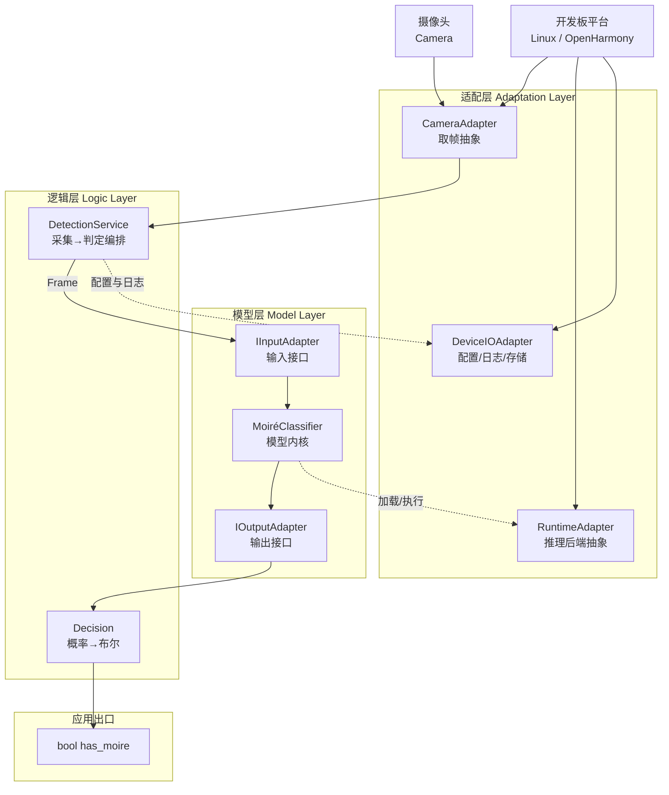

# 摩尔纹视觉识别系统 — 系统架构

> **仓库**：`https://github.com/chunri3255425/SFRNet.git`
> **文档版本**：v2.0（软件化架构重构）
> **状态**：架构基线
> **部署形态**：带摄像头的开发板，同时支持 Linux 与鸿蒙（OpenHarmony）双系统

---

## 1. 项目目标

在一台**带摄像头的开发板**上运行摩尔纹检测能力：

```
摄像头采集一张图像  →  判断图中是否存在摩尔纹  →  输出一个布尔值
```

系统的全部输出就是这一个布尔量。不要求像素级掩膜、区域可视化、面积占比报表——这些是模型内部能力，不是系统对外承诺。

**核心指标**：单帧从采集到给出结论的端到端延迟，以及判定的准确/漏检/误报。

---

## 2. 技术选型约束

| 项 | 决策 | 说明 |
|---|---|---|
| 开发板 | **硬件待定，架构上抽象** | 具体型号后续确定；本文不绑定任何 SoC 厂商 SDK，接口层隔离 |
| 操作系统 | **Linux 与鸿蒙双系统，同一套代码** | 系统差异全部收敛到适配层，业务代码零分支 |
| 开发语言 | **Python + PyTorch** | 算法与业务逻辑统一；端侧推理走 ONNX/量化图，运行时后端可替换 |
| 摄像头接口 | 抽象为"取帧"能力 | Linux 走 V4L2，鸿蒙走相机 Kit，上层无感知 |

> **关于端侧性能的现实提醒**：PyTorch 模型（7,799,872 参数）无法直接在多数嵌入式开发板的 CPU 上实时运行。架构上必须预留**模型编译/量化通道**（PyTorch → ONNX → 板端推理运行时）。这一能力由适配层的推理后端接口承载，见 §4.3。

---

## 3. 总体架构

### 3.1 三层结构



### 3.2 三层职责

| 层 | 职责 | 红线 |
|---|---|---|
| **适配层** | 屏蔽平台差异：怎么取一帧、用哪个后端跑模型、配置和日志落在哪 | ❌ 不含任何判定逻辑 ❌ 不懂"摩尔纹"是什么 |
| **模型层** | 把一帧图规范成张量、调模型、把输出规范成统一的概率图；两个预留接口负责输入/输出的形态转换 | ❌ 不做布尔判定 ❌ 不做平台判断 ❌ 不做文件 IO |
| **逻辑层** | 编排一次完整检测：触发采集 → 调模型 → 阈值判定 → 返回布尔值 | ❌ 不 import 任何平台 SDK ❌ 不碰 `state_dict` |

**依赖方向严格单向**：逻辑层 → 模型层 → （仅通过适配层接口访问）平台。

**为什么这样分**：开发板型号未定、双系统并行，平台相关的东西必须集中在一处。适配层的存在使得"换板子"或"换系统"不会触碰一行业务代码。

---

## 4. 各层设计

### 4.1 适配层

三个抽象接口，各自对应一类平台差异。

```python
# ── 4.1.1 摄像头 ─────────────────────────────
class ICameraAdapter(ABC):
    """把"取一帧"这件事抽象出来，屏蔽 V4L2 / 鸿蒙相机 Kit 的差异。"""

    @abstractmethod
    def open(self, **kwargs) -> None: ...

    @abstractmethod
    def grab(self) -> "Frame":
        """阻塞取一帧，返回 Frame(width, height, channels, timestamp, data)"""
        ...

    @abstractmethod
    def close(self) -> None: ...


# ── 4.1.2 推理后端 ───────────────────────────
class IRuntimeAdapter(ABC):
    """把"跑一次前向"抽象出来，屏蔽 PyTorch / ONNX Runtime / NPU SDK 的差异。

    开发机用 TorchRuntime；板端用 OnnxRuntime 或厂商 SDK 后端。
    上层只调用 infer()，不关心底下是什么。
    """

    @abstractmethod
    def load(self, model_path: str, **kwargs) -> None: ...

    @abstractmethod
    def infer(self, tensor) -> "np.ndarray | torch.Tensor":
        """输入 [1,3,H,W]，输出 [1,1,H,W] raw logits（未过 sigmoid）"""
        ...

    @abstractmethod
    def warmup(self) -> None: ...


# ── 4.1.3 设备 IO ────────────────────────────
class IDeviceIO(ABC):
    """配置读写、日志落盘、临时目录。两套系统的路径约定不同，统一在此。"""

    @abstractmethod
    def read_config(self) -> dict: ...

    @abstractmethod
    def log(self, level: str, msg: str) -> None: ...

    @abstractmethod
    def temp_dir(self) -> str: ...
```

**平台差异对照表**（实现时按此表填各子类）：

| 能力 | Linux 实现 | 鸿蒙实现 |
|---|---|---|
| 取帧 | `V4L2CameraAdapter`（`/dev/video*`） | `OhosCameraAdapter`（相机 Kit / NAPI） |
| 推理 | `TorchRuntime`（开发）/ `OnnxRuntime`（部署） | 同上，或厂商 NPU 后端 |
| 配置路径 | `~/.config/moireguard/` | 应用沙箱 `filesDir` |
| 日志 | `~/.local/state/moireguard/logs/` | 应用沙箱 `cacheDir/logs/` |
| 进程入口 | `python -m app.main` | ArkTS 壳调 Python 运行时，或独立进程 + IPC |

### 4.2 模型层（两个预留接口）

模型层的唯一使命：把平台送来的一帧，变成标准化的 logits；把 logits 变成标准化的输出对象。**输入形态与输出形态的转换规则集中在这两个接口里**，使得换模型、换输入格式、换输出语义都只改一处。

#### 接口一：`IInputAdapter` — 输入接口

```python
@dataclass(frozen=True)
class InputMeta:
    src_width: int
    src_height: int
    channels: int          # 1 / 3 / 4
    source_id: str         # 帧序号或时间戳，用于日志追溯
    scale_x: float = 1.0   # 若内部做过缩放，记录比例
    scale_y: float = 1.0


class IInputAdapter(ABC):
    """外部图像对象 → 模型可消费的张量。

    契约：
      C1. 返回 shape 必须为 [1, 3, H, W]，float32
      C2. 值域必须落在 [0.0, 1.0]，无 NaN/Inf
      C3. 色彩顺序必须是 RGB（不是 BGR）
      C4. 不做 tile 切分（属逻辑层职责）
      C5. 不修改传入对象
    """

    @abstractmethod
    def from_external(self, obj) -> tuple["torch.Tensor", InputMeta]: ...

    @abstractmethod
    def to_external(self, tensor, meta) -> object: ...
```

#### 接口二：`IOutputAdapter` — 输出接口

```python
@dataclass(frozen=True)
class DetectorOutput:
    logits: "torch.Tensor"   # [1,1,h,w]，未激活
    out_width: int           # 可与 input 不同分辨率
    out_height: int
    meta: InputMeta


class IOutputAdapter(ABC):
    """模型原始输出 → 统一输出契约。

    契约：
      O1. 保留 raw logits，不得先 sigmoid
      O2. shape 必须为 [1,1,h,w]，单通道
      O3. 不做阈值二值化
      O4. 若分辨率与输入不同，必须实现 resample_to_source()
    """

    @abstractmethod
    def to_external(self, raw, meta) -> DetectorOutput: ...

    @abstractmethod
    def resample_to_source(self, out: DetectorOutput) -> DetectorOutput: ...
```

> **O1 为什么重要**：Sigmoid 是非线性的。若下游对"已 sigmoid 的概率"做任何平均或聚合，与对 logits 聚合是两回事（$\sigma(\mathbb{E}[\ell]) \neq \mathbb{E}[\sigma(\ell)]$）。把融合统一在 logits 域、sigmoid 只在判定时施加一次，可避免同一模型在不同环节给出不一致的置信度。

#### 模型内核与注册表

```python
@dataclass(frozen=True)
class ModelBundle:
    model_id: str
    display_name: str
    core_factory: Callable[[], "MoiréClassifier"]
    input_adapter_factory: Callable[[], IInputAdapter]
    output_adapter_factory: Callable[[], IOutputAdapter]
    input_size: int          # 模型期望的输入边长（SFRNet 为 512）
    default_threshold: float
```

新增模型只需：实现内核类 → （如需）写两个 Adapter → 在注册表登记一行。**逻辑层与适配层零改动。**

### 4.3 逻辑层

#### `DetectionService` — 对外唯一入口

```python
@dataclass
class DetectionRequest:
    model_id: str = "sfrnet_uhd"
    threshold: float = 0.5          # 像素级
    pixel_ratio: float = 0.01       # 判定为"有摩尔纹"所需的最小面积占比
    model_input_size: int | None = None


@dataclass
class DetectionResult:
    has_moire: bool                 # ★ 系统唯一对外输出
    coverage: float                 # 内部诊断用，不对外承诺
    elapsed_ms: float
    frame_id: str
    warnings: list[str]


class DetectionService:
    def __init__(self, camera: ICameraAdapter,
                 runtime: IRuntimeAdapter,
                 registry: ModelRegistry,
                 io: IDeviceIO): ...

    def detect_once(self, req: DetectionRequest) -> DetectionResult:
        """完整一次检测：取帧 → 适配 → 推理 → 后处理 → 判定"""
        ...

    def run_forever(self, req: DetectionRequest,
                    on_result: Callable[[DetectionResult], None]) -> None:
        """连续检测循环，供常驻场景使用"""
        ...
```

#### 判定链路（一次 `detect_once`）

```
1. camera.grab()                            → Frame
2. input_adapter.from_external(frame)       → Tensor[1,3,H,W] + Meta
3. ── 尺寸适配 ──
     若 H,W > input_size：滑窗切块，逐块推理后融合（logits 域加权平均）
     若 H,W < input_size：反射填充至 input_size，融合后裁回
     若相等：单次前向
4. output_adapter.to_external(...)          → DetectorOutput(logits)
5. prob = sigmoid(logits)                   ← 全流程唯一的 sigmoid
6. coverage = (prob > threshold).mean()
7. has_moire = coverage > pixel_ratio       ★ 布尔结论
8. return DetectionResult
```

**判定规则的选择理由**：单点判据（任一像素超阈值即判 True）对孤立噪点极敏感；纯面积占比判据更稳。因此采用"像素阈值 + 面积占比"双门限，`coverage` 作为内部诊断量保留在结果里，便于现场调参，但**不写入对外契约**。

### 4.4 关于"结果导出"

系统对外的结果就是一个布尔量。落地方式按场景二选一：

| 场景 | 输出方式 |
|---|---|
| 调试/开发 | 标准输出打印 `True` / `False`，或每帧一行 `{frame_id, has_moire}` |
| 板端常驻 | 布尔量驱动一个物理指示（GPIO 电平 / 屏幕角标 / LED），由适配层的 `IDeviceIO` 扩展实现 |

不产出图片文件、不产出报告、不建结果数据库。

---

## 5. 目录结构

```
SFRNet/
├── utils/sfr/                  # 上游模型定义（冻结，不改）
│   └── {sfrnet,safm,FRM}.py
├── assets/weights/             # SFR_best.pth
├── configs/default.yaml
│
├── app/
│   ├── main.py                 # 入口：装配三层，跑单帧或常驻循环
│   │
│   ├── adaptation/             # ── 适配层
│   │   ├── camera/
│   │   │   ├── base.py         # ICameraAdapter
│   │   │   ├── v4l2.py         # Linux
│   │   │   └── ohos.py         # 鸿蒙
│   │   ├── runtime/
│   │   │   ├── base.py         # IRuntimeAdapter
│   │   │   ├── torch_runtime.py
│   │   │   └── onnx_runtime.py
│   │   ├── device_io/
│   │   │   ├── base.py         # IDeviceIO
│   │   │   ├── linux_io.py
│   │   │   └── ohos_io.py
│   │   └── factory.py          # 按平台自动选择实现
│   │
│   ├── model_layer/            # ── 模型层
│   │   ├── contracts.py        # ★ 两个预留接口 + 数据契约
│   │   ├── builtin_adapter.py  # 默认实现（RGB 输入 / 单通道输出）
│   │   ├── registry.py         # ModelRegistry
│   │   └── detectors/
│   │       └── sfrnet.py       # MoiréClassifier 实现
│   │
│   └── logic_layer/            # ── 逻辑层
│       ├── detection_service.py
│       ├── sliding_window.py   # 切块与融合
│       └── exceptions.py
│
└── tests/
```

**引用约束**：`utils.*` 只允许在 `app/model_layer/detectors/sfrnet.py` 中 import 一次。适配层以外的代码不得出现 `v4l2`、`ohos`、`onnx` 等平台字样。

---

## 6. 关键约束与已知风险

| # | 事项 | 影响 | 应对 |
|---|---|---|---|
| 1 | 板端算力未知 | PyTorch 原生模型可能跑不到实时 | 适配层 `IRuntimeAdapter` 预留 ONNX/量化后端；模型层不感知 |
| 2 | 开发板未定 | 摄像头驱动、NPU SDK 均未定 | `ICameraAdapter` 隔离；板型确认后只补一个子类 |
| 3 | 双系统同一套代码 | 需保证业务代码零平台分支 | 平台判断只允许出现在 `adaptation/factory.py` 一处 |
| 4 | 鸿蒙 Python 运行时可用性 | 鸿蒙上跑 CPython + PyTorch 生态支持有限 | 备选：Python 独立进程 + IPC，由 ArkTS 壳展示结果；此路径下逻辑层代码完全复用 |
| 5 | 上游模型无 Sigmoid 末端 | 输出是 logits 而非概率 | 契约 O1 保证下游统一施加 |
| 6 | 上游 `predict.py` 小图推理崩溃（画布未随 pad 扩大） | 直接搬用会崩 | 逻辑层滑窗自行处理填充与裁剪，不复用该脚本 |

---

## 7. 待定项

| # | 开放项 | 影响范围 |
|---|---|---|
| Q1 | 开发板具体型号与算力 | 决定推理后端与是否必须量化 |
| Q2 | 摄像头分辨率与取帧帧率 | 决定是否必须滑窗、单帧延迟预算 |
| Q3 | 是否要求实时连续检测（帧率目标） | 决定 `run_forever` 是否需多线程流水线 |
| Q4 | 布尔结果的物理呈现方式（GPIO / 屏幕 / 仅串口） | 决定 `IDeviceIO` 的扩展方向 |
| Q5 | `pixel_ratio` 的取值 | 需用真实场景样本标定 |

---

**文档结束。**
