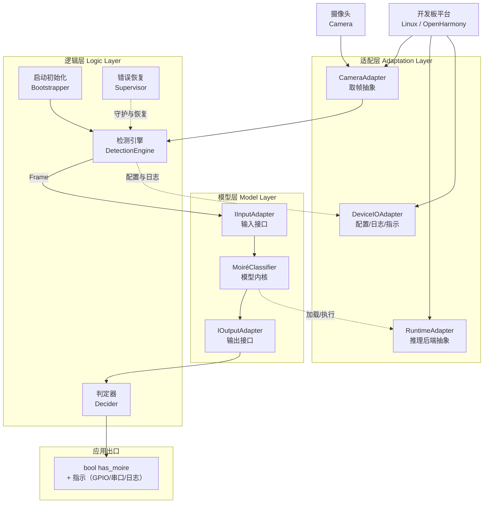
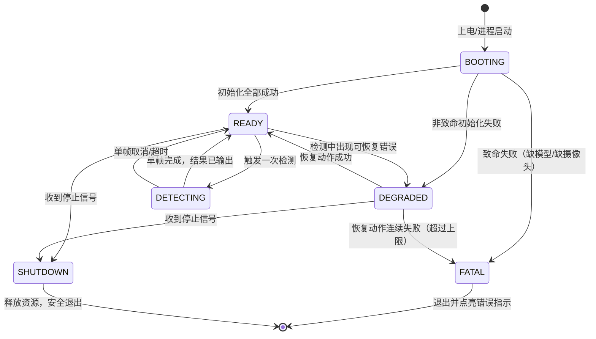

# 摩尔纹视觉识别系统 — 系统架构

> **仓库**：`https://github.com/chunri3255425/SFRNet.git`
> **文档版本**：v2.3（锁定摄像头 IMX415；新增 SSH 运维通道与 WiFi 画面回传）
> **状态**：架构基线
> **部署形态**：带摄像头的开发板，同时支持 Linux 与鸿蒙（OpenHarmony）双系统

---

## 1. 项目目标与交付品

在一台**带摄像头的开发板**上运行摩尔纹检测能力：

```
摄像头采集一张图像  →  判断图中是否存在摩尔纹  →  输出一个布尔值
```

系统的全部输出就是这一个布尔量。不要求像素级掩膜、区域可视化、面积占比报表——这些是模型内部能力，不是系统对外承诺。

### 1.1 目标硬件：触觉智能 Purple Pi OH2

| 项 | 规格 | 对本设计的影响 |
|---|---|---|
| 型号 | 触觉智能（Industio）Purple Pi OH2 | 厂商提供 Linux 与 OpenHarmony 双系统支持，契合本项目双系统要求 |
| SoC | 瑞芯微 **RK3576**（4×Cortex-A72 + 4×Cortex-A53，另含 M0 协处理器）。**大小核频率已上电实测**：A72（`CPU part 0xd08`）档顶 **2208 MHz**、A53（`0xd03`）档顶 **2016 MHz**。⚠️ 本文早期版本把两档都写成 2.2 GHz，实测 **A53 到不了 2.2 GHz** | CPU 本身也有可观算力，可作 NPU 故障时的软回退；A72 代际低于 RK3588S 的 A76，软回退与 CPU 侧融合/后处理的吞吐需按此下调预期。A53 侧预算按 **2.016 GHz** 而非 2.2 GHz 估。实测来源见 [BOARD_BRINGUP §2](../guides/BOARD_BRINGUP.md) |
| 内存/存储 | **4 GB + 64 GB eMMC**（订单 SKU：Purple Pi OH2 开发板 4+64G）。内存类型两处口径不一致：商品主图写"高速 LPDDR5"，系列规格页另见 LPDDR4/4X@4266。**已上电实测**：`MemTotal` = 3,990,676 kB（4 GB 吻合）；`dmc available_frequencies` = **534 / 1320 / 1968 / 2736 MHz**，`normal_rate` = 1968 MHz；`androidboot.fwver` 含 `ddr-v1.10-9071d8ccd4`。⚠️ 档位表里**没有 LPDDR5 应有的 3200+ 档**，最高仅 2736 —— **"LPDDR5" 说法不成立**；但板上读不到 DDR 类型节点（debugfs 未挂载、无 `/proc/ddrinfo`），**具体是 LPDDR4 还是 4X 仍不作断言**，要坐实只能取厂商 SDK 的 dts | 量化后模型与运行时占用 < 500 MB，余量充足；4 GB 内存需注意 4K 图融合缓冲（见 §6 风险 #1）。内存类型只影响实测吞吐预期，不改变任何接口设计。eMMC 代际已实测确认为 **5.1**（`mmc0: new HS400 Enhanced strobe MMC card`） |
| NPU | **6 TOPS INT8**（RKNN 生态，支持 INT4/INT8/INT16/FP16/TF32；片上 SRAM 1 MB）。**已实测调频档位**：`/sys/class/devfreq/27700000.npu` = **300–950 MHz** 八档（300/400/500/600/700/800/900/950），governor `rknpu_ondemand` | 推理后端锁定 **RKNN Runtime**；模型走 `pth → ONNX → RKNN` 转换链。TOPS 与 RK3588S 同为 6，但核数与微架构不同（公开资料对核数口径不一致，本文不作断言），单块延迟必须以实板实测为准。⚠️ governor 是 `ondemand`，意味着**冷启动首帧跑在低档**，任何延迟实测都必须先 warmup 再计时，否则数字不可比（与 `torch_runtime` 的 warmup 治理同一动机） |
| 2D 引擎 | 自带 **RGA** 光栅化加速器 | resize / 色彩转换 / 格式拷贝可卸载到 RGA，4K 输入预处理与融合缓冲的 CPU 占用由此降低（`adaptation` 侧可选优化，非首版必需） |
| 视频输入 | **多路 AHD 视频输入**（商品主图标注） | 除 MIPI CSI 外还有一条候选取帧通路；AHD 若走 V4L2 节点，则 `ICameraAdapter` 只是换一个 device path，业务层无感。是否启用属 Q2 剩余项 |
| 视频解码 | **4K@120fps**（商品主图标注；RK3576 硬件解码器） | 若输入源是码流而非裸帧，解码可交硬件，不必占用 NPU 与 CPU；当前设计按裸帧取图，暂未用到 |
| 网络 | **双千兆网口**（商品主图标注） | 硬件上具备"一路进产线网、一路点对点接巡检机"的隔离条件。⚠️ 但本文 §1 与 §4.4 对外的承诺仍然只有一个布尔量，输出走 `IDeviceIO.indicate`；HTTP/SSE 出口是本轮代码新增能力（`adaptation/network/`，配置默认 `enabled: false`），**尚未在本文立项**，是否升为正式输出通道待 Q4 一并定夺 |
| 烧录 | RKDevTool / 升级固件（.img 刷机包）。**已实板确认只有 USB 直连一条路**：厂商《上手指南》§八通篇是 OTG + Loader/Maskrom，**无 SD 启动路径**；TF 卡座是外设存储（功能表原文"TF卡(测试传输8G文件)"） | 镜像构建产出 RK3576 参数化 .img，Q6 已解。首轮点板用厂商预编译固件 `IDO_PurplePiOH2_V1B_Ubuntu22.04_HDMI4K_250907R.img`（选型与拒绝项见 [BOARD_BRINGUP §4](../guides/BOARD_BRINGUP.md)）；⚠️ 烧录只能在 Windows 主机做，WSL 不透传 USB |
| 摄像头接口 | MIPI CSI ×2（板载）+ USB；ISP 为 RKISP V3.9（16M pixel、HDR 120dB，与主图"16M ISP"一致）。厂商《Linux 使用手册》：板上实为 **3 路**摄像头座 J19/J20/J25，**J19 与 J25 默认适配 IMX415，J20 默认适配 OV13855** | 优先 MIPI CSI 摄像头（RKISP 硬件 ISP），Linux 走 V4L2。**已随板购入 IMX415 模组**（订单含"Purple Pi OH2 + IMX415 摄像头"），即 8MP/4K 级 MIPI CSI-2 传感器，Q2 的接口之争基本落定。⚠️ 接 IMX415 必须用 **J19 或 J25**；插 J20 不报错但画面偏绿，属"能跑但结果是错的"一类，已列入验收清单 |
| **摄像头型号（已定）** | **Sony IMX415**（MIPI CSI-2 接口，经板载 RKISP） | 1/2.8" STARVIS，8.46 MP，最高 3840×2160@30fps —— 传感器原生分辨率与模型 4K 基准（UHDMD）一致，滑窗参数（tile 512 / stride 256）无需调整；低照灵敏度高，适配现场光照不均的屏摄场景。Linux 下经 RKISP 驱动暴露 `/dev/video*`，V4L2 取帧即可，**无需新增驱动层抽象**（Q2 已解） |

**推理后端决策随之收敛**：

```
开发机（x86 + PyTorch）:  TorchRuntime（已有实现）
板端 Linux/OpenHarmony:  RknnRuntime（新增，实现 IRuntimeAdapter）
                          └── 模型文件：SFR_best.pth → ONNX → rknn（int8 量化）
软回退：                   OnnxRuntime CPU（NPU 驱动异常时），A53 小核上仍可低速运行
```

RKNN Runtime 是纯 C 库，Python 侧通过 `rknn-toolkit-lite2`（板端推理用）调用，无需在板上装 PyTorch。

### 1.2 交付形态：可烧录镜像

**最终交付品是一个可以直接烧录进开发板的系统镜像**，不是需要用户手动配置环境的源码包。镜像内容：

| 组成 | 内容 | 说明 |
|---|---|---|
| 操作系统 | Linux 发行版 / OpenHarmony（Purple Pi OH2 官方镜像为基座） | 双系统各构建一条流水线 |
| 运行时 | Python 解释器 + **rknn-toolkit-lite2**（板端 NPU 推理） | 随镜像预装，不依赖联网；板上不装 PyTorch |
| 应用本体 | `app/` 打包后的检测程序 | 上电自启动（systemd / 系统服务） |
| 模型资产 | 量化后的 **.rknn** 模型文件（由 `SFR_best.pth` 转换） | 随镜像固化于 `/usr/share/moireguard/models/` |
| 配置 | `default.yaml` 烧录内置默认值 | 现场可覆盖（见 §4.3.6） |

**构建流水线**（开发机执行，产出镜像）：

```
SFR_best.pth ──导出──> ONNX ──rknn-toolkit2（x86 开发机）──> .rknn（int8 量化）
app/ 源码    ──打包──> 独立运行包（免依赖安装）
                │
                ├──> Linux：        Purple Pi OH2 官方镜像 + 根文件系统叠加（systemd 自启服务）
                └──> OpenHarmony：  OH 镜像构建系统产物 + HAP/独立进程
                          │
                          ▼
                  可烧录镜像（.img，RKDevTool 刷机包）──烧录──> 开发板上电即跑
```

注意分工：**rknn-toolkit2 装在 x86 开发机上做模型转换**；**rknn-toolkit-lite2 装在板上做推理**。两者不可装反。

**验收口径**：拿到一块空白开发板 → 烧录镜像 → 接摄像头 → 上电 → 无任何手动配置 → 系统自动开始检测并输出布尔结果。这是交付测试的唯一标准。

---

## 2. 技术选型约束

| 项 | 决策 | 说明 |
|---|---|---|
| 开发板 | **触觉智能 Purple Pi OH2**（RK3576，4GB+64GB，NPU 6 TOPS） | 板型已锁定，见 §1.1；SoC 型号曾误记为 RK3588S，已按实购订单更正（订单为 OH2 4+64G 整板与 OH2 核心板+IMX415 摄像头各 2 件）；厂商 SDK（RKNN/RKISP/刷机工具）允许进入适配层与 `build/`，仍不允许进入逻辑层与模型层 |
| 操作系统 | **Linux 与鸿蒙双系统，同一套代码** | 系统差异全部收敛到适配层，业务代码零分支；镜像构建各自一条流水线 |
| 开发语言 | **Python + PyTorch（开发）/ RKNN Runtime（板端）** | 板端推理走 NPU，加载 int8 量化的 .rknn 模型；板上不跑 PyTorch |
| 摄像头接口 | 抽象为"取帧"能力 | Linux 走 V4L2（MIPI CSI 经 RKISP），鸿蒙走相机 Kit，上层无感知 |
| 上电行为 | 应用自启动 | 烧录后无需登录 shell 手动拉起 |
| 远程运维 | **SSH 连接开发板** | 开发与运维统一走 SSH：部署/更新配置用 `scp`，查日志、重启服务、故障排查走 `ssh`；SSH 仅是**运维控制面**，不进检测数据面（检测链路不依赖网络可达） |
| 画面回传 | **WiFi 传输画面到上位机** | 板端通过 WiFi 将采集帧（可选叠加判定结果）实时回传给开发/演示主机，便于远程观察现场画面；属**旁路诊断面**，可关闭、失败不致命，见 §4.5 |

> **关于端侧性能的现实预估**（2026-11-05 开发机实测后重写；本文早期推算已被实测证伪）
>
> **算力实测**：SFRNet 共 7,799,872 参数，单块 512×512 前向 **178.6 G-MAC ≈ 357 GFLOPs**（forward hook 统计 Conv2d+Linear，未含逐元素与注意力矩阵乘）。**本文早期假设的"约 1.5 GFLOPs"低估约 238 倍**，据此得出的所有延迟结论作废。热点与结构一致：最贵的 6 层里 4 条落在 `d3.*.safm.basic_block.conv_layers` 与 `d1/d2/d3.r1.c1.2`，即全分辨率处的 3×3 膨胀卷积——网络最深只下采样到 1/8，绝大部分算力花在高空间分辨率上。
>
> **开发机实测**（RTX 5060 Ti，fp32，torch eager，batch=1）：单块 **163 ms**；batch=8 摊薄后 138 ms/块（几乎不随 batch 下降 → 是算力/带宽受限，不是内核启动开销）；fp16 119 ms（仅 1.4×）；4K 全图 112 块端到端 **20.1 s**，其中滑窗融合 + 两次 PNG 编码约 1.3 s（占 6%，主体耗时确为前向）。折合有效吞吐 2.19 TFLOP/s，约为该卡 fp32 峰值的一成——torch 侧没有明显浪费，慢在模型结构本身。
>
> **对 RK3576 的直接推论**：6 TOPS(int8) 对 357 GOPs/块，**即使 100% 利用率也要 60 ms/块**；按 30–50% 的现实利用率取 120–200 ms/块，一张 4K 图 **13–22 s**。故原来的"5–20 ms/块、0.6–2.2 s/帧"不再成立，**当前架构在板上做不到实时**，且这个量级不是 int8 量化或调 stride 能翻盘的。板上真实数字仍须 M1 实测，但量级已由上面的算术锁定。
>
> **可行的收敛方向**（均需实测验证，按依据强弱排序）：① **结构化裁剪砍 `d3`**——与实测热点直接对应，是本项目最有依据的一条；② **降低检测输入分辨率**——布尔判定不要求像素级定位，1080p 下块数降到约 28，缩放记入 `InputMeta.scale_x/y`；③ **加大 stride**（256→512 使块数近乎减半，代价是融合边界质量）；④ 用 **RGA** 承担缩放与格式转换，把 CPU 从数据通路里摘出来。
>
> 另需正视：已购 IMX415 本身就是 4K 级传感器，**112 块是常态负载而不是最坏情况**。
---

## 3. 总体架构

### 3.1 三层结构



### 3.2 三层职责

| 层 | 职责 | 红线 |
|---|---|---|
| **适配层** | 屏蔽平台差异：怎么取一帧、用哪个后端跑模型、配置和日志落在哪、布尔结果如何指示 | ❌ 不含任何判定逻辑 ❌ 不懂"摩尔纹"是什么 |
| **模型层** | 把一帧图规范成张量、调模型、把输出规范成统一的 logits；两个预留接口负责输入/输出的形态转换 | ❌ 不做布尔判定 ❌ 不做平台判断 ❌ 不做文件 IO |
| **逻辑层** | 系统的**操作主体**：上电初始化、检测循环、判定、异常恢复、优雅退出 | ❌ 不 import 任何平台 SDK ❌ 不碰 `state_dict` |

**依赖方向严格单向**：逻辑层 → 模型层 → （仅通过适配层接口访问）平台。

**为什么这样分**：交付品是烧录镜像，意味着系统是**无人值守常驻运行的**——上电自启、出错自恢复、断电安全。这些"操作逻辑"全部属于逻辑层，必须显式设计，不能靠人守着终端。

---

## 4. 各层设计

### 4.1 适配层

三个抽象接口，各自对应一类平台差异。

```python
# ── 4.1.1 摄像头 ─────────────────────────────
class ICameraAdapter(ABC):
    """把"取一帧"这件事抽象出来，屏蔽 V4L2 / 鸿蒙相机 Kit 的差异。"""

    @abstractmethod
    def open(self, **kwargs) -> None: ...

    @abstractmethod
    def grab(self) -> "Frame":
        """阻塞取一帧，返回 Frame(width, height, channels, timestamp, data)"""
        ...

    @abstractmethod
    def close(self) -> None: ...


# ── 4.1.2 推理后端 ───────────────────────────
class IRuntimeAdapter(ABC):
    """把"跑一次前向"抽象出来，屏蔽 ONNX Runtime / NPU SDK 的差异。

    镜像内固化的是量化模型文件；开发机调试时亦可用 Torch 后端。
    """

    @abstractmethod
    def load(self, model_path: str, **kwargs) -> None: ...

    @abstractmethod
    def infer(self, tensor) -> "np.ndarray | torch.Tensor":
        """输入 [1,3,H,W]，输出 [1,1,H,W] raw logits（未过 sigmoid）"""
        ...

    @abstractmethod
    def warmup(self) -> None: ...


# ── 4.1.3 设备 IO ────────────────────────────
class IDeviceIO(ABC):
    """配置、日志、临时目录、布尔结果的物理指示。两套系统的路径与外设约定不同，统一在此。"""

    @abstractmethod
    def read_config(self) -> dict: ...

    @abstractmethod
    def log(self, level: str, msg: str) -> None: ...

    @abstractmethod
    def indicate(self, has_moire: bool) -> None:
        """布尔结果的物理呈现：GPIO 电平 / LED / 屏幕角标 / 串口输出"""
        ...
```

**平台差异对照表**（实现时按此表填各子类）：

| 能力 | Linux 实现 | 鸿蒙实现 |
|---|---|---|
| 取帧 | `V4L2CameraAdapter`（`/dev/video*`，MIPI CSI 经 RKISP 驱动） | `OhosCameraAdapter`（相机 Kit / NAPI） |
| 推理 | `RknnRuntime`（rknn-toolkit-lite2 + NPU）/ `TorchRuntime`（开发机） | 同左（OH 版 Purple Pi OH2 同样暴露 RKNN Runtime） |
| 配置路径 | `/etc/moireguard/`（镜像内置）+ `/var/lib/moireguard/`（现场覆盖） | 应用沙箱 `filesDir` |
| 日志 | `/var/log/moireguard/`（logrotate 滚动） | 应用沙箱 `cacheDir/logs/` |
| 自启动 | systemd 服务单元 | 系统服务 / ArkTS 壳拉起 |
| 布尔指示 | GPIO sysfs / 串口 / LED（板载 40-pin 排针可用） | GPIO NAPI / 屏幕 |
| 远程运维 | OpenSSH 服务（镜像内置，`systemd` 拉起，固定静态 IP 或 mDNS 发现） | OH 端用 sftp/hdc 替代，运维动作收敛到 `IDeviceIO` |
| 画面回传 | `WifiFrameRelay`（TCP socket，JPEG 压缩，见 §4.5） | 同左（OH 侧经 WiFi NAPI 连接） |

**RknnRuntime 的三个实现要点**（新增时按此执行）：

1. **输入布局**：RKNN 模型固定吃 `NHWC` uint8/float，与契约 C1（`NCHW` float32）不一致——转换放在 RknnRuntime 内部（`infer` 里做 permute + 量化 Scale 变换），**不改动 IInputAdapter**，契约 C1–C5 仍然成立。
2. **输出域**：.rknn 导出时**不加** sigmoid/激活后处理，保证 `infer` 返回的仍是 raw logits（契约 O1）。RKNN 转换参数里显式关掉 `reorder` 之外的自动后处理。
3. **量化校准集**：`build/export_model.py` 需提供 100–200 张真实屏摄图作校准集（不能只用合成图，见 §6 风险 #7），量化后逐块比对 logits，相对误差 > 5% 则降位宽或回退 fp16 的 .rknn。

### 4.2 模型层（两个预留接口）

模型层的唯一使命：把平台送来的一帧，变成标准化的 logits；把 logits 变成标准化的输出对象。**输入形态与输出形态的转换规则集中在这两个接口里**，使得换模型、换输入格式、换输出语义都只改一处。

#### 接口一：`IInputAdapter` — 输入接口

```python
@dataclass(frozen=True)
class InputMeta:
    src_width: int
    src_height: int
    channels: int          # 1 / 3 / 4
    source_id: str         # 帧序号或时间戳，用于日志追溯
    scale_x: float = 1.0   # 若内部做过缩放，记录比例
    scale_y: float = 1.0


class IInputAdapter(ABC):
    """外部图像对象 → 模型可消费的张量。

    契约：
      C1. 返回 shape 必须为 [1, 3, H, W]，float32
      C2. 值域必须落在 [0.0, 1.0]，无 NaN/Inf
      C3. 色彩顺序必须是 RGB（不是 BGR）
      C4. 不做 tile 切分（属逻辑层职责）
      C5. 不修改传入对象
    """

    @abstractmethod
    def from_external(self, obj) -> tuple["torch.Tensor", InputMeta]: ...

    @abstractmethod
    def to_external(self, tensor, meta) -> object: ...
```

#### 接口二：`IOutputAdapter` — 输出接口

```python
@dataclass(frozen=True)
class DetectorOutput:
    logits: "torch.Tensor"   # [1,1,h,w]，未激活
    out_width: int           # 可与 input 不同分辨率
    out_height: int
    meta: InputMeta


class IOutputAdapter(ABC):
    """模型原始输出 → 统一输出契约。

    契约：
      O1. 保留 raw logits，不得先 sigmoid
      O2. shape 必须为 [1,1,h,w]，单通道
      O3. 不做阈值二值化
      O4. 若分辨率与输入不同，必须实现 resample_to_source()
    """

    @abstractmethod
    def to_external(self, raw, meta) -> DetectorOutput: ...

    @abstractmethod
    def resample_to_source(self, out: DetectorOutput) -> DetectorOutput: ...
```

> **O1 为什么重要**：Sigmoid 是非线性的。若下游对"已 sigmoid 的概率"做任何平均或聚合，与对 logits 聚合是两回事（$\sigma(\mathbb{E}[\ell]) \neq \mathbb{E}[\sigma(\ell)]$）。把融合统一在 logits 域、sigmoid 只在判定时施加一次，可避免同一模型在不同环节给出不一致的置信度。

#### 模型内核与注册表

```python
@dataclass(frozen=True)
class ModelBundle:
    model_id: str
    display_name: str
    core_factory: Callable[[], "MoiréClassifier"]
    input_adapter_factory: Callable[[], IInputAdapter]
    output_adapter_factory: Callable[[], IOutputAdapter]
    input_size: int          # 模型期望的输入边长（SFRNet 为 512）
    default_threshold: float
```

新增模型只需：实现内核类 → （如需）写两个 Adapter → 在注册表登记一行。**逻辑层与适配层零改动。**

### 4.3 逻辑层 — 操作逻辑（本章细化）

逻辑层是系统在板上的"操作主体"。无人值守环境下，它要回答完整生命周期里的每个问题：上电后干什么、每一帧怎么处理、出错怎么办、配置怎么生效、怎么停。

#### 4.3.1 状态机

系统在任一时刻处于且仅处于以下状态之一：



各状态的对外含义（经 `IDeviceIO.indicate` 呈现）：

| 状态 | 含义 | 指示约定 |
|---|---|---|
| BOOTING | 正在初始化 | 布尔输出无效，指示"忙" |
| READY | 空闲，等待触发 | 布尔输出无效 |
| DETECTING | 正在处理一帧 | 布尔输出无效，指示"忙" |
| DEGRADED | 带病运行（见 4.3.5） | 沿用最近一次有效结果 + 警告标记 |
| FATAL | 无法继续 | 错误指示常亮，布尔输出固定为 False |

#### 4.3.2 启动序列（BOOTING → READY）

上电后按固定顺序执行，**任何一步失败立即判定致命/非致命，不静默跳过**：

```
1. 读取配置
     ├─ 读取顺序：镜像内置默认值 → 现场覆盖文件（若存在）
     └─ 配置解析失败 → 用内置默认值 + 记警告（非致命）
2. 初始化日志系统（IDeviceIO）
3. 探测平台，装配适配层实现（factory）
     └─ 平台探测失败 → FATAL（理论上不会发生）
4. 初始化推理后端（IRuntimeAdapter.load）
     ├─ 模型文件缺失 / 校验失败 → FATAL（缺模型无法工作）
     └─ 后端加载成功 → warmup() 预热一次（首次推理通常显著偏慢）
5. 打开摄像头（ICameraAdapter.open）
     ├─ 首次打开失败 → 重试 3 次（间隔 2s）
     └─ 仍失败 → FATAL（无输入源无法工作）
6. 取一帧做连通性自检（只验证管道通，不要求判定正确）
     └─ 取帧失败 → DEGRADED（可能摄像头预热中）
7. 全部通过 → READY，记录启动耗时
```

**关键决策**：模型缺失、摄像头缺失是**致命**的——镜像里两者都已固化，缺了任何一样说明镜像损坏或硬件故障，重启也救不回来，直接进 FATAL 并点亮错误指示。而配置损坏是**非致命**的——退回默认值继续跑，因为默认值足以完成基本功能。

#### 4.3.3 单帧检测流程（READY → DETECTING → READY）

一次 `detect_once` 的完整操作序列：

```
输入：DetectionRequest(model_id, threshold, pixel_ratio, timeout_ms)

1.  状态检查：当前必须为 READY，否则拒绝并返回错误码 E-BUSY
2.  取帧：camera.grab()（带超时，默认 3000 ms）
      ├─ 超时/失败 → 抛 CaptureError，交由 Supervisor 处理
      └─ 成功 → Frame
3.  输入适配：input_adapter.from_external(frame)
      → Tensor[1,3,H,W] + InputMeta
4.  尺寸适配（按帧尺寸与模型 input_size 的关系三分支）：
      a. H,W > input_size：滑窗切块，逐块推理，logits 域加权融合，
         末行/末列强制贴边回退
      b. H,W < input_size：反射填充至 input_size，推理后裁回原尺寸
      c. 相等：单次前向
5.  输出适配：output_adapter.to_external(...) → DetectorOutput(logits)
      （若输出分辨率 ≠ 输入，内部完成 resample_to_source）
6.  判定（Decider，见 4.3.4）
7.  结果输出：IDeviceIO.indicate(has_moire) + 日志一行
      log 格式：{frame_id, has_moire, coverage, elapsed_ms, state}
8.  回到 READY
```

**每步的超时预算**（单帧端到端的耗时控制点）：

| 步骤 | 预算 | 超时后果 |
|---|---|---|
| 取帧 | 3000 ms | CaptureError |
| 前向（单块） | 5000 ms（板端按实测标定） | InferTimeout，整帧作废 |
| 单帧总计 | `timeout_ms`（请求参数） | 返回 E-TIMEOUT，帧作废 |

超时帧**作废重试**而非无限等待——无人值守系统宁可漏一帧，不能卡死在某一帧上。

#### 4.3.4 判定规则（Decider）

```
prob     = sigmoid(logits)              ← 全流程唯一的 sigmoid
coverage = mean(prob > threshold)       ← 超阈值像素的面积占比
has_moire = coverage > pixel_ratio      ★ 布尔结论
```

- **双门限设计**：单点判据（任一像素超阈值即 True）对孤立噪点极敏感；纯占比判据更稳。`threshold`（像素级，默认 0.5）先过滤置信度，`pixel_ratio`（面积级，默认 0.01）再过滤规模。
- `coverage` 保留在日志与诊断结果中，便于现场标定 `pixel_ratio`，但**不写入对外契约**。
- 判定结果**逐帧独立**：不做跨帧平滑、不做历史投票。连续多帧的一致性判断（如"连续 N 帧为 True 才告警"）属应用侧策略，V1 不做，但在 Decider 接口上预留 `smooth` 参数位。

#### 4.3.5 错误恢复（Supervisor，DEGRADED 的进出）

无人值守的核心：**出错不退出，恢复不无限**。

| 错误类别 | 典型场景 | 恢复动作 | 连续失败上限 | 达到上限后 |
|---|---|---|---|---|
| 取帧失败 | 摄像头瞬时掉线、缓冲区溢出 | 重开摄像头（close → open），间隔 2s | 5 次 | FATAL |
| 推理失败/超时 | NPU 异常、内存不足 | 释放资源 → 重载模型（load + warmup） | 3 次 | FATAL |
| 帧数据异常 | 全黑帧、解码损坏 | 跳过该帧，直接取下一帧 | 连续 10 帧 | DEGRADED 持续，维持警告 |
| 未知异常 | 任何未捕获异常 | 记录堆栈 → 完整重新初始化（回到 BOOTING 序列第 3 步） | 3 次 | FATAL |

**DEGRADED 状态的语义**：系统仍在运行并持续尝试恢复，期间布尔输出**沿用最近一次有效结果**并附带警告标记（指示层区分"新结果"与"旧结果"）。这样下游不会拿到突然跳变的 False。

**退避策略**：恢复动作采用固定间隔（2s）而非指数退避——嵌入式场景下简单可靠优先，且摄像头重开本身就有硬件级延迟。

#### 4.3.6 配置热更新

运行中允许不重启更新两个运行时参数：

| 参数 | 生效方式 | 是否中断检测循环 |
|---|---|---|
| `threshold` | 下一帧立即生效 | 否 |
| `pixel_ratio` | 下一帧立即生效 | 否 |
| `model_id` / `input_size` | 需重载模型（走恢复流程） | 短暂 |
| 其他（摄像头参数等） | 需重启进程 | 是 |

配置读取遵循**"镜像内置默认值 + 现场覆盖文件"两层**：烧录后的系统自带可靠默认值，现场调参只改覆盖文件，且覆盖文件解析失败时自动回退默认值（对应 4.3.2 第 1 步）。

#### 4.3.7 连续检测模式与优雅退出

```python
class DetectionEngine:
    def run_forever(self, req, on_result) -> None:
        """常驻循环：READY → DETECTING → READY → ...

        循环体内每轮：
          1. 检查停止信号（SIGTERM / 系统关机广播）→ 走 SHUTDOWN
          2. 检查配置版本号变化 → 热更新（4.3.6）
          3. 执行 detect_once（含全部错误处理）
          4. 等待触发间隔（按配置的检测频率；0 = 连续全速）
        """

    def shutdown(self) -> None:
        """优雅退出（SHUTDOWN 状态）：
          1. 停止接收新帧
          2. 等待当前帧完成（最多再等一个 timeout_ms）
          3. 按序释放：摄像头 → 推理后端 → 日志 flush
          4. 指示层熄灭；退出码 0 = 正常收摊，1 = 恢复超限（FATAL）
             —— unit 是 Restart=on-failure，FATAL 返 0 等于告诉 systemd 不必拉回
        """
```

**上电自启与关机安全**：镜像层面由 systemd 服务单元（Linux）或系统服务（鸿蒙）负责拉起与停止；进程只需正确响应停止信号。断电安全靠"无持久状态"设计——系统不在运行中写任何关键状态文件，重启后行为与冷启动完全一致。

#### 4.3.8 对外 API 汇总

逻辑层对外的全部接口（适配层与模型层不直接对外）：

| 方法 | 用途 |
|---|---|
| `DetectionEngine.bootstrap(config)` | 上电初始化，返回 READY / DEGRADED / FATAL |
| `DetectionEngine.detect_once(req)` | 单帧检测，返回 `DetectionResult` |
| `DetectionEngine.run_forever(req, on_result)` | 常驻检测循环 |
| `DetectionEngine.update_config(partial)` | 热更新参数 |
| `DetectionEngine.shutdown()` | 优雅退出 |
| `DetectionEngine.health() -> HealthReport` | 状态查询（当前状态、最近错误、累计统计） |

`DetectionResult` 的字段：`has_moire`（唯一对外承诺）、`coverage`、`elapsed_ms`、`frame_id`、`warnings`——后四项为诊断信息。

### 4.4 关于"结果导出"

系统对外的结果就是一个布尔量。落地方式按场景二选一：

| 场景 | 输出方式 |
|---|---|
| 调试/开发 | 标准输出打印 `True` / `False`，或每帧一行 `{frame_id, has_moire}` |
| 板端常驻 | 布尔量驱动一个物理指示（GPIO 电平 / 屏幕角标 / LED），由适配层 `IDeviceIO.indicate` 实现 |

不产出图片文件、不产出报告、不建结果数据库。

### 4.5 旁路能力：SSH 运维通道与 WiFi 画面回传

两者都属**旁路诊断面**——不参与检测判定链路，检测链路在完全断网时必须照常工作。

#### 4.5.1 SSH 运维通道

| 项 | 约定 |
|---|---|
| 定位 | 开发与运维的控制面：部署模型/配置（`scp`）、查日志与状态（`ssh`）、重启服务（`systemctl restart moireguard`） |
| 数据面隔离 | 检测循环**不依赖 SSH 可达**；SSH 断开时系统照常检测 |
| 镜像内置 | OpenSSH server 随镜像固化，systemd 自启；首次开机生成主机密钥 |
| 网络发现 | 有线/WiFi 环境下用静态 IP 或 mDNS（`moireguard-<serial>.local`）定位板子，免除每次查 IP |
| 约束 | 镜像内置默认口令仅在首次登录时强制修改；禁止把运维凭据写进代码仓库 |

#### 4.5.2 WiFi 画面回传（`IFrameRelay`）

**定位**：把板端采集的画面实时传给开发/演示主机，用于远程观察现场（调试取景、远程演示、采集数据抽查）。它是**旁路**，失败只降级告警，绝不阻塞检测。

**适配层接口**（新增第四个抽象，实现仍收敛在适配层）：

```python
class IFrameRelay(ABC):
    """把一帧画面经 WiFi 推给上位机。旁路能力：失败不致命。"""

    @abstractmethod
    def start(self, host: str, port: int, **kwargs) -> None: ...

    @abstractmethod
    def push(self, frame: "Frame",
             result: "DetectionResult | None" = None) -> bool:
        """非阻塞推送一帧。返回 False 表示本轮未发出（队列满/未连接）。"""

    @abstractmethod
    def stop(self) -> None: ...
```

**数据通路**：

```
DetectionService ──取帧成功后旁路挂接──> StreamTap（逻辑层，可配置开关）
    → JPEG 编码（板端 CPU，质量 60–80，4K 帧约 100–300 KB）
    → WifiFrameRelay.push()（独立发送线程 + 长度为 1 的队列）
    → TCP: host:port ──WiFi──> 上位机查看器（PC 端小工具，播放 + 显示 has_moire 角标）
```

**关键规则**：

| # | 规则 | 理由 |
|---|---|---|
| R1 | **丢旧保新（latest-wins）**：待发槽位恒为 1，新帧直接覆盖尚未发出的旧帧，上位机看到的永远是当前画面 | 带宽不够时宁可降帧率，不能让检测循环等待网络；回传的用途是"观察现场"，把旧帧补发出去只会误导观察者 |
| R2 | **push() 非阻塞**，总耗时预算 ≤ 5 ms（入队即返回，编码与发送都在独立线程） | 画面回传不得挤占单帧检测的耗时预算（§4.3.3） |
| R3 | **降帧率回传**：默认按固定间隔回传（如 5 fps 或每 N 帧一帧），而非全帧率 | 4K@30fps 原图回传需 >100 Mbps，现场 WiFi 扛不住；JPEG 压缩后 5 fps 约 1–2 Mbps，普通 WiFi 可行 |
| R4 | **可叠加判定结果**：编码前把 `has_moire`/coverage 以角标文字画进画面（可选开关） | 上位机无需解析第二通道即可看到结论 |
| R5 | **失败降级**：连接断开/发送超时 → 重连退避（2s 固定），连续 5 次失败 → 记 WARN + 状态转 DEGRADED 附带警告标记，**不 FATAL** | 旁路坏了主业务必须活着 |
| R6 | **分辨率可降**：回传前可下采样（如长边 1080），不影响板端检测用原图 | 进一步压缩带宽；检测与回传的分辨率解耦 |
| R7 | **默认关闭**：`relay.enabled: false` 为镜像默认值，现场用覆盖文件或 SSH 热配置打开 | 上电即跑的验收场景（§1.2）不应依赖网络 |

**配置项**（并入 `configs/default.yaml`）：

```yaml
relay:
  enabled: false        # 默认关闭（R7）
  host: "192.168.1.100" # 上位机地址
  port: 9000
  interval_frames: 6    # 每 6 帧回传 1 帧（≈5fps @30fps）
  jpeg_quality: 75
  downscale: 1080       # 长边降采样，0 = 原分辨率
  overlay_result: true  # 画面叠加 has_moire 角标
```

**为什么独立线程 + 单槽队列而不是 RTSP/网络流**：RTSP 服务端在板端引入额外依赖与配置成本，且本项目回传的是"观察用低帧率画面"而非"实时视频流"，一条 TCP 长连接 + JPEG 帧序列（自定义 4 字节长度前缀分包）即可满足，上位机用任何语言 20 行可写接收端。若后续确需标准流媒体，仅需在适配层新增 `RtspRelay(IFrameRelay)` 实现，逻辑层零改动。

---

## 5. 目录结构

```
SFRNet/
├── upstream/sfr/               # 上游模型定义（冻结，不改）
│   └── {sfrnet,safm,FRM}.py
├── upstream/                   # + data_loding.py / metrics.py（训练侧，产品路径不调用）
├── assets/weights/             # SFR_best.pth（板端模型的转换源，不入库）
├── samples/                    # 屏摄样张与对照实验图（本地调试用，不入库）
│
├── app/                        # ★ 软件主体（唯一包，历史 moireguard/ 双真源已消除）
│   ├── main.py                 # ★ 唯一组合根：装配 + 四种形态（常驻循环 / --detect /
│   │                           #   --serve-net / --selftest），平台分支只经 factory 一次
│   ├── adaptation/             # ── 适配层（对上层零感知，不得 import logic_layer）
│   │   ├── base.py             # ★ 抽象聚合 + DTO + 反向注入用 Protocol（IImageService 等）
│   │   ├── factory.py          # ★ 平台探测与实现装配（唯一允许平台分支处；缺能力显式报错）
│   │   ├── camera/{base,v4l2,ohos,fake,file_camera}.py
│   │   ├── runtime/{base,onnx_runtime,torch_runtime,rknn_runtime}.py
│   │   ├── relay/{base,wifi_frame_relay}.py   # WiFi 画面回传（旁路，见 §4.5）
│   │   ├── network/http_server.py             # HTTP/SSE 网络出口（代码先行，见 §4.4 待 Q4）
│   │   └── device_io/{base,linux_io}.py       # ohos_io 未落地（见下表缺口）
│   ├── model_layer/            # ── 模型层
│   │   ├── contracts.py        # ★ 两个预留接口 + 数据契约
│   │   ├── builtin_adapter.py  # 默认实现（RGB 输入 / 单通道输出）
│   │   ├── registry.py         # ModelRegistry（strict：未知 model_id / 缺权重即抛）
│   │   └── detectors/sfrnet_detector.py       # DetectorCore 实现
│   └── logic_layer/            # ── 逻辑层（不 import 平台 SDK / 不碰 state_dict / 不做平台判断）
│       ├── engine.py           # DetectionEngine（状态机 + 逐帧 + 重试降级，无独立 supervisor）
│       ├── bootstrapper.py     # 7 步启动序列（DEFAULTS 由 config.AppConfig 导出）
│       ├── config.py           # ★ 默认值唯一真源（dataclass）+ 分层 merge
│       ├── decider.py          # 双门限判定（全流程唯一一次 sigmoid）
│       ├── sliding_window.py   # 切块与余弦窗融合
│       ├── postprocess.py      # 开发/标定侧后处理（与 Decider 同界同判）
│       ├── inference_service.py# 单次推理编排（图片路径 → 结果，供网络出口调用）
│       ├── export_service.py   # 掩膜/热力图/JSON 导出
│       └── exceptions.py       # 错误分类与恢复策略映射
│
├── build/                      # 镜像构建流水线
│   ├── export_model.py         # SFR_best.pth → ONNX → .rknn（int8 量化 + 一致性比对）
│   ├── package_app.py          # app/ → 分层 stage 打包（/opt /etc /usr /var + systemd）
│   ├── image_linux/moireguard.service
│   └── tools/view_relay.py     # 上位机画面查看器
│
├── configs/{default.yaml,models.yaml}   # 镜像内置默认配置（超时待 M1 实测回填）
├── {train,predict}.py          # 上游训练/预测脚本（研究侧，不进镜像）
├── run_sim.py                  # 开发机模拟器：FileCamera 接进 DetectionEngine
├── serve.py                    # 兼容壳 → app.main（不再承接新逻辑）
└── tests/{smoke_board_pipeline,test_real_weights}.py
```

**引用约束**：`upstream.*` 只允许在 `app/model_layer/detectors/sfrnet_detector.py` 中 import 一次；`v4l2`、`ohos`、`onnx`、`rknn` 等平台字样只允许出现在 `app/adaptation/` 与 `build/` 之下；**适配层不得 import 逻辑层**（依赖方向只能是 逻辑层 → 模型层 → 适配层），跨层反向调用一律走 `adaptation/base.py` 里的 Protocol 由组合根注入。

**目录树与本文的已知缺口**（代码先行、文档尚未立项的部分，不粉饰）：

| 本文声称 | 实际状态 |
|---|---|
| `device_io/ohos_io.py` | 未落地，鸿蒙侧仅有 `camera/ohos.py` 占位 |
| `build/image_ohos/`、`build/calib/` | 目录不存在；鸿蒙流水线与 RKNN 量化校准集待 M1 |
| `logic_layer/supervisor.py` | 无此文件，重试与降级已并入 `engine.py`（C-10~C-13） |
| 网络出口（`adaptation/network/`） | 代码已可用（HTTP/SSE + token 鉴权），且常驻循环的逐帧判定现已真的接进 SSE（`--serve-net --loop`）；但 §1/§4.4 对外的正式承诺仍只有一个布尔量，是否升为正式输出通道待 Q4 |
| 默认阈值 `threshold=0.5 / coverage_threshold=0.01` | **实测对任何输入都判有摩尔纹**（零内容图 coverage=1.0000），Q5/Q9 未解前不可作交付判据 |

---

## 6. 关键约束与已知风险

| # | 事项 | 影响 | 应对 |
|---|---|---|---|
| 1 | 4 GB 内存与 4K 图融合缓冲 | 3840×2160 三张 float32 融合缓冲约 95 MB，加上多块推理的中间张量，峰值可控但无浪费空间 | 融合缓冲复用（SlidingFuser 预分配）；禁止同帧持有两份全图张量；4K 以上输入按 `max_pixels` 拦截 |
| 2 | RKNN 对 ONNX 算子覆盖不全 | SFRNet 中的自定义注意力（SAFM/FRM）可能含 RKNN 不支持的算子，转换失败 | 导出脚本先跑 ONNX 全图数值比对，再转 RKNN；不支持的算子拆为 CPU 子图（RKNN 支持 NPU/CPU 混合），实在不行该块回退 OnnxRuntime |
| 3 | 双系统同一套代码 | 需保证业务代码零平台分支 | 平台判断只允许出现在 `adaptation/factory.py` 一处 |
| 4 | 鸿蒙 Python 运行时可用性 | 鸿蒙上跑 CPython 生态支持有限 | 备选：Python 独立进程 + IPC，由 ArkTS 壳展示结果；此路径下逻辑层代码完全复用 |
| 5 | 上游模型无 Sigmoid 末端 | 输出是 logits 而非概率 | 契约 O1 保证下游统一施加 |
| 6 | 上游 `predict.py` 小图推理崩溃（画布未随 pad 扩大） | 直接搬用会崩 | 逻辑层滑窗自行处理填充与裁剪，不复用该脚本 |
| 7 | 量化对精度的影响 | 摩尔纹多为高频细密纹理，int8 量化敏感度未知，且校准集若用合成图会引入分布偏移（实测：模型对合成图输出近乎饱和，无区分力） | 校准集必须用真实屏摄图；导出脚本内建"量化前后 logits 一致性比对"，相对误差 > 5% 降位宽或回退 fp16 |
| 8 | 无人值守长期运行 | 内存泄漏 / 日志撑满存储 | 每帧释放中间张量；日志滚动（适配层负责）；Supervisor 周期性自检 |
| 9 | WiFi 画面回传挤占检测资源或网络不稳 | 旁路故障干扰主业务 | 回传走独立线程 + 单槽队列（R1/R2），失败固定退避重连、连续 5 次仅 DEGRADED 告警（R5）；默认关闭（R7） |

---

## 7. 待定项

| # | 开放项 | 影响范围 |
|---|---|---|
| ~~Q1~~ | ~~开发板具体型号与算力~~ **已定**：Purple Pi OH2（RK3576，4+64G，NPU 6 TOPS） | 已解：后端锁定 RKNN，烧录走 RKDevTool .img。⚠️ 本文档早期版本误写 RK3588S，已按实板更正；涉及 CPU 代际与 NPU 微架构的性能推算需实测复核 |
| ~~Q2~~ | ~~摄像头选型（MIPI CSI 还是 USB）~~ **基本已定**：已随板购入 IMX415（MIPI CSI-2，8MP/4K），走 RKISP + V4L2；剩余待定为实际帧率、曝光/对焦与是否改用板载 AHD 输入 | 已解大半：接口不再需要 USB 分支；分辨率/帧率仍需实测标定后回填超时预算 |
| Q3 | 检测频率（连续全速 / 定周期 / 变化触发） | 决定 `run_forever` 触发间隔参数 |
| Q4 | 布尔结果的物理呈现方式（板载 40-pin GPIO / LED / 屏幕 / 串口） | 决定 `IDeviceIO.indicate` 各系统实现 |
| Q5 | `pixel_ratio` 与 `threshold` 的取值 | **实测已暴露严重问题**：纯灰/纯黑/纯白这类零内容图，logits 均值 +0.80 ~ +2.23，sigmoid 后 0.69 ~ 0.90，全图 coverage = 1.0000。即按现配置（threshold 0.5 / coverage_threshold 0.01）**系统对任何输入都判“有摩尔纹”**。阈值必须用真实屏摄图标定，且标定前须先排除 Q9 |
| ~~Q6~~ | ~~镜像的烧录格式~~ **已定**：RK3576 .img 刷机包（RKDevTool / 升级固件） | 已解：`build/` 产出参数化 .img |
| Q7 | SFRNet 自定义算子在 RKNN 上的可转换性 | **新增，优先级最高**：决定模型能否上 NPU；M1 阶段第一件事就是跑通转换链 |
| Q8 | RKNN 量化校准集的来源（需真实屏摄图 100–200 张） | 新增：决定 int8 量化可行性；可从 UHDMD 数据集抽样 |
| Q9 | **SFR_best.pth 是否已退化（新增，优先级等同 Q7）** | 实测证据：权重确实生效（随机初始化 mean 0.438 vs 加载后 0.903），但对无内容图像恒输出高概率；结合已知问题"FRM Router 100% 坍缩到 branch_1"，需在真实屏摄图上跑一次混淆矩阵才能定性。若确认退化，M1 的判定链与 Q5 阈值标定都要重做，且需评估是否自行重训 |

---

**文档结束。**
